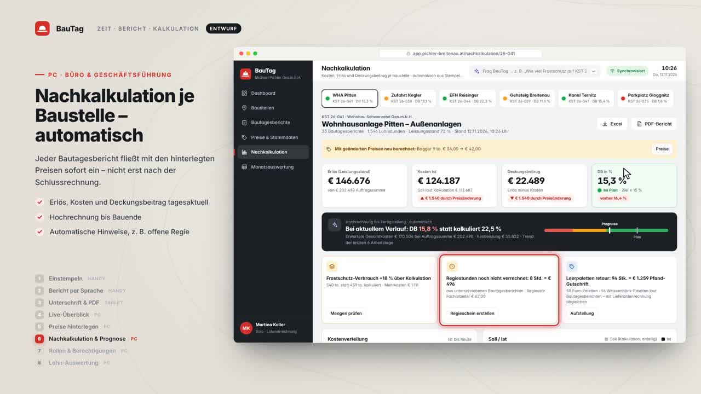

# BauTag – Stundenaufzeichnung, Bautagesbericht & Nachkalkulation (Entwurf)

Entwurf einer Plattform für einen Erdbau- und Pflasterbetrieb in Österreich (ca. 30 Mitarbeiter). Sie läuft als **eine** Web-App auf PC, Tablet und Handy.



## Inhalt

| Ordner / Datei | Was ist das? |
|---|---|
| [`video/BauTag_Entwurfsvideo.mp4`](video/BauTag_Entwurfsvideo.mp4) | **Entwurfsvideo** (4:28 min, Full HD, mit Sprecher): Rundgang durch alle Funktionen auf Handy, Tablet und PC, inkl. Budget-Alarm und Papier-Scan |
| [`docs/Konzept.md`](docs/Konzept.md) | **Fachkonzept**: Funktionen, Rollen & Berechtigungen, innovative Funktionen, Österreich-Recht (AZG, KV Bau, BUAK, SEG, DSGVO), Datenmodell, Technik, Kaufen vs. Bauen, Kosten, Phasenplan, offene Fragen |
| [`prototype/`](prototype/) | **Klickbarer Prototyp** (reines HTML/CSS/JS, ohne Backend, fiktive Beispieldaten). Ablauf und Routen: [`prototype/DEMO.md`](prototype/DEMO.md) |
| [`app/`](app/) | **Lauffähige Anwendung BauTag (MVP)**: Server (Node 22, Express 5, SQLite) + Web-App/PWA für Handy, Tablet, PC. Start, Inbetriebnahme und Betrieb: [`app/server/README.md`](app/server/README.md); Schnittstelle: [`app/API.md`](app/API.md); Stand: [`app/FORTSCHRITT.md`](app/FORTSCHRITT.md); unabhängige Prüfberichte `app/PRUEFBERICHT_*.md` |
| [`docs/vorlage/`](docs/vorlage/) | Papiervorlage des Bautagesberichts und Excel-Vorlage der Nachkalkulations-Positionen |
| [`docs/preislisten/`](docs/preislisten/) | Preislisten 2026 (Geräte, Grube Breitenau, Pichler Kies) |
| `video/stage.html`, `video/record.js`, `video/lib/` | Aufnahme-Werkzeug des Videos (Bühne mit Geräterahmen, Drehbuch, Screencast → MP4) |

## Funktionen im Überblick

- **Einstempeln am Handy:** Ankunfts-Hinweis, Standort nur im Moment des Stempelns, Pause und Baustellenwechsel. Der Polier stempelt seine Kolonne mit einem Tipp. Geräte per NFC/QR, 5 Sprachen und ein Baustellen-Modus.
- **Bautagesbericht:** aufgebaut wie die Papiervorlage und vorbefüllt aus den Stempelzeiten. Man kann ihn **diktieren** (die KI füllt die Felder), **Lieferscheine fotografieren**, und das Wetter wird automatisch eingetragen, samt Schlechtwetter-Vorschlag.
- **Tablet:** Der Bauherr unterschreibt vor Ort oder über einen SMS-Link. Das PDF geht automatisch an den Auftraggeber, ohne interne Preise.
- **Büro (PC):** Live-Dashboard mit Warnungen nach dem Arbeitszeitgesetz und Berichtsfreigabe. Dazu kommen Preise & Stammdaten und die **Nachkalkulation je Baustelle** mit Hochrechnung und automatischen Hinweisen. Die Monatsauswertung lässt sich für Lohnverrechnung und BUAK exportieren.
- **Rollen & Berechtigungen:** Preise, €-Werte und Nachkalkulation sehen nur Büro/Lohnverrechnung und Geschäftsführung, der Bauleiter nur für seine eigenen Baustellen. Polier und Mitarbeiter sind fix gesperrt.

## App starten (echte Anwendung)

**Am einfachsten (Windows):** einmal Node.js „LTS“ von https://nodejs.org installieren, dann im heruntergeladenen Ordner **`BauTag-starten-Windows.bat` doppelklicken** – der Browser öffnet sich automatisch (Mac: `BauTag-starten-Mac.command`). Anmelden mit Namen und PIN 1234 (Testdaten).

Manuell:

```bash
cd app && npm install
BAUTAG_DEMO=1 npm run seed      # Testdaten (Demo-PIN 1234) – nur zum Ausprobieren
BAUTAG_DEMO=1 npm start          # http://localhost:3000
npm test && npm run test:e2e     # Server-Tests und Ablauftests (Handy/Tablet/PC)
```

Für den Echtbetrieb ohne Testdaten: `node server/einrichten.js` (legt die erste Geschäftsführung mit eigener PIN an) – Details in `app/server/README.md`.

## Prototyp starten

```bash
python3 -m http.server 8765
# dann im Browser öffnen, z. B.:
#   http://localhost:8765/prototype/index.html                         (Login)
#   http://localhost:8765/prototype/index.html?rolle=polier#/stempeluhr  (Handy-Ansicht: Fenster schmal ziehen)
#   http://localhost:8765/prototype/index.html?rolle=buero#/dashboard    (Büro)
#   http://localhost:8765/prototype/index.html?rolle=gf#/benutzer        (Berechtigungen)
```

Rollen: `mitarbeiter`, `polier`, `bauleiter`, `buero`, `gf`. Alle Parameter stehen in [`prototype/DEMO.md`](prototype/DEMO.md).

## Video neu aufnehmen

```bash
python3 -m http.server 8765 &          # im Repo-Wurzelverzeichnis
python3 video/lib/tts.py <de_DE-thorsten-high.onnx> /tmp/stimme   # Sprecher erzeugen (pip install piper-tts)
VOICE_DIR=/tmp/stimme node video/record.js   # erzeugt video/BauTag_Entwurfsvideo.mp4 (Playwright + ffmpeg)
```

> Hinweis: Das ist ein Entwurf. Alle Namen, Baustellen und Preise sind fiktive Beispielwerte, und es wird bewusst noch kein Firmenlogo verwendet. Rechtliche Punkte im Konzept sind mit **„Prüfen:“** markiert und mit Steuerberatung, Lohnverrechnung bzw. WKO abzustimmen.
