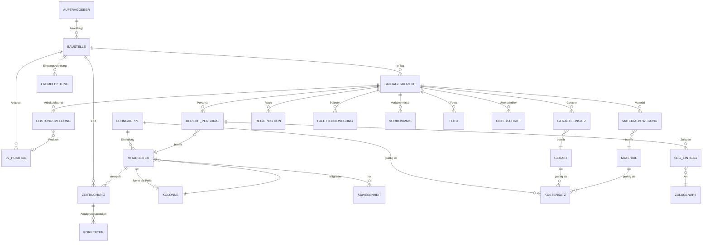
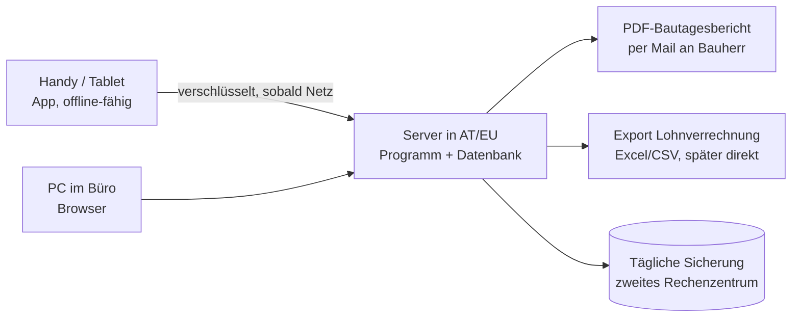

# Fachkonzept: Digitale Zeiterfassung, Bautagesbericht und Nachkalkulation

**Michael Pichler – Erdbau · Pflasterungen · Asphaltierungen · Transporte · Kieswerk, 2624 Breitenau**

| | |
|---|---|
| Dokument | Fachkonzept als Grundlage für die Entscheidung und für das Einholen von Angeboten |
| Stand | 12. November 2026, Version 1.0 (Entwurf zur Besprechung) |
| Begleitend | Klickbarer Prototyp (Ordner `prototype/`), Papiervorlage `docs/vorlage/Vorlage_Bautagesbericht.pdf` |
| Wichtiger Hinweis | Dieses Konzept ersetzt keine Rechts-, Steuer- oder Lohnverrechnungsberatung. Alles, was mit **Prüfen:** markiert ist, muss vor der Umsetzung mit der genannten Stelle geklärt werden. |

**Inhalt**

0. Zusammenfassung
1. Ausgangslage und Ziele
2. Rollen, Berechtigungen und Geräte
3. Funktionen im Detail
4. Innovative Funktionen und Benutzerfreundlichkeit
5. Österreich-spezifische und rechtliche Punkte
6. Datenmodell und Rechenlogik
7. Technik und Betrieb
8. Kaufen oder bauen?
9. Umsetzung in Phasen, Kosten, Einführung
10. Offene Fragen an den Betrieb
- Quellen
- Anhang: Begriffe

---

## 0 Zusammenfassung

**Was ist geplant?** Eine App, die am Handy, am Tablet und am PC gleich funktioniert:

1. **Stempeln:** Mitarbeiter stempeln auf der Baustelle ein und aus. Der Polier kann seine ganze Partie mit einem Tipp einstempeln, damit niemand ein eigenes Smartphone braucht.
2. **Bautagesbericht:** Am Abend füllt der Polier den Bautagesbericht im gewohnten Aufbau Ihrer Papiervorlage aus. Personal, Uhrzeiten und Baustelle sind aus den Stempelungen schon eingetragen. Der Bauherr unterschreibt am Tablet, das PDF geht sofort per Mail an Bauherr und Büro.
3. **Preise und Nachkalkulation:** Im Büro sind Lohnkostensätze, Gerätesätze, Materialpreise und die Einheitspreise aus dem Angebot hinterlegt. Daraus rechnet die App je Baustelle laufend Kosten, Erlös und Deckungsbeitrag und zeigt eine Ampel.
4. **Monatsabschluss:** Geprüfte Stunden, Abwesenheiten, Schlechtwetterstunden und SEG-Zulagen gehen als Export an die Lohnverrechnung. Die BUAK-Meldungen werden daraus vorbereitet.
5. **Für die Baustelle gemacht (Kapitel 4):** Die Bedienung folgt dem Grundsatz „höchstens drei Tipps, kaum Tippen“:
   - große Knöpfe, Baustellen-Modus für Sonne und Handschuhe, fünf Sprachen;
   - den Bericht diktieren statt schreiben, Lieferscheine fotografieren statt abschreiben;
   - Wetter und Schlechtwetter-Vorschlag automatisch, Gerätestunden per NFC-/QR-Tag;
   - Warnungen bei Pause und Höchstarbeitszeit, Hochrechnung der Baustelle bis Bauende;
   - Fernunterschrift per SMS-Link.

   KI macht dabei immer nur Vorschläge, der Polier bestätigt.

**Wer sieht was (Kapitel 2.2):**

- Preise, alle €-Werte, die Nachkalkulation und Löhne sehen **nur Büro/Lohnverrechnung und die Geschäftsführung**. Wir gehen davon aus, dass der Inhaber vollen Zugriff behält.
- **Bauleiter** sehen sie standardmäßig nicht; die Geschäftsführung kann es einzeln freischalten.
- **Polier und Mitarbeiter** sehen sie nie. Das ist eine feste Regel, auch per Ausnahme nicht freischaltbar.
- Auf die Geräte dieser Personen werden die Daten **gar nicht übertragen**, also nicht bloß ausgeblendet.
- Das PDF für den Auftraggeber enthält nie interne Kosten.

**Warum?** Heute wird jede Stunde mehrfach geschrieben: am Zettel, im Bautagesbericht, im Lohnprogramm und in Excel. Zettel gehen verloren oder kommen spät. Regie wird nicht immer unterschrieben und verrechnet. Ob eine Baustelle Geld verdient hat, weiß man erst Wochen nach der Schlussrechnung, oft gar nicht. Grob geschätzt bringt die Umstellung **rund 40.000–50.000 € pro Jahr** an Zeitersparnis und zusätzlich verrechneter Regie. Die Annahmen dazu stehen in Kapitel 1 und werden im Pilot überprüft.

**Unsere Empfehlung:**

- **Eine schlanke, eigene Web-App (PWA) bauen lassen.** Sie läuft mit einem Programmcode auf allen Geräten und funktioniert auch ohne Empfang. Der Grund: Wir haben kein Standardprodukt gefunden, das Ihren Bautagesbericht und eine Nachkalkulation mit Ihren eigenen Preisen samt den österreichischen Bau-Besonderheiten (BUAK, Schlechtwetter, SEG-Zulagen) in einem Guss abbildet.
- **Nicht selbst bauen** sollten Sie Lohnverrechnung, BUAK-Meldung, Buchhaltung und Angebotskalkulation. Diese Aufgaben bleiben in den bestehenden Programmen, die App liefert ihnen die Daten zu (Hybrid-Lösung).
- **Vor der Auftragsvergabe eine Gegenprobe machen:** Ein Polier testet zwei Wochen lang 123erfasst, das am ehesten passende Standardprodukt. Passen Bautagesbericht, Lohnexport und Nachkalkulation dort ohne Verbiegen, ist Kaufen die günstigere Variante.
- **Datenschutz:** Der Standort wird nur im Moment des Stempelns erfasst, es gibt kein Tracking. Vor dem Start braucht es eine Betriebsvereinbarung oder die schriftliche Zustimmung jedes Mitarbeiters.
- **Innovation mit Augenmaß:**
  - *Gleich in Phase 1*, weil verlässlich: Baustellen-Modus, Mehrsprachigkeit, AZG-Wächter, Wetter mit Schlechtwetter-Vorschlag, Fernunterschrift.
  - *Erst testen, dann Phase 2:* die KI-Funktionen „Bericht diktieren“ und „Lieferschein lesen“. Vorher prüfen wir sie im Dezember mit echten Aufnahmen Ihrer Poliere und echten Lieferscheinen (Dialekt, Baulärm).
  - *Später und nur optional*, weil eher Komfort als Muss: Ankunfts-Hinweis per Geofence und „KI-Fragen an die Daten“.

**Kosten und Zeitplan (Richtwerte, netto):**

| Baustein | Einmalig | Laufend |
|---|---|---|
| Phase 0 und 1: Klärung, KI-Test, Stempeln und digitaler Bautagesbericht (MVP) inkl. Rollen und Rechte, Baustellen-Modus, 2 Fremdsprachen, AZG-Wächter, Wetter, Fernunterschrift | 39.000–80.000 € | |
| Phase 2: Preise, Nachkalkulation mit Hochrechnung, Geräte-Tags, weitere Sprachen | 23.000–48.500 € | |
| Phase 2, nur nach erfolgreichem Test: KI-Diktat und Lieferschein-Erkennung | 9.000–22.500 € | |
| Geräte: 6–8 robuste Tablets, NFC-Chips, Geräte-Tags, Halterungen | 4.000–7.500 € | |
| Betrieb: Hosting, Wartung, Support, KI-Dienste, SMS, Mobilfunk | | ca. 400–1.000 € pro Monat |

Das ist deutlich mehr als ein Standardprodukt, siehe den ehrlichen Vergleich in Kapitel 8. Die Spannen werden mit Festpreisangeboten enger.

- **Feinkonzept, KI-Test und Angebote:** bis Mitte Dezember 2026.
- **Entwicklung von Phase 1:** Jänner bis März 2027.
- **Pilot mit einer Partie:** ab Saisonstart (März/April 2027), Papier läuft parallel weiter.
- **Alle Partien:** ab Mai 2027.
- **Nachkalkulation:** ab Spätsommer 2027.

Mögliche Förderung: KMU.DIGITAL (Details in Kapitel 9).

**Nächste Schritte:**

1. Die offenen Fragen aus Kapitel 10 beantworten, in etwa zwei Stunden mit Büro und einem Polier.
2. Mit dem Steuerberater bzw. der Lohnverrechnung das Exportformat und die Lohnarten klären. Betriebsrat bzw. Mitarbeiter informieren.
3. Den Prototyp mit zwei Polieren durchklicken, die Rechte-Matrix (Kapitel 2.2) bestätigen, den KI-Test (ca. 20 Diktate, 30 Lieferscheine) machen und die Gegenprobe mit 123erfasst starten.
4. Zwei bis drei Angebote von Entwicklern einholen, Förderung beantragen, Entscheidung treffen.

---

## 1 Ausgangslage und Ziele

### 1.1 Der Betrieb

Der Betrieb hat rund 30 Mitarbeiter: Poliere, Vorarbeiter, Pflasterer bzw. Facharbeiter, Maschinisten, LKW-Fahrer, Hilfsarbeiter und Lehrlinge. Zur Firma gehören fünf Sparten (Erdbau, Pflasterungen, Asphaltierungen, Transporte, Kieswerk). Typisch sind viele kurze Baustellen, die gleichzeitig laufen, mit wechselnden Partien und Geräten. Auftraggeber sind Private, Gemeinden und Firmen. Das Kieswerk liefert Eigenmaterial (z. B. Frostschutz, Splitt) auf die eigenen Baustellen, und die LKW sind teils für Baustellen, teils für Transportaufträge unterwegs.

### 1.2 Der heutige Ablauf auf Papier

Den folgenden Ablauf nehmen wir an; bitte bestätigen oder korrigieren (siehe Kapitel 10):

1. Der Polier schreibt täglich je Baustelle einen Bautagesbericht auf Papier: Personal mit Uhrzeiten, Geräte, Material, Leistung, Regie und Vorkommnisse.
2. Stunden werden zusätzlich auf Stundenzetteln oder in Listen für die Lohnverrechnung geführt.
3. Die Zettel kommen gesammelt ins Büro, oft erst am Wochen- oder Monatsende.
4. Das Büro tippt die Stunden ins Lohnprogramm, die Regie in die Rechnung und, wenn Zeit bleibt, die Mengen in eine Excel-Nachkalkulation.

### 1.3 Was das heute kostet

| Problem | Folge | Grobe Größenordnung (Annahme, im Pilot prüfen) |
|---|---|---|
| Doppelte Erfassung (Polier schreibt, Büro tippt ab) | Büro-Zeit, Tippfehler | Bei 6 Partien sind das ca. 125 Berichte pro Monat zu je 10 Minuten, dazu Stundenlisten und Rückfragen: ca. 45 Std. pro Monat, rund **24.000 € pro Jahr** |
| Zettel kommen spät, sind nass, unleserlich oder verloren | Rückfragen, Schätzungen, Streit über Stunden | Schwer messbar, bindet aber Polier und Büro |
| Regie nicht oder spät unterschrieben | Regie wird nicht oder nur gekürzt verrechnet | Bei 2 nicht verrechneten Stunden pro Woche für Partie und Gerät à 150 € und 40 Saisonwochen: rund **12.000 € pro Jahr** |
| Poliere füllen Zettel und Bericht doppelt aus | Zeitverlust am Abend | 10 Min. pro Tag × 6 Poliere × 210 Tage ≈ 210 Std., rund **11.500 € pro Jahr** |
| Nachkalkulation spät oder nie | Falsche Preise werden im nächsten Angebot wiederholt | Nicht bezifferbar, aber vermutlich der größte Hebel |
| Schlechtwetter schlecht dokumentiert | Rückerstattung durch die BUAK gefährdet | Je nach Saison |
| Verstöße gegen das Arbeitszeitgesetz fallen erst im Nachhinein auf | Strafrisiko bei Kontrollen | – |
| Pfandpaletten nicht nachverfolgt | Pfand geht verloren | Klein, aber laufend |

Zusammen sind das **rund 40.000–50.000 € pro Jahr** an messbarem Potenzial, ohne den Effekt besserer Angebotspreise.

### 1.4 Ziele (messbar)

| Ziel | Messgröße | Zielwert | Wann |
|---|---|---|---|
| Keine Papier-Stundenzettel mehr | Anteil digital erfasster Stunden | 100 % | 3 Monate nach Rollout |
| Bericht am selben Tag fertig | Berichte abgeschlossen bis 20:00 Uhr | ≥ 90 % | ab Rollout |
| Regie bestätigt | Regieleistungen mit Unterschrift des Bauherrn innerhalb von 24 Std. | ≥ 80 % | ab Rollout |
| Kein Bericht geht verloren | Fehlende Berichte je Monat | 0 | ab Rollout |
| Schnellerer Monatsabschluss | Büro-Aufwand für den Lohnabschluss | ≤ ½ Tag (heute erheben) | nach 3 Monaten |
| Nachkalkulation aktuell | Daten in der Nachkalkulation | Stand Vortag; Endergebnis ≤ 5 Arbeitstage nach Fertigstellung | ab Phase 2 |
| Akzeptanz | Mitarbeiter, die die App „einfach“ finden (Kurzumfrage) | ≥ 80 % | Ende Pilot |

---

## 2 Rollen, Berechtigungen und Geräte

### 2.1 Wer nutzt was?

| Rolle | Typische Aufgaben in der App | Gerät |
|---|---|---|
| **Mitarbeiter** (Facharbeiter, Hilfsarbeiter, Lehrling; auch LKW-Fahrer und Maschinisten) | Optional selbst stempeln; „Meine Woche“ ansehen; Urlaub beantragen; Korrektur melden. Fahrer und Maschinisten zusätzlich: Fahrt- und Ladezeit, Fahrzeug bzw. Gerät wählen, später Transport-/Lieferschein | Eigenes Handy (freiwillig), Firmenhandy oder gar keines, weil der Polier stempelt |
| **Polier / Vorarbeiter** | Partie stempeln, Baustelle wechseln, Schlechtwetter melden, Bautagesbericht, Fotos, Unterschrift mit Bauherrn, Korrekturen in der eigenen Partie | Robustes Firmen-Tablet, zusätzlich das Firmenhandy |
| **Bauleiter** (falls vorhanden; in kleineren Betrieben übernimmt das oft die Geschäftsführung) | Betreut mehrere Baustellen: Berichte prüfen und freigeben, Schlechtwetter bestätigen, Regie und Nachträge, Nachkalkulation der eigenen Baustellen | Tablet / Handy und PC |
| **Büro / Lohnverrechnung** | Stunden prüfen und freigeben, Abwesenheiten, Korrekturen, Stammdaten, Monatsabschluss, Exporte | PC |
| **Geschäftsführung (Admin)** | Übersicht „Wer ist wo“, Preise, Nachkalkulation, Auswertungen; vergibt Rollen und Rechte | PC und Handy |
| **Bauherr / Vertreter des Auftraggebers** (extern) | Unterschreibt am Tablet oder per SMS-/Mail-Link und bekommt das PDF; kein eigener Zugang | Tablet des Poliers bzw. eigenes Handy |
| **Steuerberater / externe Lohnverrechnung** (extern) | Bekommt die Exportdatei; auf Wunsch Lesezugang nur zu den Lohndaten | PC |

### 2.2 Rollen & Berechtigungen

> **Grundregel:** Auf der Baustelle sieht niemand Preise, €-Werte, Nachkalkulation oder Löhne. Poliere und Vorarbeiter sehen **Mengen und Stunden** ihrer Partie und ihrer Baustellen. Sie sehen **keine Preise, keine Kosten, keine Nachkalkulation und keine Löhne anderer**. Was jemand nicht sehen darf, wird auf sein Gerät gar nicht erst übertragen.

**Berechtigungsmatrix (Standardeinstellung, je Benutzer anpassbar):**

| Funktion | Mitarbeiter | Polier / Vorarbeiter | Bauleiter | Büro / Lohnverrechnung | Geschäftsführung (Admin) |
|---|---|---|---|---|---|
| Eigene Zeiten stempeln und sehen („Meine Woche“) | ja | ja | ja | ja | ja |
| Urlaub beantragen, Korrektur melden | ja | ja | ja | ja | ja |
| Partie stempeln, Baustellenwechsel für die Partie | – | eigene Partie | eigene Baustellen | ja | ja |
| Zeiten anderer sehen | – | eigene Partie | eigene Baustellen | alle | alle |
| Zeiten anderer korrigieren (immer mit Grund) | – | eigene Partie, bis zur Freigabe | eigene Baustellen, bis zur Freigabe | ja | ja |
| Zeiten freigeben, Monat abschließen | – | – | – | ja | ja |
| Abwesenheiten (K/U/ZA) erfassen bzw. genehmigen | nur Antrag | sieht nur das Kürzel in der Partie, ohne Gründe | sieht Kürzel | ja | ja |
| Schlechtwetter melden bzw. bestätigen | – | melden | bestätigen | bestätigen | ja |
| Bautagesbericht erstellen, Fotos, Unterschrift Auftragnehmer, Versand | – | ja (eigene Baustellen) | ja | nur korrigieren | ja |
| Bautagesbericht prüfen und freigeben | – | – | ja | ja | ja |
| Mengen, Leistungsstand, Geräte- und Materialmengen | – | eigene Baustellen, **ohne €** | eigene Baustellen | ja | ja |
| Stundenrahmen der Baustelle (Soll-/Ist-Stunden, ohne €) | – | optional je Baustelle | ja | ja | ja |
| Einheitspreise, Angebotssummen, Regiesätze sehen | – | – | eigene Baustellen | ja | ja |
| Interne Kostensätze (Lohn, Geräte, Material-Einkauf) sehen | – | – | – (nur Summen in der Nachkalkulation) | ja | ja |
| Preise und Kostensätze bearbeiten | – | – | – | Material-Einkauf, Fremdleistungen | ja, alle |
| Nachkalkulation, Hochrechnung, automatische Hinweise | – | – | eigene Baustellen (Lohn nur als Summe) | ja | ja |
| Lohnauswertung je Person (Lohngruppe, SEG, Taggeld, Mehrstunden), Lohn- und BUAK-Export | nur eigene Stundenliste, ohne € | – | – | ja | ja |
| Stammdaten (Baustellen, Geräte, Material, Positionen) | – | – | Baustellen und Positionen anlegen | ja | ja |
| Benutzer anlegen, PIN zurücksetzen, Gerät abmelden | – | – | – | ja | ja |
| Rollen und Ausnahmen vergeben | – | – | – | – | ja |
| Änderungsprotokoll einsehen | eigene Daten | eigene Partie | eigene Baustellen | Zeiten und Berichte | alles, inkl. Rechte und Preise |
| KI-Fragen an die Daten (Phase 3, optional) | – | – | im Rahmen der eigenen Rechte | im Rahmen der eigenen Rechte | ja |

„Eigene Partie“ und „eigene Baustellen“ ergeben sich aus der Zuordnung: Polier ↔ Partie, Bauleiter ↔ Baustellen. Diese Zuordnung pflegt das Büro.

**Ausnahmen je Benutzer:** Die Geschäftsführung kann einzelnen Personen Rechte zusätzlich geben oder wegnehmen, auf Wunsch befristet. Beispiele:

- Ein Vorarbeiter vertritt zwei Wochen lang einen Polier und darf in dieser Zeit „Partie Huber stempeln“.
- Ein Bauleiter sieht zusätzlich die Gerätesätze.
- Eine Büro-Teilzeitkraft bekommt keine Einsicht in Lohndaten.
- Ein Polier mit Kalkulationsaufgaben darf die Nachkalkulation seiner Baustellen sehen. Das ist eine bewusste Entscheidung der Geschäftsführung.

Die App zeigt eine Liste „Wer darf mehr oder weniger als seine Rolle“. Wir empfehlen, sie einmal im Quartal durchzusehen.

**Änderungsprotokoll:**

- Jede Änderung an Rechten, Rollen, Preisen, Kostensätzen, Zeiten und Berichten wird mit Person, Zeitpunkt, altem und neuem Wert und Grund gespeichert.
- Das Protokoll kann niemand löschen, auch kein Admin.
- Es gibt mindestens **zwei Admins** (Geschäftsführung und Stellvertretung), damit sich niemand aussperrt.
- Änderungen an Lohnkostensätzen und Rechten sieht die zweite Admin-Person in ihrer Übersicht (Vier-Augen-Hinweis).

**Technischer Grundsatz: Rechte werden am Server durchgesetzt, nicht in der Oberfläche.**

- Der Server prüft bei jeder Anfrage, wer fragt, welche Rolle und Ausnahmen gelten und für welchen Bereich (alles, eigene Baustellen, eigene Partie, nur selbst).
- Er liefert **nur die Daten, für die ein Recht besteht**. Preise, Kostensätze, €-Werte, Nachkalkulation und Lohndaten verlassen den Server nie in Richtung der Geräte von Polieren und Mitarbeitern, auch nicht in den Offline-Speicher. Die Positionsliste für die Leistungsmeldung kommt beim Polier ohne Einheitspreise an.
- Bloßes Ausblenden in der Oberfläche wäre unsicher, weil technisch versierte Nutzer versteckte Daten auslesen könnten.
- Exporte (Lohn, BUAK, Nachkalkulation) erzeugt nur der Server, und nur für berechtigte Rollen.
- Automatische Tests prüfen bei jedem Update, dass die Antworten an Polier- und Mitarbeiterrollen keine Preis- oder Lohnfelder enthalten.

**Das PDF für den Auftraggeber enthält nie interne Werte:**

- Bautagesbericht und Regieschein für den Auftraggeber enthalten **keine Kosten, keine Kostensätze, keinen Deckungsbeitrag, keine Löhne und überhaupt keine €-Werte**. Regiepreise stehen erst auf der Rechnung.
- Die Kürzel **K und U erscheinen nicht** im PDF für den Auftraggeber, denn ein Krankenstand geht ihn nichts an. **SW** bleibt, weil es den Bauablauf betrifft.
- Für das Büro gibt es eine interne Fassung mit allen Kürzeln. Beide Fassungen kommen aus getrennten Vorlagen und werden automatisch getestet.
- **Prüfen:** ob Mitarbeiternamen im PDF für den Auftraggeber nötig sind, oder ob Funktion und Kürzel reichen (Datenminimierung).

**Datenschutz: Lohndaten von Kollegen.**

- Löhne, Lohngruppen, Kostensätze sowie SEG- und Taggeld-Beträge sind vertrauliche personenbezogene Daten. Sehen darf sie nur, wer sie für seine Aufgabe braucht, also Büro und Geschäftsführung (DSGVO: Datenminimierung, Vertraulichkeit, Sicherheit der Verarbeitung).
- Auch in der Nachkalkulation des Bauleiters erscheinen Lohnkosten nur als **Summe**. Bei einer Lohngruppe mit nur einer Person wird zusammengefasst, damit man nicht auf den Lohn eines Einzelnen schließen kann.
- Der Polier sieht die Stunden seiner Partie, weil er sie verantwortet, aber nicht deren Löhne.
- Beim Krankenstand wird nur das Kürzel „K“ gespeichert, nie eine Diagnose. Die Krankmeldung als Beleg sieht nur das Büro.
- Das Rollenkonzept wird Teil der Betriebsvereinbarung bzw. der Mitarbeiterinformation (Kapitel 5.7).

**Verlorene oder gemeinsam genutzte Geräte:**

- **Automatische Sperre:** Das Polier-Tablet sperrt nach ca. 10 Minuten ohne Bedienung und wird mit der PIN entsperrt. Sitzungen von Büro und Geschäftsführung enden nach ca. 30 Minuten.
- **Gemeinsames Tablet** (Bauhof, Bus): Nach jeder Stempelung wird sofort wieder abgemeldet. „Meine Woche“ ist nur nach PIN-Eingabe sichtbar und schließt sich nach 60 Sekunden.
- **Fernabmeldung:** Büro oder Admin melden ein Gerät bzw. einen Benutzer aus der Ferne ab. Beim nächsten Netzkontakt werden noch offene Daten übertragen und danach der lokale Speicher gelöscht. Die Geräteverwaltung kann zusätzlich das ganze Firmengerät sperren oder löschen.
- **Wenig Daten am Gerät:** Am Gerät liegt nur das Nötigste (Stammdaten, eigene Partie, letzte 14 Tage), verschlüsselt und **ohne Preise**. Ein verlorenes Polier-Tablet verrät also weder Preise noch Löhne.
- **PIN-Fehlversuche:** Nach 5 Fehlversuchen wird gesperrt. Das Büro entsperrt.

### 2.3 Mitarbeiter ohne Smartphone

Nicht jeder hat ein Smartphone oder will das private Handy dienstlich verwenden. Niemand soll dazu gezwungen werden.

| Möglichkeit | So funktioniert es | Bewertung |
|---|---|---|
| **Partie-Stempeln durch den Polier** | Der Polier hakt am Tablet an, wer da ist, und stempelt alle mit einem Tipp ein. Jede Stempelung trägt den Vermerk „erfasst durch Polier …“. | **Empfohlen als Standard.** Am wenigsten Aufwand, entspricht dem heutigen Ablauf. |
| **Gemeinsames Baustellen-Tablet** | Das Tablet liegt im Bus bzw. auf der Baustelle. Jeder stempelt dort mit Personalnummer und PIN selbst. | Gut, wenn Mitarbeiter selbst stempeln wollen. Braucht etwas Disziplin. |
| **NFC-Chip (Schlüsselanhänger)** | Der Mitarbeiter hält seinen Chip an das Tablet des Poliers. | Schnell und ohne PIN. **Funktioniert in einer Web-App nur auf Android-Geräten mit Chrome**, nicht am iPhone/iPad. Chips kosten ca. 3–5 € pro Stück. |
| **QR-Code am Firmenausweis oder Helm** | Die Kamera des Poliers liest den Code. | Funktioniert auf allen Geräten. Billig, aber weniger robust (Schmutz). |
| **Terminal im Bauhof / Kieswerk** | Fix montiertes Tablet für Werkstatt und Kieswerk | Sinnvoll für Mitarbeiter, die immer am selben Ort arbeiten |
| **Privates Handy (freiwillig)** | Stempeln, „Meine Woche“, Urlaubsantrag | Nur freiwillig, nie Pflicht. Den Umgang mit privaten Geräten in der Betriebsvereinbarung regeln. |

> **Empfehlung:** Standard ist das Partie-Stempeln durch den Polier. Wer mit dem eigenen Handy stempeln will, darf das. Für Bauhof und Kieswerk kommt ein fixes Tablet dazu. NFC-Chips sind eine Option, wenn die Firmen-Tablets Android-Geräte sind, was wir ohnehin empfehlen (Kapitel 7).

### 2.4 Ein Tag mit der App (Beispiel)

| Uhrzeit | Was passiert | In der App |
|---|---|---|
| 06:45 | Partie Huber trifft sich im Bauhof und lädt Rüttelplatte und Splitt | Polier: „Partie stempeln“ → Tätigkeit *Laden Bauhof*, KST der Baustelle |
| 07:05 | Fahrt zur Baustelle Hofeinfahrt Musterstraße | „Fahrt“; der LKW-Fahrer wählt sein Fahrzeug |
| 07:30 | Ankunft, Arbeitsbeginn | „Baustelle“; einmalig wird der Standort gespeichert (im Umkreis der Baustelle: ja/nein) |
| 10:15 | Bauherr ordnet zusätzlich das Abtragen eines Gartenmäuerchens an | Polier: „Regie starten“ für 2 Mann und den Bagger 2,7 t |
| 12:00–12:30 | Mittagspause | Pause wird automatisch laut Vereinbarung gebucht, oder per Taste |
| 14:00 | Starkregen, die Arbeit wird eingestellt | Polier: „Schlechtwetter“ mit Grund und Uhrzeit, gilt für alle Anwesenden |
| 14:20 | Ein Mitarbeiter fährt zur Werkstatt | Einzeln: „Baustelle wechseln“ → *Werkstatt* |
| 16:30 | Bericht | Der Assistent hat alles vorbefüllt. Der Polier ergänzt Geräte, Material, Leistung (m²) und macht 3 Fotos. |
| 16:40 | Unterschrift | Der Bauherr unterschreibt am Tablet, das PDF geht an Bauherr und Büro. |
| am nächsten Morgen | Büro | Ampel: Bericht vollständig, eine AZG-Warnung (Ruhezeit) zu prüfen, Regie bereit zur Verrechnung |

---

## 3 Funktionen im Detail

### 3.1 Zeiterfassung

**Stempelarten (Handy und Tablet):**

| Taste | Bedeutung | Zuordnung (KST) |
|---|---|---|
| **Arbeitsbeginn** (großer Knopf) | Beginn mit Auswahl der Baustelle; zuletzt genutzte und geplante Baustellen stehen oben | Baustelle |
| **Pause** / **Weiter** | Ruhepause | – (keine Arbeitszeit) |
| **Baustelle wechseln** | Ende auf Baustelle A, Beginn auf Baustelle B (Fahrt dazwischen wird automatisch erkannt) | A, Fahrt, B |
| **Tätigkeit** | *Baustelle* (Standard), *Fahrt*, *Laden* (Bauhof/Kieswerk), *Werkstatt*, *Kieswerk*, *Transport* | Baustelle bzw. Gemeinkosten-KST (Bauhof, Werkstatt, Kieswerk, Transporte) |
| **Regie** an/aus | Kennzeichnet die laufende Zeit als Regie | Baustelle, Kennzeichen Regie |
| **Arbeitsende** | Tagesende | – |

**Partie-Stempeln:** Der Polier pflegt seine Partie. Die Mitglieder sind vorgeschlagen und können für den Tag geändert werden, z. B. wenn ein Mann ausgeborgt ist. Ein Tipp stempelt alle Angehakten. Wer selbst gestempelt hat, wird nicht doppelt erfasst: Die App zeigt dem Polier „bereits gestempelt um 07:28“. Jeder Mitarbeiter sieht unter „Meine Woche“, was für ihn gebucht wurde, und kann eine Korrektur melden.

**Fahrzeit, Ladezeit, Werkstatt:** Diese Zeiten werden **getrennt erfasst**, damit die Lohnverrechnung richtig entscheiden kann, was davon Arbeitszeit bzw. zu bezahlen ist. Für den Bau gilt laut WKO-Erläuterungen zum KV: Fährt der Arbeiter zuerst zum Bauhof, beginnt die zu vergütende Arbeitszeit grundsätzlich erst auf der Baustelle. Ausgenommen sind Tätigkeiten, die er vorher im Auftrag des Arbeitgebers erledigt, etwa das Laden. **Prüfen:** Wie das Lenken des Firmenfahrzeugs und das Mitfahren behandelt werden, mit der Lohnverrechnung bzw. der WKO klären. Die App bekommt dafür eine einstellbare Regel („Fahrt Bauhof → Baustelle: Arbeitszeit ja/nein, je Rolle Lenker/Mitfahrer“).

**Pausen:**

- **Erwachsene:** Bei mehr als 6 Stunden Arbeitszeit sind 30 Minuten Pause Pflicht (§ 11 AZG).
- **Jugendliche unter 18** (Lehrlinge): Bei mehr als 4½ Stunden sind 30 Minuten Pflicht, und die Pause darf nicht geteilt werden (KJBG).
- **Erleichterung:** Ist die Pausenlage per Betriebsvereinbarung bzw. schriftlicher Einzelvereinbarung festgelegt, z. B. „30 Minuten zwischen 11:30 und 13:00“, müssen Pausen nicht gesondert aufgezeichnet werden (§ 26 AZG).

> **Empfehlung:** Eine feste Pausenregel vereinbaren. Die App bucht die Pause dann automatisch, abweichende Pausen werden per Taste erfasst.

**Korrekturen mit Freigabe:**

1. Ein Mitarbeiter meldet in „Meine Woche“, dass ein Stempel fehlt oder falsch ist, und gibt einen Grund an.
2. Der Polier korrigiert Zeiten seiner Partie, ebenfalls mit Grund (Auswahlliste plus Text).
3. Das Büro sieht alle Korrekturen gesammelt und gibt frei oder lehnt ab.
4. **Nichts wird überschrieben.** Jede Änderung wird mit alter und neuer Zeit, Person, Zeitpunkt und Grund protokolliert. Das schützt den Betrieb bei Kontrollen und die Mitarbeiter bei Streitfragen.
5. Nach dem Monatsabschluss sind die Zeiten gesperrt. Spätere Änderungen sind nur noch durch das Büro möglich und werden in einer Nachtragsliste für die Lohnverrechnung vermerkt.

**Abwesenheiten:**

| Code | Bedeutung | Wer erfasst | Besonderheit |
|---|---|---|---|
| **K** | Krankenstand | Büro (nach Krankmeldung) | Bestätigung als Foto hochladbar; im Bericht als „K“ |
| **U** | Urlaub | Mitarbeiter beantragt, Büro genehmigt | Am Bau läuft das Urlaubsentgelt über die BUAK, deshalb fließt U in den BUAK-Export |
| **SW** | Schlechtwetter | Polier für die Partie (mit Uhrzeit und Grund), Büro bestätigt | Zähler je Mitarbeiter gegen die Höchstgrenzen; Export für die BUAK-Rückerstattung (Kapitel 5.4) |
| **ZA** | Zeitausgleich | Antrag oder Büro | Abbuchung vom Zeitkonto |
| FT | Feiertag | automatisch (Kalender Niederösterreich) | – |
| BS | Berufsschule (Lehrlinge) | Büro | Zählt bei Jugendlichen als Arbeitszeit (KJBG) |
| SD | Sonstige Dienstverhinderung (Arzt, Pflegefreistellung, Behörde …) | Büro | – |

**Warnungen (Arbeitszeitgesetz):** Die App warnt den Polier sofort und das Büro im Dashboard, z. B. bei:

- mehr als 10 Stunden am Tag (Hinweis) bzw. mehr als 12 Stunden (Grenze);
- weniger als 11 Stunden Ruhezeit;
- fehlender Pause;
- Wochensumme über 50 bzw. 60 Stunden;
- 17-Wochen-Schnitt über 48 Stunden;
- strengeren Grenzen für Jugendliche (8 Std. pro Tag, 40 Std. pro Woche, 12 Std. Ruhezeit).

Die App verhindert nichts, sie macht aufmerksam. Entscheiden müssen Polier und Büro.

**Offline-Betrieb (Baustellen ohne Empfang):**

- Alles funktioniert ohne Netz: stempeln, Bericht, Fotos, Unterschrift.
- Die Daten werden verschlüsselt am Gerät gespeichert und automatisch übertragen, sobald wieder Empfang da ist. Ein Symbol zeigt „3 Einträge noch nicht übertragen“.
- Stammdaten (Baustellen, Mitarbeiter, Geräte, Material, Positionen) liegen am Gerät und werden bei jeder Verbindung aktualisiert.
- Uhrzeit: Die App merkt sich beim Stempeln die Gerätezeit. Beim Übertragen vergleicht sie diese mit der Serverzeit. Größere Abweichungen (verstellte Uhr) werden markiert.
- Ist ein Gerät länger als 2 Tage nicht synchronisiert, bekommt das Büro einen Hinweis.

**Standort, nur beim Stempeln:**

- Beim Arbeitsbeginn, beim Baustellenwechsel und beim Arbeitsende wird **einmal** der Standort abgefragt.
- Gespeichert wird vor allem die Information „im Umkreis der Baustelle: ja/nein“ (z. B. 300 m). Die Koordinaten werden nach dem Monatsabschluss plus 2 Monaten gelöscht.
- **Keine laufende Ortung, kein Bewegungsprofil, keine Ortung in Pausen oder nach Arbeitsende.**
- Wer nicht zustimmt, stempelt ohne Standort. Dann bestätigt der Polier die Anwesenheit.
- Die rechtlichen Hintergründe stehen in Kapitel 5.7.

### 3.2 Bautagesbericht

**Ablauf als Assistent (Schritt für Schritt):**

1. **Kopf:** Datum, Baustelle/KST, Auftraggeber, Bauvorhaben (alles vorbefüllt), Wetter.
2. **Personal:** Liste aus den Stempelungen mit Zeitblöcken, Pause und Stunden. Codes K/U/SW sind übernommen.
3. **SEG-Zulagen:** Tätigkeit und Stunden je Person.
4. **Geräte:** Geräte des Tages mit Stunden (Vorschlag aus Stempelungen und Vortag).
5. **Material:** Aushub, Bruch, Frostschutz, Grädermaterial, Splitt mit Menge und Einheit.
6. **Arbeitsleistung:** Positionen aus dem Angebot mit Menge, Freitext bleibt möglich.
7. **Materialbeistellung und Paletten retour.**
8. **Regieleistungen.**
9. **Besondere Vorkommnisse und Fotos.**
10. **Kontrolle und Unterschriften**, dann PDF und Mail.

Jeder Schritt kann leer bleiben („heute keine Regie“). Der Bericht ist auch am Handy ausfüllbar, das Tablet ist aber angenehmer.

**Feldzuordnung: jedes Feld der Papiervorlage und sein digitales Gegenstück**

| Nr. | Feld auf der Vorlage | Digitales Gegenstück | Datenquelle / Vorbefüllung | Wofür danach verwendet |
|---|---|---|---|---|
| 1 | Firmenkopf (Logo, Adresse, Telefon) | Fester PDF-Kopf | Firmenstammdaten | – |
| 2 | Datum | Berichtsdatum | Heutiges Datum bzw. Datum der Stempelungen | Lohn; Preisgültigkeit in der Nachkalkulation |
| 3 | KST | Kostenstelle = Baustellennummer | Baustelle, die beim Arbeitsbeginn gewählt wurde | Zuordnung aller Kosten und Erlöse |
| 4 | Auftraggeber | Kunde | Baustellen-Stammdaten | PDF-Empfänger, Rechnung |
| 5 | Bauvorhaben | Bezeichnung und Adresse der Baustelle | Baustellen-Stammdaten | – |
| 6 | Personal: Name (6 Zeilen) | Personalliste ohne Zeilenbegrenzung | Alle Mitarbeiter mit Stempelung auf dieser KST an diesem Tag; die Partie wird vorgeschlagen | Lohn, Nachkalkulation |
| 7 | Arbeitszeit von–bis (1. Block) | Erster Zeitblock | Stempel Arbeitsbeginn bis Pause bzw. Wechsel | Arbeitszeitaufzeichnung (AZG) |
| 8 | Arbeitszeit von–bis (2. Block) | Zweiter Zeitblock; weitere Blöcke möglich und im PDF als Zusatzzeile | Stempel nach Pause bzw. Rückkehr | wie oben |
| 9 | Pause | Pausendauer | Pausenstempel oder Standardpause laut Vereinbarung | AZG-Prüfung |
| 10 | Arbstd. | Arbeitsstunden je Person | Berechnet: Zeitblöcke minus Pause (Fahrt und Laden als eigene Spalte, siehe Kapitel 10) | Lohn, Nachkalkulation |
| 11 | Gesamtstunden | Summe | Berechnet | Nachkalkulation (Lohnstunden) |
| 12 | K = Krank, U = Urlaub, SW = Schlechtwetter | Kennzeichen je Person in der Stundenspalte | Abwesenheiten (Büro bzw. Antrag) oder Schlechtwetter-Meldung des Poliers | Lohn, BUAK (Schlechtwetter-Rückerstattung) |
| 13 | SEG-Zulagen: Tätigkeit | Zulagenart aus dem Firmenkatalog, z. B. Heißasphalt, Arbeiten in Künette | Polier wählt; Vorschlag aus Tätigkeit bzw. Position | Lohn; Nachweis für § 68 EStG |
| 14 | SEG-Zulagen: Stunden | Stunden je Person und Zulagenart | Vorschlag = Arbeitsstunden, Polier korrigiert | Lohn |
| 15 | Geräte: LKW mit Kran 3-A / 4-A, LKW 2-/3-/4-Achser, LKW Zug oder Sattel, LKW mit Tieflader | Konkretes Fahrzeug (Kennzeichen/Inventarnr.) mit Stunden | Fahrzeug, das der Fahrer beim Stempeln gewählt hat; Stunden = seine Stempelzeit | Nachkalkulation (interner Satz), Regie, Auslastung |
| 16 | Geräte: Leerzeile in der Liste | „Sonstiges Gerät“ | Auswahl aus der ganzen Geräteliste, auch Mietgeräte | wie oben |
| 17 | Verlegemaschine, Schneidgerät, Kompressor, Dumper | Gerät mit Stunden | Polier; Vorschlag aus dem Vortag auf dieser Baustelle | wie oben |
| 18 | Bobcat, Bagger 1,5 / 2,7 / 9 / 23 to., Radlader, Gräder | Gerät mit Stunden | Stempelzeit des Maschinisten, der das Gerät gewählt hat | wie oben |
| 19 | Bomag BW 177, Hamm Walz 2 to., Handwalze, Rüttelplatte, Grabenwalze | Gerät mit Stunden | Polier; Vorschlag aus dem Vortag | wie oben |
| 20 | Material: Aushub, Betonbruch, Asphaltbruch (to/m³) | Menge, Einheit (t oder m³) und Ziel (Deponie, Kieswerk/Recycling, andere Baustelle) | Polier; später Wiege- oder Lieferschein | Nachkalkulation (Entsorgungskosten), Abrechnung, Recyclingmengen |
| 21 | Material: Frostschutz, Grädermaterial, Splitt (to.) | Menge in t mit Herkunft | Polier; später Lieferschein des Kieswerks | Nachkalkulation, Abrechnung |
| 22 | Arbeitsleistung (Freitextzeilen) | Leistungsmeldung: Position aus dem Angebot, Menge und Einheit; Freitext weiter möglich | Polier wählt aus der Positionsliste der Baustelle | Erlös (Einheitspreis × Menge), Soll/Ist, Aufwandswerte |
| 23 | Materialbeistellung: Eigenmaterial | Material und Menge, Herkunft „Eigen (Kieswerk/Lager)“ | Polier | Nachkalkulation zum internen Verrechnungspreis |
| 24 | Materialbeistellung: Fremdmaterial | Material und Menge, dazu Lieferant mit Lieferschein-Nr. oder „vom Bauherrn beigestellt“ | Polier, Foto vom Lieferschein | Nachkalkulation (Einkaufspreis bzw. 0 € bei Beistellung), Rechnungsprüfung |
| 25 | Paletten retour: Euro | Anzahl Europaletten | Polier | Palettenkonto je Baustelle und Lieferant |
| 26 | Paletten retour: Weissenböck | Anzahl Paletten dieses Lieferanten; weitere Lieferanten einstellbar | Polier | Pfand-Gutschrift kontrollieren |
| 27 | Regieleistungen (Zeilen) | Regieposition: Beschreibung, Personen mit Stunden, Geräte mit Stunden, Material | Mit „Regie“ gekennzeichnete Stempelungen; Polier ergänzt | Regierechnung zu Regiesätzen; eigener Regieschein-Ausdruck |
| 28 | Besondere Vorkommnisse (z. B. Anweisungen AG, Beschädigungen, Sonstiges) | Einträge mit Kategorie (Anweisung AG, Behinderung/Wartezeit, Beschädigung, Unfall/Beinahe-Unfall, Mangel, Sonstiges), Text und Fotos | Polier | Sofortige Nachricht ans Büro; Grundlage für Mehrkostenforderungen |
| 29 | Unterschrift Auftragnehmer oder dessen Beauftragter | Unterschrift des Poliers am Gerät mit Name und Zeitpunkt | Angemeldeter Polier | Abschluss des Berichts |
| 30 | Unterschrift Bauherr oder dessen bevollmächtigter Vertreter | Unterschrift am Tablet mit Name in Druckschrift und Funktion; alternativ „nicht anwesend“ mit Versand zur Bestätigung | Bauherr vor Ort | Beweis, Bestätigung der Regie |
| neu | (nicht auf Papier) Wetter | Temperatur, Niederschlag, Wind | Automatisch von einem Wetterdienst; der Polier kann ergänzen | Nachweis für Schlechtwetter und Behinderung |
| neu | (nicht auf Papier) Fotos | Fotos mit Zeitstempel | Kamera | Dokumentation |
| neu | (nicht auf Papier) Status und Versand | Entwurf, abgeschlossen, unterschrieben, versendet, geprüft | Automatisch | Nachvollziehbarkeit |

**Plausibilitätsprüfungen beim Abschließen:**

- Die Stunden im Bericht stimmen mit den Stempelzeiten überein. Abweichungen sind möglich, brauchen aber einen Grund.
- Ein Gerät hat nicht mehr Stunden als die Partie anwesend war und ist nicht gleichzeitig auf zwei Baustellen.
- Mengen sind plausibel. Beispiel: 400 t Frostschutz an einem Tag mit einem LKW ergeben eine Rückfrage.
- Leistung ohne Personal oder Personal ohne Leistung erzeugt einen Hinweis.
- Regie ohne Unterschrift des Bauherrn erzeugt einen Hinweis an das Büro.

**Änderungen nach der Unterschrift:** Der unterschriebene Bericht wird als PDF eingefroren. Spätere Änderungen erzeugen eine neue Version mit dem Vermerk „geändert nach Unterschrift am …, Grund …“. Diese Version geht erneut an den Bauherrn. Die alte Version bleibt erhalten.

### 3.3 Fotos, Unterschrift, PDF und Mail

- **Fotos:** Die App verkleinert Fotos automatisch (ca. 300–500 KB), damit die Übertragung auch bei schlechtem Netz klappt. Zu jedem Foto gibt es Zeitstempel, Baustelle und Kategorie (Leistungsstand, Vorkommnis, Lieferschein, Mangel). Personen sollen nicht im Mittelpunkt der Fotos stehen.
- **Unterschrift:** Der Bauherr unterschreibt mit Finger oder Stift am Tablet, darüber steht eine Zusammenfassung des Berichts. Gespeichert werden das Unterschriftsbild, der Name in Druckschrift, Zeitpunkt, Gerät und eine Prüfsumme des PDFs. So ist erkennbar, falls das PDF später verändert wurde.
- **Ist der Bauherr nicht vor Ort,** bekommt er das PDF mit einem Bestätigungslink per Mail. Wird der Bericht nicht binnen einer vereinbarten Frist beanstandet, wird das vermerkt (Kapitel 5.9).
- **PDF:** Gleicher Aufbau und gleiche Reihenfolge wie die Papiervorlage, damit Bauherren und Bauleiter ihn sofort wiedererkennen. Fotos kommen auf Folgeseiten, Regie zusätzlich als eigener Regieschein.
- **Mail:** Das PDF geht automatisch an den Ansprechpartner des Auftraggebers und ans Büro, auf Wunsch auch an die örtliche Bauaufsicht. Jeder Versand wird protokolliert.

### 3.4 Preise und Nachkalkulation

**Stammdaten Preise.** Jeder Preis hat ein „gültig ab“-Datum. Eine Preisänderung wirkt also nicht rückwirkend auf alte Baustellen.

| Preisart | Kostenseite (für die Nachkalkulation) | Verkaufsseite (für Angebot und Regie) | Woher kommt der Wert? | Pflege |
|---|---|---|---|---|
| **Lohn** je Lohngruppe (Polier, Vorarbeiter, Facharbeiter, Maschinist, LKW-Fahrer, Hilfsarbeiter, Lehrling) | **Lohnkostensatz** €/Std. = Ist-Lohn × Lohnnebenkosten-Faktor (inkl. Sonderzahlungen, BUAK-Zuschläge, SV, Ausfallzeiten) | **Mittellohnpreis bzw. Regiesatz** €/Std. = Kosten plus Gesamtzuschlag (Geschäftsgemeinkosten, Wagnis, Gewinn) | Eigene K3-Kalkulation nach ÖNORM B 2061; Hilfe: Mittellohnpreis-Broschüre der Bundesinnung Bau | Jährlich zum 1. Mai (KV-Erhöhung) |
| **Geräte** je Gerät (ohne Bediener) | **Interner Gerätesatz** €/Std. = (Abschreibung + Verzinsung + Reparatur) pro Monat ÷ Einsatzstunden pro Monat + Betriebsstoffe pro Stunde | **Regiesatz** €/Std., meist mit Fahrer (Achtung, siehe unten) | Baugeräteliste (BGL 2025, gemeinsame dt.-österr. Ausgabe) als Richtwert, eigene Werte gehen vor | Jährlich, bei Neuanschaffung |
| **Material** | **Einkaufspreis** €/Einheit (bei Eigenmaterial aus dem Kieswerk: interner Verrechnungspreis) | Verkaufspreis bzw. Einkaufspreis plus Materialzuschlag | Lieferanten, Kieswerk-Preisliste | Laufend |
| **Fremdleistungen** (Subunternehmer, Deponie, Mietgeräte) | Betrag laut Eingangsrechnung | – | Buchhaltung (Import je KST) oder händische Eingabe | Monatlich |
| **Leistungspositionen** je Baustelle | Optional: kalkulierte Kosten je Einheit bzw. Aufwandswert (Std. je Einheit) | **Einheitspreis** (EP) laut Angebot, Pauschalen | Angebot (Excel-Import, später ÖNORM-Datenträger) | Je Auftrag |

> **Wichtig: nicht doppelt zählen.** Im Bautagesbericht stehen der Maschinist unter *Personal* und der Bagger unter *Geräte*. Deshalb muss der interne Gerätesatz **ohne Bediener** gerechnet werden. In der Regie ist es oft umgekehrt („Bagger 9 t mit Fahrer“). Die App kennt bei jedem Regiesatz das Merkmal „inkl. Bediener ja/nein“ und rechnet die Fahrerstunden dann nicht ein zweites Mal ab.

**Formeln (in Worten):**

- **Lohnkosten** = Arbeitsstunden je Person × Lohnkostensatz ihrer Lohngruppe (gültig an diesem Tag)
- **Gerätekosten** = Gerätestunden × interner Gerätesatz
- **Materialkosten** = Menge × Einkaufspreis bzw. Verrechnungspreis (vom Bauherrn beigestelltes Material: 0 €)
- **Fremdleistungen** = Summe der Eingangsrechnungen mit dieser KST
- **Ist-Kosten** = Lohn + Geräte + Material + Fremdleistungen
- **Erlös (Leistung)** = gemeldete Menge × Einheitspreis, plus Regiestunden × Regiesatz, plus Regiematerial, plus Pauschalen × Fertigstellungsgrad
- **Deckungsbeitrag (DB)** = Erlös − Ist-Kosten, **DB-Quote** = DB ÷ Erlös

Der DB ist der Betrag, der zur Deckung von Büro, Bauhof, Geschäftsführung (Geschäftsgemeinkosten) und Gewinn übrig bleibt. Wer will, kann zusätzlich einen Gemeinkostenzuschlag (z. B. 12 %) abziehen und sieht dann das „Ergebnis nach Gemeinkosten“.

**Rechenbeispiel: Pflasterung einer Hofeinfahrt, 220 m², 3 Arbeitstage.** Alle Preise sind **Beispielwerte zur Veranschaulichung** und müssen durch Ihre eigenen ersetzt werden. Zum Vergleich: Der KV-Mindestlohn für Facharbeiter (Lohngruppe IIb) beträgt ab 1. 5. 2026 laut WKO 19,99 €/Std. Der Lohnkostensatz liegt wegen der Lohnnebenkosten deutlich darüber.

*Ist-Kosten:*

| Kostenart | Menge | Satz | Betrag |
|---|---|---|---|
| Lohn Polier | 27 Std. | 52,00 €/Std. | 1.404 € |
| Lohn Facharbeiter (2 Pflasterer) | 54 Std. | 46,00 €/Std. | 2.484 € |
| Lohn Hilfsarbeiter | 27 Std. | 40,00 €/Std. | 1.080 € |
| Lohn LKW-Fahrer | 8 Std. | 44,00 €/Std. | 352 € |
| **Summe Lohn** | **116 Std.** | | **5.320 €** |
| Bagger 2,7 t | 10 Std. | 28 €/Std. | 280 € |
| Radlader | 4 Std. | 38 €/Std. | 152 € |
| Rüttelplatte | 12 Std. | 6 €/Std. | 72 € |
| Verlegemaschine | 8 Std. | 30 €/Std. | 240 € |
| Schneidgerät | 6 Std. | 8 €/Std. | 48 € |
| LKW 3-Achser | 8 Std. | 55 €/Std. | 440 € |
| **Summe Geräte** | | | **1.232 €** |
| Frostschutz (Eigenmaterial Kieswerk) | 60 t | 14 €/t | 840 € |
| Splitt 4/8 (Eigenmaterial) | 12 t | 28 €/t | 336 € |
| Pflastersteine (Zukauf) | 220 m² | 24 €/m² | 5.280 € |
| Aushub zur Deponie | 70 t | 9 €/t | 630 € |
| **Summe Material** | | | **7.086 €** |
| Fräsen alter Asphalt (Subunternehmer) | pauschal | | **650 €** |
| **Ist-Kosten gesamt** | | | **14.288 €** |

*Erlös:*

| Position (aus dem Angebot) | Menge | Einheitspreis | Betrag |
|---|---|---|---|
| Asphalt abtragen inkl. Fräsen und Entsorgung | 220 m² | 9,50 € | 2.090 € |
| Aushub und Abtransport | 66 m³ | 22,00 € | 1.452 € |
| Frostschutz liefern und einbauen, 30 cm | 220 m² | 9,80 € | 2.156 € |
| Pflaster liefern und verlegen inkl. Splittbett | 220 m² | 52,00 € | 11.440 € |
| Regie: Facharbeiter (Gartenmauer abtragen) | 4 Std. | 58,00 € | 232 € |
| Regie: Bagger 2,7 t mit Fahrer | 3 Std. | 85,00 € | 255 € |
| **Erlös gesamt** | | | **17.625 €** |

*Ergebnis:*

| | Soll (Angebot/Kalkulation) | Ist | Abweichung |
|---|---|---|---|
| Erlös | 17.138 € (ohne Regie) | 17.625 € | +487 € (Regie) |
| Kosten | 13.600 € | 14.288 € | +688 € |
| **Deckungsbeitrag** | **3.538 € (20,6 %)** | **3.337 € (18,9 %)** | −201 € |
| Lohnstunden | 100 Std. | 116 Std. | +16 % |

**Was die App daraus ableitet:** Die Ampel steht auf **Gelb**, weil die DB-Quote knapp unter dem Ziel von 20 % liegt. Die Lohnstunden sind um 16 % überschritten. Davon sind 7 Std. Regie, die verrechnet wurde. Im Bericht vom 2. Tag steht unter „Besondere Vorkommnisse“: „1,5 Std. Wartezeit auf Pflasterlieferung, 4 Mann“, das sind 6 Std. Die App schlägt vor, zu prüfen, ob die Wartezeit dem Lieferanten oder Auftraggeber verrechnet werden kann. Der Ist-Aufwandswert „Pflaster verlegen“ (Std. je m²) wird für das nächste Angebot gespeichert.

**Soll/Ist gegenüber dem Angebot:**

- **Angebot mit Einheitspreisen:** Für jede Position werden Menge, Einheitspreis und, wenn vorhanden, die kalkulierten Kosten je Einheit (bzw. Stunden je Einheit) hinterlegt. Daraus ergeben sich die Soll-Kosten beim aktuellen Leistungsstand: gemeldete Menge × kalkulierte Kosten je Einheit. So sieht man schon am 2. Tag, ob die Baustelle aus dem Ruder läuft, und nicht erst am Ende.
- **Pauschalauftrag:** Der Polier oder Bauleiter schätzt einmal pro Woche den Fertigstellungsgrad in %. Der Erlös ergibt sich dann aus Pauschale × Fertigstellungsgrad.
- **Ohne Kalkulation:** Die App zeigt nur den Ist-DB. Das ist trotzdem viel mehr als heute.

**Ampel (Vorschlag, Schwellen einstellbar):**

| Ampel | Bedingung |
|---|---|
| **Grün** | DB-Quote ≥ Ziel (z. B. 20 %) und Ist-Kosten höchstens 5 % über den Soll-Kosten |
| **Gelb** | DB-Quote zwischen 10 % und dem Ziel, oder Ist-Kosten 5–15 % über Soll |
| **Rot** | DB-Quote unter 10 %, oder Ist-Kosten mehr als 15 % über Soll |
| **Grau** | Zu wenig Daten: Berichte fehlen seit über 2 Tagen oder Preise fehlen |

**Grenzen ehrlich benannt:**

- Die Nachkalkulation ist nur so gut wie die Bautagesberichte. Gerätestunden und Mengen werden anfangs geschätzt sein.
- Eingangsrechnungen kommen oft Wochen später. Deshalb gilt die Nachkalkulation bis zum Eingang aller Rechnungen als **„vorläufig“**. In Phase 3 kann der Lieferschein als vorläufiger Wert dienen.

### 3.5 Auswertungen und Exporte

| Auswertung / Export | Inhalt | Für wen | Phase |
|---|---|---|---|
| **Dashboard „Heute“** | Wer ist wo, fehlende Stempel, offene Berichte, AZG-Warnungen, Regie ohne Unterschrift | Büro, Geschäftsführung | 1 |
| **Monatsliste je Mitarbeiter** | Tage mit Beginn, Ende, Pause, Stunden; Normal- und Mehrstunden (Vorschlag), Fahrt, SW, U, K, ZA, FT, BS; SEG-Stunden je Art; Taggeld-Tage, Nächtigungen | Lohnverrechnung; auf Verlangen der Mitarbeiter bzw. Arbeitsinspektorat | 1 |
| **Export Lohnverrechnung** | CSV/Excel nach abgestimmter Vorlage; in Phase 3 direkt im Importformat des Lohnprogramms | Steuerberater / Lohnverrechnung | 1 / 3 |
| **BUAK-Vorbereitung** | Je Mitarbeiter: Beschäftigungstage, Urlaub, Schlechtwetterstunden mit Datum, Zeit und Grund | Lohnverrechnung (die Meldung selbst läuft weiter über eBUAK) | 1 |
| **Berichtsarchiv** | Alle Bautagesberichte einer Baustelle als PDF-Paket (ZIP), Regiescheine gesammelt | Büro, Bauleitung, Streitfall | 1 |
| **Nachkalkulation je Baustelle** | Kosten nach Kostenart, Erlös, DB, Soll/Ist, Ampel, Aufwandswerte | Geschäftsführung | 2 |
| **Baustellenvergleich** | DB-Quote je Sparte (Pflaster, Asphalt, Erdbau) und je Auftraggeber | Geschäftsführung | 2 |
| **Geräteauslastung** | Stunden je Gerät und Monat, Stillstand | Geschäftsführung | 2 |
| **Palettenkonto** | Offene Paletten je Lieferant | Büro | 2 |
| **Aufwandswerte-Bibliothek** | Ist-Stunden je Einheit aus abgeschlossenen Baustellen | Angebotskalkulation | 2 |

> **Grundsatz:** Die App **rechnet keine Löhne aus**. Sie liefert geprüfte Stunden mit allen Kennzeichen. Die Lohnberechnung, die Überstundenbewertung im Detail und die BUAK-Meldung bleiben im Lohnprogramm. Das hält die App schlank und vermeidet doppelte Pflege der KV-Regeln.

---

## 5 Österreich-spezifische und rechtliche Punkte

Stand der Recherche: 12. November 2026. Die Quellen stehen am Ende des Dokuments. Die Gesetzestexte konnten aus der Arbeitsumgebung nicht direkt im RIS geöffnet werden. Die Aussagen beruhen auf Fundstellen von Gesetzesportalen, WKO, BUAK und Fachverlagen. **Vor der Umsetzung im RIS (ris.bka.gv.at) bzw. mit den genannten Stellen gegenprüfen.**

### 5.1 Arbeitszeitgesetz (AZG)

- **Aufzeichnungspflicht (§ 26 AZG):** Der Arbeitgeber muss Aufzeichnungen über die geleisteten Arbeitsstunden führen, und zwar so, dass Dauer und Lage der Arbeitszeit samt Pausen überprüfbar sind.
  - Auch wenn Mitarbeiter selbst stempeln, **bleibt der Arbeitgeber verantwortlich**. Er muss anleiten, die Aufzeichnungen einsammeln und kontrollieren. In der App ist das die Freigabe durch das Büro.
  - Mitarbeiter haben einmal monatlich Anspruch auf eine kostenlose Übermittlung ihrer Aufzeichnungen, wenn sie diese nachweislich verlangen. Die App erledigt das mit „Meine Woche“ bzw. dem Monats-PDF.
- **Pausen-Erleichterung (§ 26 AZG):** Ist die Pause per Betriebsvereinbarung (ohne Betriebsrat: schriftliche Einzelvereinbarung) mit Beginn und Ende oder mit einem Zeitrahmen festgelegt, entfällt die Pflicht, Pausen aufzuzeichnen. Die Arbeitszeit selbst muss weiter aufgezeichnet werden.
- **Höchstgrenzen (§ 9 AZG):** 12 Stunden pro Tag und 60 Stunden pro Woche. Im Durchschnitt von 17 Wochen höchstens 48 Stunden.
- **Ruhepause (§ 11 AZG):** 30 Minuten bei mehr als 6 Stunden Arbeitszeit. Teilung ist unter Voraussetzungen möglich.
- **Tägliche Ruhezeit (§ 12 AZG):** mindestens 11 Stunden. Der KV kann Abweichungen vorsehen.
- **Überstundenzuschlag:** gesetzlich 50 % (§ 10 AZG). Der Bau-KV regelt Zuschläge für Überstunden-, Sonn-, Feiertags-, Nacht- und Schichtarbeit in einem eigenen Anhang.
- **Strafen (§ 28 AZG):** Verstöße sind Verwaltungsübertretungen. Die Strafbestimmungen wurden zuletzt 2025 geändert und sind abgestuft nach Schwere der Überschreitung.

**Für die App heißt das:** lückenlose, unveränderbare Aufzeichnung mit Änderungsprotokoll, Warnungen bei Grenzwerten, Freigabe durch das Büro und ein Export je Mitarbeiter und Monat.

### 5.2 Lehrlinge und LKW-Lenker

- **Jugendliche unter 18 (KJBG):**
  - höchstens 8 Stunden pro Tag und 40 Stunden pro Woche;
  - bei mehr als 4½ Stunden mindestens 30 Minuten Pause, nicht teilbar;
  - 12 Stunden Ruhezeit;
  - die Berufsschulzeit zählt zur Arbeitszeit;
  - Überstunden unter 16 Jahren gar nicht, zwischen 16 und 18 nur in Ausnahmefällen.

  Die App braucht deshalb das Merkmal „jugendlich bis Datum“ und strengere Warnregeln.
- **LKW-Lenker:** Für Lenker gelten zusätzlich die EU-Lenk- und Ruhezeiten (Verordnung (EG) Nr. 561/2006, Tachograph) und die Sonderbestimmungen für Lenker im AZG. **Die App ersetzt den Tachographen nicht.** Sie erfasst nur Arbeits-, Fahrt- und Ladezeit für Lohn und Nachkalkulation. **Prüfen** (WKO / Fachgruppe Güterbeförderung): ob und welche Ausnahmen für Baustellenverkehr gelten.

### 5.3 Kollektivvertrag Bauindustrie und Baugewerbe (Arbeiter)

- **Normalarbeitszeit:** Die Lohntafel geht von einer 39-Stunden-Woche aus (169,5 Std. pro Monat).
- **Löhne:** Neue Löhne gelten jeweils ab 1. Mai. Laut WKO gilt ab 1. 5. 2026 für Facharbeiter (IIb) ein Mindestlohn von 19,99 €/Std. Seit 2025 gibt es optional ein **Jahresarbeitszeitmodell**. **Prüfen:** welches Arbeitszeitmodell im Betrieb gilt (Kapitel 10).
- **Taggeld, Nächtigungsgeld, Reiseaufwandsvergütung:**
  - Taggeld gebührt grundsätzlich bei Einsatz auf Baustellen außerhalb des ständigen Betriebs mit täglicher Heimkehr, und zwar unabhängig davon, ob von zu Hause, vom Bauhof oder vom Quartier aus gefahren wird.
  - Die Höhe hängt u. a. von der Dauer des Arbeitstages und von einer Nächtigung ab.
  - Eine Übernachtung gilt laut WKO-Erläuterung als angeordnet, wenn die Baustelle mindestens 100 km vom Wohnort entfernt ist oder die Heimfahrt nachweislich unzumutbar ist.
  - **Für die App:** Baustellen bekommen die Merkmale Entfernung bzw. Taggeld-relevant. Die App macht einen **Taggeld-Vorschlag** je Tag, die Lohnverrechnung entscheidet. Die Sätze werden jährlich in den Stammdaten aktualisiert.
- **Fahrzeit:** siehe Kapitel 3.1. Bei Fahrt über den Bauhof beginnt die vergütungspflichtige Arbeitszeit laut WKO-Erläuterung grundsätzlich auf der Baustelle, außer bei Tätigkeiten vorher im Auftrag des Arbeitgebers.

**Prüfen** (Lohnverrechnung / WKO Landesinnung Bau NÖ): Zuschlagssätze, Taggeld-Regeln und Fahrzeitregeln im Detail, weil sie direkt in Export und Warnregeln einfließen.

### 5.4 Schlechtwetter (BSchEG)

- **Wer entscheidet:** Der Arbeitgeber entscheidet nach Anhörung des Betriebsrats, ob wegen Schlechtwetters die Arbeit eingestellt, fortgesetzt oder wieder aufgenommen wird (§ 5 BSchEG). In der Praxis handelt der Polier im Auftrag. Während des Schlechtwetters müssen Arbeiter andere zumutbare Arbeit im Betrieb leisten.
- **Höhe:** 60 % des Lohnes für die ausgefallenen Stunden (§ 6 BSchEG).
- **Höchstausmaß (§ 4 Abs. 3 BSchEG):**
  - Winterperiode (1. 11.–30. 4.): 200 Stunden
  - Sommerperiode (1. 5.–31. 10.): 120 Stunden
  - Nicht verbrauchte Sommerstunden können in den folgenden Winter übertragen werden.
- **Rückerstattung:** Der Betrieb zahlt aus und beantragt die Rückerstattung bei der BUAK über eBUAK. Laut WKO wird zusätzlich ein Pauschalzuschlag von 30 % für Lohnnebenkosten erstattet. Laut BUAK-Folder ist der Antrag binnen drei Monaten nach Ablauf des Abrechnungszeitraums einzubringen.
- **Kriterien (u. a. laut BUAK und WKO):**
  - Hitze über 32,5 °C im Schatten, gemessen an der nächstgelegenen Messstelle;
  - Kälte, Neuschnee und Niederschlag nach bestimmten Schwellen (z. B. Neuschnee ab 5 cm, Regen ab 1 mm);
  - jede Stunde über 32,5 °C ist eine Schlechtwetterstunde, bei 3 Stunden in Folge gilt der Rest des Tages als Schlechtwetter.

**Für die App:** Schlechtwetter-Meldung je Partie mit Uhrzeit von–bis, Grund und Wetterwerten, auf Wunsch automatisch von einem Wetterdienst wie GeoSphere Austria. Dazu ein Stundenzähler je Mitarbeiter gegen 200/120 Stunden und ein Export für den eBUAK-Antrag.

**Prüfen:** Laut einer Rechtsdatenbank wurde das BSchEG 2026 geändert (Inkrafttreten 1. 8. 2026). Die aktuellen Grenzwerte und Fristen deshalb bei der BUAK bestätigen lassen.

### 5.5 BUAK (Urlaubs- und Abfertigungskasse)

- Bauarbeitgeber melden monatlich über das eBUAK-Portal. Die BUAK rechnet daraus die Zuschläge und schickt eine Vorschreibung. Urlaubsmeldungen fließen in die monatliche Zuschlagsmeldung ein.
- **Frist:** Ältere Angaben nennen den 1. bis 15. des Folgemonats, eine BUAK-Anleitung aus 2025 nennt künftig den 22. des Folgemonats. **Prüfen** bei der BUAK bzw. der Lohnverrechnung.
- **Für die App:** keine eigene BUAK-Schnittstelle in Phase 1. Die App liefert die Zahlen geprüft und vollständig: Tage, Urlaub, Schlechtwetter. Gemeldet wird weiter aus dem Lohnprogramm. Eine direkte Übergabe kann in Phase 3 geprüft werden (eBUAK bietet eine Datenübertragung an).

### 5.6 SEG-Zulagen (§ 68 EStG)

- **Was steuerfrei ist:** Schmutz-, Erschwernis- und Gefahrenzulagen sind zusammen mit Sonn-, Feiertags- und Nachtzuschlägen (und den dazugehörigen Überstundenzuschlägen) bis zu einem gemeinsamen Höchstbetrag steuerfrei. Nach der aktuellen Fassung von § 68 Abs. 1 EStG sind das **400 € pro Monat**; früher waren es 360 €. Seit 2026 ist auch das Feiertagsarbeitsentgelt ausdrücklich in diesem Rahmen.
- **Voraussetzungen:** Die Steuerfreiheit gilt nur, wenn die Zulage auf einer lohngestaltenden Vorschrift beruht (z. B. KV, Betriebsvereinbarung) und die Arbeiten überwiegend unter verschmutzenden, erschwerenden bzw. gefährlichen Umständen erfolgen. Die Zulage muss außerdem angemessen sein.
- **Sozialversicherung:** Laut Fachliteratur ist nur die (steuerfreie) Schmutzzulage beitragsfrei, Erschwernis- und Gefahrenzulagen sind beitragspflichtig.
- **Für die App:** Genau dafür ist das SEG-Feld im Bautagesbericht da, als **tagesgenauer Nachweis von Tätigkeit und Stunden**. Die App führt einen Zulagenkatalog (welche Tätigkeit, welche Zulage, welcher Satz) und exportiert die Stunden je Art und Monat.

**Prüfen** (Steuerberater): aktuelle Höhe, Grundlage im Betrieb, Angemessenheit und Nachweisform.

### 5.7 Datenschutz, Standort und Mitbestimmung

- **DSGVO:**
  - Arbeitszeitaufzeichnungen sind gesetzlich vorgeschrieben (Rechtsgrundlage: rechtliche Verpflichtung).
  - Für die übrigen Daten (Bautagesbericht, Fotos, Standort) die Rechtsgrundlage mit einer Datenschutzberatung festlegen.
  - Pflichten: Information der Mitarbeiter, Verzeichnis der Verarbeitungstätigkeiten, Auftragsverarbeitungsvertrag mit Hoster und Entwickler, Löschkonzept.
  - Eine Datenschutz-Folgenabschätzung ist bei unserem Konzept (kein Tracking) voraussichtlich nicht zwingend, eine kurze Risikobewertung empfehlen wir trotzdem.
- **Betriebsrat vorhanden (ArbVG):**
  - Für Kontrollmaßnahmen und technische Systeme, die die Menschenwürde berühren, ist eine Betriebsvereinbarung zwingend (§ 96 Abs. 1 Z 3 ArbVG).
  - Für Personaldatensysteme gilt § 96a ArbVG: Zustimmung des Betriebsrats, die durch die Schlichtungsstelle ersetzt werden kann. Das gilt nicht, soweit die Daten nur zur Erfüllung gesetzlicher, kollektivvertraglicher oder arbeitsvertraglicher Pflichten verwendet werden.
- **Kein Betriebsrat (§ 10 AVRAG):** Kontrollmaßnahmen, die die Menschenwürde berühren, brauchen die **Zustimmung jedes einzelnen Mitarbeiters**. Nach unserem Verständnis ist diese Zustimmung widerrufbar, wenn keine Dauer vereinbart ist. **Prüfen.**
- **Rechtsprechung zu GPS:** Der OGH hat 2020 entschieden (9 ObA 120/19s): GPS-Ortung im Dienstwagen ohne Betriebsvereinbarung bzw. ohne Zustimmung kann Schadenersatz auslösen. Das ASG Wien sah 2022 auch die Ortung während der Arbeitszeit als zustimmungspflichtig.
- **Unsere Bewertung:** Ein einmaliger Standort beim Stempeln ist viel weniger eingreifend als eine laufende Ortung. Ob er die Menschenwürde „berührt“, ist aber nicht sicher abgegrenzt.

> **Empfehlung:**
> 1. Standort nur beim Stempeln, gespeichert als „bei der Baustelle ja/nein“; Koordinaten kurz aufbewahren.
> 2. Mit Betriebsrat eine **Betriebsvereinbarung**, sonst eine **schriftliche Zustimmung** jedes Mitarbeiters, mit klarer Beschreibung: was wird erfasst, wer sieht es, wie lange wird es gespeichert, wofür wird es *nicht* verwendet (keine Leistungsbewertung).
> 3. Ohne Zustimmung funktioniert die App ohne Standort.
> 4. **Prüfen:** Rechtsberatung oder WKO-Arbeitsrecht für den Text der Vereinbarung.

### 5.8 Aufbewahrungsfristen

| Daten | Empfohlene Frist | Grundlage / Begründung |
|---|---|---|
| Arbeitszeitaufzeichnungen, Monatslisten, Lohnexporte | 7 Jahre ab Ende des Kalenderjahres | Lohnkonto und Lohnunterlagen nach § 132 BAO 7 Jahre. Im AZG haben wir keine eigene allgemeine Frist gefunden. Entgeltansprüche verjähren nach 3 Jahren (§ 1486 ABGB). **Prüfen:** Steuerberater |
| Bautagesberichte, Regiescheine, Fotos | mind. 7 Jahre nach Schlussrechnung | Belege für Rechnungen (BAO); Beweismittel für Gewährleistung (bei Bauwerken 3 Jahre) und Schadenersatz. **Prüfen:** Rechtsberatung, ggf. länger bei großen Aufträgen |
| Standort-Koordinaten | ca. 2–3 Monate nach Monatsabschluss | Datenminimierung: nur für die Klärung von Unstimmigkeiten nötig |
| Änderungsprotokoll | wie die zugehörigen Daten | Nachvollziehbarkeit |
| Ausgeschiedene Mitarbeiter (Stammdaten) | bis Ablauf der längsten zugehörigen Frist, dann löschen | DSGVO-Speicherbegrenzung |

Die App löscht nach diesen Fristen automatisch bzw. schlägt die Löschung vor.

### 5.9 Rechtliche Wirkung der elektronischen Unterschrift

- **Einfache elektronische Signatur:** Eine Unterschrift am Tablet ist eine einfache elektronische Signatur. Nach der eIDAS-Verordnung (Art. 25 Abs. 1) darf sie als Beweismittel nicht allein deshalb abgelehnt werden, weil sie elektronisch ist. Das Gericht würdigt sie frei, wie eine Unterschrift auf Papier, die bestritten wird.
- **Qualifizierte Signatur:** Nur die qualifizierte elektronische Signatur (z. B. mit ID Austria) ist der eigenhändigen Unterschrift gleichgestellt (eIDAS Art. 25 Abs. 2) und erfüllt eine gesetzliche Schriftform nach § 886 ABGB (§ 4 SVG).
- **Bautagesbericht:** Für ihn gibt es keine gesetzliche Schriftform. Er ist ein Beweismittel. Damit er wie ein Baubuch wirkt, muss das laut Fachliteratur **vertraglich vereinbart** werden.

> **Empfehlung:**
> 1. Tablet-Unterschrift mit Name, Zeitpunkt und Prüfsumme; **sofortiger Mail-Versand des PDFs** an den Auftraggeber (das stärkt den Beweiswert erheblich).
> 2. In Angebot bzw. Auftragsbestätigung einen Satz aufnehmen wie: „Bautagesberichte und Regieberichte werden elektronisch geführt, vor Ort elektronisch unterzeichnet bzw. per E-Mail übermittelt. Einwände sind binnen 5 Werktagen schriftlich zu erheben.“
> 3. Bei öffentlichen Auftraggebern (Gemeinden, Land NÖ) deren Vertragsbestimmungen beachten; manche verlangen eigene Formulare.
> 4. **Prüfen:** Rechtsberatung für die Vertragsklausel.

### 5.10 ÖNORMen

- **ÖNORM B 2110** (Werkvertragsnorm, aktuelle Ausgabe 2023-05-01; gilt nur, wenn sie vereinbart ist):
  - regelt eine allgemeine Dokumentationspflicht der Vertragspartner; Bautagesberichte führt der Auftragnehmer, das Baubuch ist davon zu unterscheiden;
  - laut WKO-Leitfaden zu Regieleistungen sind Regieberichte täglich zu führen und in kurzen Abständen (höchstens wöchentlich) zur Bestätigung vorzulegen;
  - Behinderungen und Mehrkosten sind rechtzeitig anzuzeigen; dafür ist das Feld „Besondere Vorkommnisse“ das Frühwarnsystem.
  - **Prüfen:** genaue Abschnitte und Fristen im Normtext bzw. mit der Landesinnung Bau.
- **ÖNORM B 2061** (Preisermittlung für Bauleistungen, Ausgabe 2020): Sie gliedert die Kalkulation in K-Blätter: K2 Gesamtzuschläge, K3 Personalpreis (Mittellohnpreis), K4 Material, K6 Geräte, K7 Preisermittlung. **Die Preis-Stammdaten der App folgen dieser Gliederung**, damit Kalkulation und Nachkalkulation dieselbe Sprache sprechen.
- **ÖNORM A 2063** (elektronischer Austausch von Leistungsverzeichnissen): Sie ist als späteres Importformat für Angebotspositionen interessant, wenn Ihr Angebotsprogramm sie unterstützt (nicht im Detail geprüft).

### 5.11 E-Rechnung

- **Bund:** Rechnungen an Bundesdienststellen müssen seit 2014 als strukturierte E-Rechnung über USP oder PEPPOL eingebracht werden.
- **Firmen (B2B) im Inland:** Laut Recherche gibt es Stand Herbst 2026 keine allgemeine Pflicht.
- **EU:** Für grenzüberschreitende B2B-Umsätze sieht das EU-Paket „ViDA“ ab 1. 7. 2030 E-Rechnungen vor.
- **Für die App:** keine eigene Rechnungslegung. Regie und Leistungsmengen werden an das bestehende Rechnungsprogramm übergeben (Phase 3).

### 5.12 Wer muss was prüfen?

| Thema | Stelle |
|---|---|
| Lohnarten, Exportformat, Überstunden- und Zuschlagslogik, Taggeld, Fahrzeit | Lohnverrechnung / Steuerberater; WKO Landesinnung Bau NÖ |
| SEG-Zulagen (Höhe, Grundlage, Nachweis), Aufbewahrungsfristen | Steuerberater |
| BUAK-Meldefristen, Schlechtwetter-Grenzen, Datenübergabe | BUAK, Lohnverrechnung |
| Betriebsvereinbarung bzw. Zustimmungserklärung, Datenschutz-Dokumente | Rechtsberatung oder WKO-Arbeitsrecht; Datenschutzberatung |
| Vertragsklausel elektronischer Bautagesbericht, ÖNORM B 2110 | Rechtsberatung, WKO Landesinnung Bau |
| Lenkzeiten, Tachograph, Ausnahmen Baustellenverkehr | WKO Fachgruppe Güterbeförderung |

---

## 6 Datenmodell und Rechenlogik

### 6.1 Überblick



### 6.2 Die wichtigsten Datenobjekte

| Objekt | Wichtige Inhalte |
|---|---|
| **Mitarbeiter** | Name, Personalnummer, Rolle, Lohngruppe, jugendlich bis (Datum), PIN (verschlüsselt), NFC-/QR-Kennung, Standort-Zustimmung ja/nein, Sprache, Ein- und Austritt |
| **Kolonne (Partie)** | Name, Polier, Mitglieder (mit Gültigkeitszeitraum) |
| **Auftraggeber** | Name, Adresse, Ansprechpartner, Mail für Berichte, UID |
| **Baustelle** | KST-Nummer, Bauvorhaben, Adresse, Koordinaten und Radius, Auftraggeber, Sparte, Status, Ziel-DB, Taggeld-Merkmal / Entfernung |
| **LV-Position** | Positionsnummer, Kurztext, Einheit, Angebotsmenge, Einheitspreis, Art (EP, Pauschale, Regie), optional Soll-Kosten bzw. Std. je Einheit |
| **Zeitbuchung** | Mitarbeiter, KST, Beginn, Ende, Art (Arbeit, Fahrt, Laden, Werkstatt, Kieswerk, Transport, Pause), Regie ja/nein, Fahrzeug/Gerät, Quelle (selbst, Polier, Büro), Gerätezeit / Synchronisierungszeit, „bei Baustelle ja/nein“, Status (offen, freigegeben, gesperrt) |
| **Abwesenheit** | Mitarbeiter, von–bis, Code (K, U, SW, ZA, FT, BS, SD), Stunden, Status, Beleg |
| **Korrektur** | Objekt, alter Wert, neuer Wert, Grund, wer, wann, Freigabe |
| **Bautagesbericht** | Baustelle, Datum, Polier, Wetter, Status, Version, PDF-Prüfsumme, Versandprotokoll |
| **Berichtszeilen** | Personal (Zeitblöcke, Pause, Stunden, Code), SEG-Eintrag, Geräteeinsatz (Gerät, Stunden, Regie ja/nein), Materialbewegung (Material, Menge, Einheit, Richtung, Herkunft Eigen/Zukauf/Beistellung AG, Lieferschein), Leistungsmeldung (Position, Menge), Regieposition, Palettenbewegung (Art, Anzahl), Vorkommnis (Kategorie, Text), Foto, Unterschrift (Rolle, Name, Zeitpunkt, Bild) |
| **Gerät** | Inventarnummer, Bezeichnung, Kategorie (entspricht der Zeile in der Vorlage), Gewichtsklasse, Eigen- oder Mietgerät |
| **Material** | Bezeichnung, Einheit, Umrechnung m³ ↔ t, Eigenmaterial (Kieswerk) ja/nein |
| **Kostensatz** | Bezug (Lohngruppe, Gerät oder Material), gültig ab, Kostensatz, Verkaufs- bzw. Regiesatz, Regiesatz inkl. Bediener ja/nein |
| **Zulagenart** | Bezeichnung, Typ (Schmutz, Erschwernis, Gefahr), Satz, Grundlage (KV oder Betriebsvereinbarung) |
| **Fremdleistung** | Baustelle, Lieferant, Rechnungsnummer, Datum, Betrag, Art (Subunternehmer, Material, Deponie, Miete) |
| **Monatsabschluss** | Monat, Status, Exportdateien, erstellt von / am |

### 6.3 Kernlogik

**A) Vom Stempel zum Bericht (je Baustelle und Tag):**

```
für jede Person mit Zeitbuchungen auf KST = Baustelle und Datum = Tag:
    Zeitblöcke = aufeinanderfolgende Buchungen der Art "Arbeit" zusammenfassen
    Pause      = Summe der Pausenbuchungen, sonst Standardpause laut Vereinbarung
    Arbstd.    = Summe(Zeitblöcke) − Pause
    Fahrt/Laden getrennt ausweisen (Anzeige im Bericht einstellbar)
    Code       = K/U/SW aus Abwesenheiten bzw. Schlechtwetter-Meldung
Gerätevorschlag = Fahrzeug/Gerät aus den Buchungen der Lenker/Maschinisten + Geräte vom Vortag
```

Der Polier kann alles übersteuern. Jede Abweichung von den Stempeln wird als Korrektur mit Grund gespeichert.

**B) Nachkalkulation (je Baustelle, beliebiger Zeitraum):**

```
Lohnkosten     = Σ Arbstd.(Person, Tag) × Kostensatz(Lohngruppe der Person, gültig am Tag)
Gerätekosten   = Σ Gerätestd.(Gerät, Tag) × interner Satz(Gerät, gültig am Tag)
Materialkosten = Σ Menge × Preis(Material, gültig am Tag)    | Beistellung AG = 0
Fremdleistung  = Σ Eingangsrechnungen mit dieser KST
Ist-Kosten     = Lohn + Geräte + Material + Fremdleistung

Erlös = Σ Leistungsmenge(Position) × EP(Position)
      + Σ Regiestunden × Regiesatz   (Fahrerstunden nicht doppelt, wenn Satz "inkl. Bediener")
      + Σ Regiematerial × Preis × (1 + Materialzuschlag)
      + Σ Pauschale × Fertigstellungsgrad

DB = Erlös − Ist-Kosten          DB-Quote = DB / Erlös
Soll-Kosten (Leistungsstand) = Σ Leistungsmenge × kalkulierte Kosten je Einheit
Abweichung = Ist-Kosten − Soll-Kosten  → Ampel (Kapitel 3.4)
Ist-Aufwandswert(Position) = zugeordnete Lohnstunden / Leistungsmenge
```

**C) Regeln:**

- Preise wirken ab ihrem Gültigkeitsdatum.
- Nicht freigegebene Berichte erscheinen in der Nachkalkulation als „ungeprüft“.
- Fehlen noch Eingangsrechnungen, gilt das Ergebnis als „vorläufig“.
- Mengen werden über den Materialfaktor zwischen m³ und t umgerechnet.
- Regiestunden werden nicht zusätzlich in Leistungsmengen verrechnet.

---

## 7 Technik und Betrieb

### 7.1 Empfehlung: eine Web-App (PWA) für alle Geräte

Eine **Progressive Web App (PWA)** ist eine Webseite, die sich wie eine App am Startbildschirm installieren lässt und auch offline funktioniert. Sie hat eine Codebasis für PC, Handy und Tablet.

| | PWA (empfohlen) | Eigene Apps für Android und iPhone |
|---|---|---|
| Entwicklungsaufwand | 1 Codebasis | 2–3 Codebasen, deutlich teurer |
| Verteilung, Updates | Sofort, ohne App-Store | Über App-Stores, Prüfzeiten |
| Offline | Ja (Speicher im Gerät) | Ja |
| Automatische Übertragung im Hintergrund | Android: ja. **iPhone/iPad: nur wenn die App geöffnet wird** | Ja |
| NFC-Chips lesen | **Nur Android (Chrome)** | Ja |
| Kamera, Standort, Unterschrift | Ja | Ja |

> **Empfehlung:**
> - Eine PWA bauen. **Firmengeräte als Android-Geräte** anschaffen, weil dort Offline-Übertragung und NFC voll funktionieren. Private iPhones (freiwillig) funktionieren für Stempeln und „Meine Woche“; die App zeigt dort deutlich an, wenn Daten noch nicht übertragen sind.
> - Sollte später eine echte App nötig werden (z. B. für NFC am iPhone), kann die PWA ohne Neuentwicklung in eine App „verpackt“ werden.

### 7.2 Aufbau



- **Server und Datenbank:** bewährte Standardtechnik, z. B. TypeScript bzw. Node.js oder vergleichbar, mit der Datenbank **PostgreSQL**. Kein Exot, damit auch ein anderer Entwickler später weiterarbeiten kann. PDF-Erstellung und Mailversand laufen am Server.
- **Synchronisierung:** Jede Buchung bekommt am Gerät eine eindeutige Nummer und kann nie doppelt ankommen. Konflikte (Polier und Mitarbeiter stempeln dieselbe Person) werden nicht automatisch überschrieben, sondern dem Polier bzw. Büro zur Entscheidung angezeigt.
- **Wetter:** Abfrage bei einem Wetterdienst (z. B. GeoSphere Austria) für den Baustellenort, als Vorschlag im Bericht. **Prüfen:** Nutzungsbedingungen des Dienstes.

### 7.3 Hosting in Österreich bzw. der EU

Die Daten sollen in einem Rechenzentrum in Österreich oder der EU liegen, mit Auftragsverarbeitungsvertrag nach DSGVO. Beispiele sind österreichische Anbieter wie Exoscale (Wien) oder Anexia (Klagenfurt/Wien) bzw. europäische Anbieter wie Hetzner (Deutschland/Finnland). Diese Beispiele wurden nicht im Detail geprüft. Größenordnung für einen Betrieb Ihrer Größe: **50–150 € pro Monat** inkl. Sicherung.

### 7.4 Anmeldung

| Wer | Wie |
|---|---|
| Mitarbeiter | Personalnummer und 4–6-stellige **PIN**; optional NFC-Chip oder QR-Ausweis am Polier-Tablet |
| Polier | Gerät ist fix angemeldet, Entsperren mit PIN; Sperre nach Inaktivität |
| Büro, Geschäftsführung | Benutzername und Passwort plus **zweiter Faktor** (Code aus einer Authenticator-App) |
| Bauherr | Kein Konto; unterschreibt am Gerät des Poliers bzw. über einen einmaligen Bestätigungslink |

**Verlorenes Gerät:** Das Büro meldet es aus der Ferne ab. Die Daten am Gerät sind verschlüsselt und nur mit PIN zugänglich.

### 7.5 Datensicherung

- tägliche, verschlüsselte Sicherung in ein **zweites Rechenzentrum**;
- Aufbewahrung: 30 Tagessicherungen und 12 Monatssicherungen;
- vierteljährlich eine **Probe-Wiederherstellung**;
- die Geschäftsführung kann jederzeit **alle Daten exportieren** (Excel/CSV und PDF-Archiv). Damit sind Sie nicht vom Entwickler abhängig.

### 7.6 Sicherheit

- verschlüsselte Übertragung (HTTPS);
- Rechte nach Rolle (Kapitel 2.2);
- Änderungsprotokoll;
- regelmäßige Updates;
- Firmengeräte über eine einfache Geräteverwaltung (z. B. Android Enterprise) mit Sperre, Fernlöschung und App-Modus;
- vor dem Start ein kurzer Sicherheits-Check durch einen Dritten (1–2 Tage, optional).

### 7.7 Geräte (Richtpreise, Stand Recherche, ohne Gewähr)

| Gerät | Zweck | Preis je Stück |
|---|---|---|
| Robustes Android-Tablet (z. B. Samsung Galaxy Tab Active-Klasse, 8–10 Zoll, mit Stift) | Polier: Partie stempeln, Bericht, Unterschrift | ca. 550–850 € (z. B. Tab Active5 Pro Enterprise Edition bei einem österr. Händler ca. 549 €, deutsche UVP 809 €) |
| Robustes Android-Handy (z. B. Galaxy XCover-Klasse) | LKW-Fahrer, Maschinisten, falls kein Firmenhandy vorhanden | ca. 300–650 € (XCover7 Pro: österr. Händler ca. 560 €, dt. UVP 609 €) |
| Normales Tablet mit Schutzhülle | Bauhof/Kieswerk-Terminal | ca. 250–450 € |
| NFC-Schlüsselanhänger | Stempeln ohne PIN | ca. 3–5 € |
| Fahrzeughalterung und Ladekabel | Tablet im Bus/LKW | ca. 30–80 € |
| Datentarif | je Tablet/Handy | ca. 5–15 € pro Monat |

**Bedarf (Annahme):** 6–8 Tablets, 1 Terminal, NFC-Chips für alle, dazu die vorhandenen Firmenhandys weiter nutzen. Das ergibt **ca. 4.000–7.000 €**.

### 7.8 Eigentum und Unabhängigkeit

Im Entwicklungsvertrag sollten folgende Punkte festgehalten werden:

- **Quellcode und Daten gehören dem Betrieb.**
- Der Quellcode liegt in einem Repository, auf das der Betrieb Zugriff hat.
- Es gibt eine Mindestdokumentation (Installation, Datenmodell, Exportformate).
- Es wird Standardtechnik verwendet.

So kann bei Bedarf ein anderer Entwickler übernehmen.

---

## 8 Kaufen oder bauen?

### 8.1 Marktüberblick

Alle Preise und Funktionsangaben beruhen auf öffentlich zugänglichen Angaben von Anbietern und Vergleichsportalen. **Stand Recherche, ohne Gewähr; vor einer Entscheidung beim Anbieter bestätigen lassen.**

| Produkt (Herkunft) | Schwerpunkt | Was es abdeckt | Was fehlt bzw. unklar ist | Preis, indikativ |
|---|---|---|---|---|
| **TimeTac** (Graz, AT) | Zeiterfassung | App mit Offline-Modus, GPS beim Stempeln, NFC, Terminals, Projektzeit; BMD-Export für die Lohnverrechnung; Seite für Baustellen und Außendienst | Kein Bautagesbericht im Sinne Ihrer Vorlage, keine Geräte- und Materialerfassung, keine Nachkalkulation mit eigenen Preisen; BUAK/Schlechtwetter unklar | Laut Vergleichsportalen ca. 4–5 € (Arbeitszeit) bis 9 € (Projektzeit) je Benutzer und Monat, plus Basisgebühr ca. 20 €/Monat; Terminal ab ca. 35 €/Monat Miete |
| **123erfasst** (DE; gehört laut Anbieterangabe zur NEVARIS-Gruppe) | Zeit- und Leistungserfassung Bau | Mobile Zeiterfassung (auch offline), Bautagebuch, Maschinen, Fotos; seit 2026 ein Kalkulationsmodul, das mit Zeiterfassung, Bautagebuch und Maschinen verknüpft ist; viele Lohnschnittstellen | Berichtsaufbau ist der eigene, nicht Ihre Vorlage. Österreichische Besonderheiten (BUAK, BSchEG, SEG, AT-Lohnprogramme) haben wir nicht belegt gefunden. Kieswerk- und Transportlogik unklar | Nicht öffentlich. Ältere Broschüre (2020): 4,90–9,90 € je Benutzer und Monat plus Zusatzmodule ab 1,90 € |
| **clockin** (DE) | Zeiterfassung und Dokumentation für Handwerk | Stempeln, Projektzeit, Fotos, Checklisten | Kein Bautagesbericht nach Vorlage, keine Nachkalkulation mit Gerätesätzen; AT-Lohn unklar | ca. 3–8 € je Benutzer und Monat, unter 5 Benutzern plus 10 €/Monat |
| **BauMaster** (PASit software, Seewalchen, AT) | Bauleiter-App | Bautagebuch, Mängel, Abnahmeprotokoll mit Unterschrift vor Ort, Hosting in Österreich | Keine Zeiterfassung für Arbeiter, keine Nachkalkulation | Tarif „Smart“ ca. 79 € je Nutzer und Monat (Jahresabo); günstigere Einstiegstarife genannt; Enterprise ab 30 Lizenzen |
| **PlanRadar** (Wien, AT) | Baudokumentation, Mängel, Formulare | Dokumentation, Fotos, Pläne, Berichte | Keine Zeiterfassung, keine Nachkalkulation | ca. 26 / 89 / 129 € je Nutzer und Monat (jährlich), monatlich teurer |
| **docu tools** (Wien, AT) | Baudokumentation | Fotos, Pläne, Protokolle | Keine Zeiterfassung, keine Nachkalkulation | ab ca. 22 € je Nutzer und Monat (laut Vergleichsportal) |
| **NEVARIS Success X** (vormals AUER Success, AT) | Bau-Software fürs Büro | Ausschreibung, Vergabe, Abrechnung (ÖNORM), Kalkulation, Controlling | Keine Baustellen-App im Produkt selbst (mobil eher über 123erfasst; eine direkte Verbindung haben wir nicht belegt gefunden); für 30 Mitarbeiter eher groß | Auf Anfrage |
| Weitere (nicht geprüft) | z. B. Capmo (DE, Baumanagement; Preis nach Bauvolumen), Streit V.1 (DE, Handwerkersoftware mit Bautagebuch), BRZ, ABK | | | |

### 8.2 Abdeckung Ihrer Anforderungen

| Anforderung | TimeTac | 123erfasst | BauMaster / PlanRadar | Eigenentwicklung |
|---|---|---|---|---|
| Stempeln am Handy, Partie durch Polier | ja (Partie unklar) | ja | nein | ja |
| Offline auf der Baustelle | ja (laut Anbieter) | ja (laut Anbieter) | teils | ja |
| Bautagesbericht **genau nach Ihrer Vorlage**, vorbefüllt aus Stempeln | nein | teilweise (eigenes Layout) | teilweise (eigenes Layout, ohne Stempeldaten) | ja |
| Geräte- und Materialmengen je Tag | nein | ja | teils | ja |
| Unterschrift Bauherr und PDF per Mail | unklar | unklar | ja (BauMaster) | ja |
| Nachkalkulation mit eigenen Lohn-, Geräte- und Materialsätzen, Soll/Ist, Ampel | nein | teilweise (Modul seit 2026, prüfen) | nein | ja |
| AT-Spezifika: BUAK, Schlechtwetter, SEG, Taggeld, Export an AT-Lohnprogramm | teilweise (BMD-Export) | unklar | nein | ja (nach Vorgabe der Lohnverrechnung) |
| Kieswerk und Transporte als eigene KST | über Projekte | unklar | nein | ja |

### 8.3 Drei Varianten im Vergleich (5 Jahre, netto, grob)

| | **A: Komplettlösung kaufen** (z. B. 123erfasst) | **B: Standard-Bausteine kombinieren** (TimeTac + Bautagebuch-App + Excel) | **C: Eigene schlanke App + bestehende Lohn- und Buchhaltungsprogramme** |
|---|---|---|---|
| Einmalig | 3.000–8.000 € (Einrichtung, Schulung) | 2.000–5.000 € | 43.000–83.000 € (Phasen 0–2) |
| Laufend pro Jahr | 3.600–9.000 € (30 Nutzer à ca. 10–25 €/Monat, Annahme) | 3.600–9.400 € | 3.600–7.800 € (Hosting und Wartung; unabhängig von der Mitarbeiterzahl) |
| **Summe 5 Jahre** | **ca. 21.000–53.000 €** | **ca. 20.000–52.000 €** plus laufende Excel-Arbeit | **ca. 61.000–122.000 €** |
| Passt der Bautagesbericht? | Eigenes Layout, Anpassung unklar | Zwei getrennte Systeme, doppelte Eingabe | Genau Ihre Vorlage |
| Nachkalkulation | Teilweise, im Test prüfen | Nein (Excel) | Ja, mit Ihrer Struktur |
| Österreich-Spezifika | Prüfen | Teilweise | Ja |
| Start | Sofort | Sofort | Pilot ab März/April 2027 |
| Abhängigkeit | Vom Anbieter (Preise, Funktionen) | Von zwei Anbietern | Vom Entwickler; abgefedert durch Code-Eigentum und Standardtechnik |
| Geräte (in allen Varianten) | 4.000–7.000 € | 4.000–7.000 € | 4.000–7.000 € |

Geräte und Mobilfunk fallen in allen Varianten an und sind in der Summe nicht enthalten.

### 8.4 Empfehlung

**Variante C: eine eigene, schlanke App für die Kernabläufe** (Stempeln → Bautagesbericht → Nachkalkulation), angebunden an die bestehende Lohnverrechnung (Export), Buchhaltung (Import der Eingangsrechnungen je KST) und das Rechnungsprogramm.

**Begründung:**

1. Ihr eigentlicher Nutzen entsteht dort, wo Standardprodukte schwach sind: Der **Bautagesbericht genau in Ihrer Form**, vorbefüllt aus den Stempeln, und die **Nachkalkulation mit Ihren eigenen Sätzen**, einschließlich Kieswerk-Eigenmaterial und Transporten.
2. Eine Kombination mehrerer Standardprodukte (Variante B) bringt die Doppelerfassung zurück, die Sie loswerden wollen.
3. Die Mehrkosten gegenüber dem Kauf von rund 40.000–70.000 € über 5 Jahre stehen einem geschätzten Nutzen von 40.000–50.000 € **pro Jahr** gegenüber. Die laufenden Kosten steigen nicht mit jedem zusätzlichen Mitarbeiter, Lehrling oder Saisonarbeiter.
4. Der klickbare Prototyp verkürzt die Abstimmung und senkt das Risiko, dass am Bedarf vorbei entwickelt wird.

**Was wir ausdrücklich nicht bauen würden:**

- Lohnverrechnung und BUAK-Meldung
- Buchhaltung
- Angebotskalkulation bzw. Ausschreibung, Vergabe, Abrechnung
- Tachograph-Auswertung
- Rechnungslegung inkl. E-Rechnung

Dafür gibt es bewährte Programme, und dort ändert sich jährlich viel (KV, Steuern).

**Die ehrliche Gegenprobe:** Testen Sie **vor** der Beauftragung zwei Wochen lang 123erfasst mit einem Polier und einer echten Baustelle. Kriterien:

- Ist der Bautagesbericht für Polier und Bauherrn so brauchbar wie Ihr Papier?
- Liefert der Lohnexport das, was Ihre Lohnverrechnung braucht (inkl. SW, SEG, Taggeld)?
- Lassen sich Ihre Gerätesätze und Kieswerkpreise abbilden, und wie hoch ist der Gesamtpreis?

Sind diese drei Punkte klar erfüllt, **kaufen Sie**: Das ist dann günstiger und sofort verfügbar. Unsere Erwartung ist, dass Berichtsform, österreichische Lohnthemen und die Kieswerk-/Transportlogik die Knackpunkte sind.

---

## 9 Umsetzung in Phasen, Kosten, Einführung

### 9.1 Phasenplan

| Phase | Inhalt | Aufwand | Kosten (netto) | Zeitraum |
|---|---|---|---|---|
| **0 – Klärung** | Offene Fragen (Kapitel 10), Feinkonzept, Prototyp mit Polieren testen, Exportformat mit der Lohnverrechnung, Betriebsvereinbarung bzw. Zustimmung, Stammdaten sammeln (Mitarbeiter, Geräte, Baustellen), Gegenprobe 123erfasst, Förderantrag | 30–50 Std. Entwickler, dazu interne Zeit | 3.000–6.000 € | Nov.–Dez. 2026 |
| **1 – MVP: Stempeln und digitaler Bautagesbericht** | Anmeldung (PIN), Stempeln inkl. Partie, Fahrt, Laden, Werkstatt, Pause, Baustellenwechsel, Regie-Kennzeichen; offline; Standort beim Stempeln; Abwesenheiten (K/U/SW/ZA); AZG/KJBG-Warnungen; Korrekturen mit Freigabe; Bautagesbericht nach Vorlage (alle Felder aus 3.2), Fotos, Unterschrift, PDF, Mail; Büro-Dashboard; Stammdaten; Monatsliste und Excel-Export für Lohn und BUAK; Sicherung | 280–400 Std. | 25.000–48.000 € | Jänner–März 2027 |
| **Pilot** | Eine Partie, 4–6 Wochen, Papier parallel; wöchentliche Verbesserungsrunde | 20–40 Std. Nachbesserung (in Phase 1 enthalten) | – | März/April 2027 |
| **Rollout** | Alle Partien, Bauhof, Kieswerk | Schulung, Begleitung | interne Zeit | Mai 2027 |
| **2 – Preise und Nachkalkulation** | Kostensätze mit Gültigkeit (Lohn, Geräte, Material), Angebotspositionen (Excel-Import), Leistungsmeldung auf Positionen, Fremdleistungen (Import aus der Buchhaltung), Nachkalkulation, Soll/Ist, Ampel, Aufwandswerte, Baustellenvergleich, Palettenkonto, Geräteauslastung | 160–240 Std. | 15.000–29.000 € | Juni–August 2027 |
| **3 – Ausbau (nach Bedarf, je Modul entscheiden)** | Direkter Import ins Lohnprogramm (z. B. BMD/RZL) | 40–80 Std. | 4.000–10.000 € | ab Herbst 2027 |
| | Einsatzplanung (wer, welches Gerät, wo morgen) | 80–150 Std. | 7.000–18.000 € | |
| | Geräteverwaltung (Betriebsstunden, Service, Prüftermine, Werkstattkosten je Gerät) | 60–120 Std. | 5.000–14.000 € | |
| | Digitale Liefer- und Transportscheine (Kieswerk, Transporte; ggf. Waage-Schnittstelle) | 80–160 Std. | 7.000–19.000 € | |
| | Übergabe von Regie und Mengen an das Rechnungsprogramm (E-Rechnung bleibt dort) | 40–100 Std. | 4.000–12.000 € | |
| | Mehrsprachigkeit (z. B. BKS, Ungarisch, Rumänisch), Wetter-Automatik | je 20–60 Std. | je 2.000–7.000 € | |

### 9.2 Annahmen hinter den Kosten

- Stundensatz eines österreichischen Freelancers bzw. einer kleinen Agentur: **90–120 € netto**.
- Ein erfahrenes Entwicklerteam (1–2 Personen) mit Standardtechnik.
- Der klickbare Prototyp dient als abgestimmte Vorlage für die Oberflächen.
- Das Büro liefert die Stammdaten als Excel-Listen. Die Geschäftsführung bzw. ein Polier stehen wöchentlich ca. 1 Stunde für Fragen zur Verfügung.
- Keine Sonderwünsche außerhalb dieses Konzepts. Änderungen werden über eine kurze Änderungsliste mit Preis vereinbart.
- **Nicht enthalten:** Rechts- und Steuerberatung, Geräte, interne Arbeitszeit für Schulung und Stammdaten.

> **Empfehlung:** Angebote mit **Festpreis je Phase** und einer klaren Abnahmeliste (die Felder aus 3.2 und die Funktionen aus 3.1) einholen, dazu einen Wartungsvertrag mit festem Monatsbetrag.

**Förderung:** Laut Recherche fördert **KMU.DIGITAL** Beratungen mit bis zu 3.000 € und Umsetzungsprojekte mit 30 % (max. 6.000 €) bei 2.000–30.000 € Projektvolumen. Voraussetzung ist eine vorherige Beratung durch einen zertifizierten Berater. **Prüfen** (WKO / aws): aktuelle Einreichphase, Budget und Bedingungen. Wichtig ist vor allem, ob vor der Beauftragung eingereicht werden muss.

### 9.3 Einführung: so gelingt die Umstellung

1. **Ein Polier als „Pate“:** Ein angesehener, technikoffener Polier ist von Anfang an dabei, testet den Prototyp und führt den Pilot. Kollegen hören eher auf ihn als auf das Büro.
2. **Ehrliche Information vorab:** eine Betriebsversammlung oder Info im Bauhof, ca. 30 Minuten. Die Kernbotschaften:
   - **„Kein Tracking.“** Der Standort wird nur beim Stempeln abgefragt.
   - **„Ihr seht alles, was über euch gespeichert ist“** („Meine Woche“). Das schützt auch vor vergessenen Überstunden.
   - **„Weniger Zettel für die Poliere, schneller richtiger Lohn.“**
3. **Pilot mit einer Partie, 4–6 Wochen, Papier parallel.** Fehler im Pilot haben keine Folgen. Jede Woche gibt es 15 Minuten Rückmeldung, und kleine Verbesserungen kommen sofort.
4. **Schulung kurz und praktisch:**
   - Poliere 2 × 1 Stunde am eigenen Tablet;
   - Mitarbeiter 15 Minuten (nur „Meine Woche“, Korrektur melden, ggf. selbst stempeln);
   - Büro 1 Tag;
   - dazu eine laminierte Kurzanleitung im Bus.
5. **Rollout zu einem ruhigen Zeitpunkt** (geplant Mai 2027, nach dem Pilot). Danach 4 Wochen „Sprechstunde“ für Fragen.
6. **Papier abschalten:** wenn 3 Wochen lang ≥ 95 % der Berichte digital und vollständig sind.
7. **Ältere Mitarbeiter und Mitarbeiter ohne Handy:** Für sie stempelt der Polier. Es gibt keinen Zwang zur Smartphone-Nutzung.

### 9.4 Laufende Kosten (pro Monat, netto, Richtwerte)

| Posten | Betrag |
|---|---|
| Hosting inkl. Sicherung (AT/EU) | 50–150 € |
| Wartung, Updates, Support (Vertrag, ca. 3–5 Std. pro Monat) | 250–500 € |
| Mailversand, Domain, Zertifikate | 0–30 € |
| Mobilfunk für 6–8 Tablets | 40–120 € |
| Jährliche Anpassungen (KV-Sätze, Gesetzesänderungen), umgelegt | 50–100 € |
| **Summe** | **ca. 400–850 € pro Monat** |

### 9.5 Risiken und Gegenmaßnahmen

| Risiko | Gegenmaßnahme |
|---|---|
| Mitarbeiter lehnen die App ab | Polier-Pate, kein Tracking, Partie-Stempeln, Transparenz („Meine Woche“), Betriebsvereinbarung |
| Funklöcher, Datenverlust am Gerät | Vollständiger Offline-Betrieb, Anzeige offener Übertragungen, Android-Firmengeräte |
| Gerät kaputt oder verloren | Robuste Geräte, Ersatzgerät im Büro, Daten am Server, Fernabmeldung |
| Schlechte Datenqualität (Gerätestunden geschätzt) | Vorschläge aus Stempeln, Plausibilitätsprüfungen, Ampel „grau“ bei Lücken |
| Abhängigkeit vom Entwickler | Code- und Datenrechte beim Betrieb, Standardtechnik, Dokumentation, jederzeitiger Datenexport |
| „Es soll noch das und das können“ | Strikte Phasen, Festpreise, Phase 3 nur nach Nutzen |
| Rechtliche Änderungen (KV jährlich, BSchEG 2026) | Werte als Stammdaten statt im Programmcode, Wartungsvertrag |

---

## 10 Offene Fragen an den Betrieb

**Organisation und Arbeitszeit**

1. Wie viele Partien gibt es, wer ist jeweils Polier bzw. Vorarbeiter, und wie fix ist die Besetzung?
2. Gibt es einen **Betriebsrat**? (Davon hängt ab, ob eine Betriebsvereinbarung oder Einzelzustimmungen nötig sind.)
3. Welche Firmenhandys und Tablets gibt es heute? Wie viele Mitarbeiter haben ein Smartphone, und wer würde es freiwillig verwenden?
4. Wo beginnt die Arbeit praktisch: Treffpunkt Bauhof oder direkt auf der Baustelle? Wer lenkt, wer fährt mit? Wie werden Fahr- und Ladezeiten heute bezahlt?
5. Gibt es eine feste Pausenregel (Uhrzeit bzw. Zeitfenster)?
6. Welches Arbeitszeitmodell gilt (Durchrechnung, Jahresarbeitszeitmodell, Zeitausgleich)? Gibt es eine Betriebsvereinbarung dazu?
7. Welche Sprachen sprechen die Mitarbeiter? Brauchen wir die App neben Deutsch in weiteren Sprachen?

**Lohn und BUAK**

8. Wer macht die Lohnverrechnung (intern oder Steuerberater), mit welchem Programm (z. B. BMD, RZL, DPW)? Gibt es eine Liste der Lohnarten und eine Importvorlage?
9. Welche **SEG-Zulagen** werden heute für welche Tätigkeiten bezahlt, in welcher Höhe und auf welcher Grundlage?
10. Wie werden Taggeld und Nächtigungsgeld heute ermittelt?
11. Wer erstellt die BUAK-Meldungen und Schlechtwetter-Anträge, und wie wird Schlechtwetter heute dokumentiert?

**Bautagesbericht**

12. Was bedeutet „Materialbeistellung Fremdmaterial“ bei Ihnen: zugekauft, oder vom Bauherrn beigestellt, oder beides?
13. „Paletten retour“: nur Euro- und Weissenböck-Paletten oder weitere Lieferanten? Wird das Pfand heute nachverfolgt?
14. Wofür werden die zwei „von–bis“-Blöcke heute genutzt (Vormittag/Nachmittag, zwei Baustellen)? Sollen Fahrzeiten im Bericht stehen?
15. Wie oft unterschreibt der Bauherr heute wirklich? Wer soll das PDF bekommen (Bauherr, Bauleitung, ÖBA)? Gibt es Auftraggeber mit eigenen Formularen (Gemeinden, Land NÖ, Generalunternehmer)?
16. Reicht der Bautagesbericht als Regienachweis, oder braucht es einen eigenen Regieschein?
17. Sollen Fotos Pflicht sein (z. B. mindestens ein Foto Leistungsstand pro Tag)?
18. Machen auch LKW-Fahrer bei reinen Transporten einen Bericht, oder einen Lieferschein bzw. Transportschein?

**Preise und Nachkalkulation**

19. Gibt es eine Mittellohnpreis-Kalkulation (K3) bzw. Kostensätze je Lohngruppe? Wer pflegt sie?
20. Gibt es interne Gerätesätze? Bitte eine Geräteliste mit Inventarnummern schicken. Haben die Geräte Betriebsstundenzähler?
21. Wie werden Angebote erstellt (Programm, Excel, Word)? Können die Positionen als Excel oder ÖNORM-Datei exportiert werden?
22. Kieswerk-Material: Soll die Baustelle mit Herstellkosten oder mit Marktpreis belastet werden?
23. Wie werden Eingangsrechnungen heute Baustellen bzw. KST zugeordnet, und in welchem Programm?
24. Welcher Deckungsbeitrag ist Ihr Ziel (für die Ampel), und gibt es Unterschiede je Sparte?

**IT und Projekt**

25. Welche Programme sind im Einsatz (Buchhaltung, Rechnung, Angebot)? Wer betreut die IT? Unter welcher Mail-Domain sollen die Berichte verschickt werden?
26. Wer ist intern verantwortlich (Vorschlag: eine Person aus dem Büro und ein Polier)? Welcher Budgetrahmen und welcher Wunschtermin gelten?

---

## Quellen

Recherche am 12. 11. 2026 über Websuche. Die Primärtexte (RIS) konnten aus der Arbeitsumgebung nicht direkt aufgerufen werden. Rechtsangaben bitte vor Verwendung im RIS prüfen. Preis- und Funktionsangaben zu Produkten: Stand Recherche, ohne Gewähr.

**Arbeitszeit (AZG, KJBG)**
- AZG § 26 (Jusline): https://www.jusline.at/gesetz/azg/paragraf/26.pdf
- Arbeitszeitaufzeichnungen (USP): https://www.usp.gv.at/mitarbeiter/arbeitszeit/arbeitszeitaufzeichnungen.html
- WKO NÖ, Aufzeichnungspflicht: https://www.wko.at/noe/arbeitsrecht-sozialrecht/arbeitszeit-aufzeichnungspflicht
- AZG § 9 (Jusline): https://www.jusline.at/gesetz/azg/paragraf/9.pdf
- AZG § 28 (Jusline): https://www.jusline.at/gesetz/azg/paragraf/28.pdf
- Arbeitsbedingungen für Lehrlinge (oesterreich.gv.at): https://www.oesterreich.gv.at/themen/bildung_und_ausbildung/lehre-und-berufsbildende-schulen/Seite.333901.html
- AK Wien, Arbeitszeit Jugendliche: https://wien.arbeiterkammer.at/beratung/arbeitundrecht/lehre/Arbeitszeit.html

**Kollektivvertrag Bau**
- Lohnordnung Arbeiter ab 1. 5. 2025 (WKO): https://www.wko.at/kollektivvertrag/lohnordnung-baugewerbe-bauindustrie-arbeiter-2025
- Lohnerhöhungen Bau ab 1. 5. 2026 (WKO): https://www.wko.at/oe/kollektivvertrag/lohnerhoehungen-bau-ab-01.05.2026.pdf
- KV Bau, Erläuterungen Dienstreisevergütung (WKO): https://wko.at/oe/kollektivvertrag/kv-bau-erlaeuterungen-dienstreiseverguetung.pdf
- Option Jahresarbeitszeitmodell 2025 (WKO): https://www.wko.at/kollektivvertrag/information-option-jahresarbeitszeitmodell-2025

**Schlechtwetter und BUAK**
- BSchEG § 4 (Jusline): https://www.jusline.at/gesetz/bscheg/paragraf/4.pdf
- BSchEG § 5 (Jusline): https://www.jusline.at/gesetz/bscheg/paragraf/5.pdf
- BSchEG § 6 (Jusline): https://www.jusline.at/gesetz/bscheg/paragraf/6.pdf
- WKO, Bauarbeiter-Schlechtwetterentschädigung: https://www.wko.at/arbeitsrecht/bauarbeiter--schlechtwetterentschaedigung
- BUAK, Folder Schlechtwetter: https://buak.at/08_folder_schlechtwetter_deutsch
- BUAK, Kriterien Niederschlag: https://www.buak-bvk.at/cms/BUAK/BUAK_10.2.1.4.3.3/for-employers/services/bad-weather/criteria/precipitation
- WKO, Schlechtwetter bei Hitze: https://www.wko.at/gewerbe-handwerk/bau/schlechtwetter-bei-hitze
- USP, Rückerstattung Schlechtwetterentschädigung: https://www.usp.gv.at/themen/brancheninformationen/bau/schlechtwetterentschaedigung.html
- WKO, BUAG-Meldeverfahren: https://www.wko.at/arbeitsrecht/buag-meldeverfahren
- BUAK, Anleitung Meldungseingabe (2025): https://buak.at/wp-content/uploads/2025/04/02_Anleitung_Meldungseingabe.pdf
- USP, Arbeitgeberpflichten Bau: https://www.usp.gv.at/themen/brancheninformationen/bau/arbeitgeberpflichten.html

**SEG-Zulagen**
- EStG § 68 (Jusline): https://www.jusline.at/gesetz/estg/paragraf/68.pdf
- KPMG Tax News 05/2026, Feiertagsarbeit und Überstunden: https://kpmg.com/at/de/media/newsletter/tax-news/2026/05/tn-kmu-feiertagsarbeit-und-ueberstunden-werden-steuerlich-entlastet.html
- WKO, Versteuerung von Zulagen und Zuschlägen: https://www.wko.at/ktn/steuern/versteuerung-zulagen-zuschlaege-broschuere.pdf
- finanzundrecht.at, SEG-Zulagen (SV-Behandlung): https://finanzundrecht.at/arbeit/seg-zulagen/

**Datenschutz, Mitbestimmung, Aufbewahrung, Signatur**
- OGH, unzulässige GPS-Ortung (9 ObA 120/19s): https://www.ogh.gv.at/entscheidungen/entscheidungen-ogh/unzulaessige-verwendung-eines-gps-ortungssystems-durch-den-arbeitgeber-in-den-dienstfahrzeugen-der-arbeitnehmer/
- DRdA infas 2023, GPS-Tracking als mitbestimmungspflichtige Kontrollmaßnahme: https://www.drda.at/infas/2023/405/38/GPS-Tracking-als-mitbestimmungspflichtige-Kontrollmassnahme
- ArbVG § 96 (Jusline): https://jusline.at/gesetz/arbvg/paragraf/96.pdf
- ArbVG § 96a (Jusline): https://www.jusline.at/gesetz/arbvg/paragraf/96a.pdf
- BAO § 132 (Jusline): https://www.jusline.at/gesetz/bao/paragraf/132.pdf
- WKO, Aufbewahrungsfristen Personaldaten: https://www.wko.at/dsgvo4kmu/aufbewahrungsfristen-personaldaten
- SVG § 4 (gesetzefinden.at): https://gesetzefinden.at/bundesrecht/bundesgesetze/svg/para-4
- Uni Wien, Elektronische Signatur (2024): https://unternehmensrecht.univie.ac.at/fileadmin/user_upload/i_unternehmensrecht/Lehre/SS_2024/Kurse/Kustor/2024_Elektronische_Signatur_-_Wahlfachkorb_Computer_und_Recht_.pdf

**ÖNORMen, Kalkulation, Geräte**
- Wolf Theiss, Werkvertragsnorm ÖNORM B 2110 (2023): https://www.wolftheiss.com/app/uploads/2024/01/2023_09-Werkvertragsnorm-ONORM-B-2110.pdf
- Forum Media, Leitfaden ÖNORM B 2110: https://www.forum-media.at/downloads/Gratis-Leitfaden-OeNORM-B-2110-fuer-Bauvertragserstellung-1252234
- WKO, Know-how Bau: Regieleistungen: https://WKO.at/oe/gewerbe-handwerk/bau/know-how-bau-regieleistungen.pdf
- WKO, Kalkulation und Preisbildung: https://www.wko.at/gewerbe-handwerk/bau/kalkulation
- WKO, Mittellohnpreis-Kalkulation 2026: https://www.wko.at/oe/gewerbe-handwerk/bau/mittellohnpreiskalkulation-2026.pdf
- WKO Steiermark, Neue ÖNORM B 2061: https://www.wko.at/stmk/gewerbe-handwerk/metalltechniker/neue-oenorm-b-2061-preisermittlung-bauleistungen
- WKO, Baugeräteliste: https://www.wko.at/gewerbe-handwerk/bau/baugeraeteliste
- WKO OÖ, Neuauflage BGL 2025: https://www.wko.at/ooe/gewerbe-handwerk/bau/neuauflage-der-baugeraeteliste-bgl-2025-

**E-Rechnung, Förderung**
- WKO, E-Rechnung-Pflicht: https://www.wko.at/aussenwirtschaft/e-rechnung-pflicht
- EY, E-Rechnungspflicht: https://www.ey.com/de_at/insights/tax/e-rechnungspflicht
- BMWET, KMU.DIGITAL 2026: https://www.bmwet.gv.at/Presse/Archiv/BMWET-Pressemeldungen-2026/pa-bmwet-2026-05/KMU.DIGITAL.html
- WKO Kärnten, Neue Fördermittel KMU.DIGITAL: https://www.wko.at/ktn/information-consulting/unternehmensberatung-buchhaltung-informationstechnologie/neue-foerdermittel-fuer-kmu.digital-ab-12.-jaenner-verfuegbar
- selbststaendig-machen.at, KMU.DIGITAL 2026: https://www.selbststaendig-machen.at/kmu-digital-2026-foerderung/

**Marktüberblick**
- TimeTac, Baustellen: https://www.timetac.com/en/construction-sites
- TimeTac, BMD-Schnittstelle: https://next.timetac.com/en/integration-api/bmd/
- TimeTac, Kosten (trusted.de): https://trusted.de/timetac-kosten
- TimeTac (heise download): https://www.heise.de/download/product/timetac-82783
- 123erfasst (Softguide): https://www.softguide.de/programm/123erfasst
- 123erfasst, Broschüre 2020: https://www.baulinks.de/bkd_file/123erfasst/123erfasst_DigitaleBroschuere_17082020.pdf
- 123erfasst, Kalkulationsmodul 2026: https://www.baulinks.de/bkd_file/123erfasst/123erfasst_Kalkulationsmodul_20260805.pdf
- NEVARIS Success X, Produktbroschüre: https://bausoftware.com/wp-content/uploads/2024/04/2024-04_success-x_produktbroschuere.pdf
- clockin, Kosten (trusted.de): https://trusted.de/clockin-kosten
- BauMaster (ki-syndikat): https://www.ki-syndikat.de/tools/baumaster/
- BauMaster (Softwareabc24): https://www.softwareabc24.de/baudokumentation-software/baumaster
- PlanRadar, Preise: https://www.planradar.com/pricing/
- docu tools, Preise: https://docu-tools.com/en/preise/
- docu tools (OMR): https://omr.com/en/reviews/product/docu-tools/pricing
- Capmo, Preise: https://www.capmo.com/en/preise

**Technik und Geräte**
- PWA auf iOS (firt.dev): https://firt.dev/notes/pwa-ios/
- PWA iOS Limitations (MagicBell): https://www.magicbell.com/blog/pwa-ios-limitations-safari-support-complete-guide
- Samsung, XCover7 Pro und Tab Active5 Pro: https://news.samsung.com/de/robust-sicher-und-smart-samsung-galaxy-xcover7-pro-und-galaxy-tab-active5-pro
- MediaMarkt AT, Tab Active5 Pro EE: https://www.mediamarkt.at/de/product/_samsung-x356-galaxy-tab-active5-pro-ee-5g-128gb-green-tablet-128-gb-101-zoll-grun-157361455.html
- MediaMarkt AT, XCover7 Pro EE: https://www.mediamarkt.at/de/product/_samsung-galaxy-xcover7-pro-enterprise-edition-128-gb-schwarz-dual-sim-2029397.html

---

## Anhang: Begriffe

| Begriff | Bedeutung |
|---|---|
| **AZG / KJBG** | Arbeitszeitgesetz / Kinder- und Jugendlichen-Beschäftigungsgesetz |
| **BSchEG** | Bauarbeiter-Schlechtwetterentschädigungsgesetz |
| **BUAK** | Bauarbeiter-Urlaubs- und Abfertigungskasse |
| **Betriebsvereinbarung (BV)** | Schriftliche Vereinbarung zwischen Arbeitgeber und Betriebsrat |
| **DB / DB-Quote** | Deckungsbeitrag = Erlös minus direkte Kosten; Quote = DB in % vom Erlös |
| **EP** | Einheitspreis je m², m³, t, lfm laut Angebot |
| **KST** | Kostenstelle, hier meist = Baustellennummer; dazu Gemeinkosten-KST (Bauhof, Werkstatt, Kieswerk, Transporte) |
| **Lohnkostensatz / Mittellohnpreis** | Kosten einer Arbeitsstunde inkl. Lohnnebenkosten / Verkaufspreis einer Stunde inkl. Gesamtzuschlag (ÖNORM B 2061, K3-Blatt) |
| **LV** | Leistungsverzeichnis, die Positionen eines Angebots |
| **MVP** | „Minimum Viable Product“: die kleinste Version, die im Alltag schon echten Nutzen bringt |
| **Offline-fähig** | Funktioniert ohne Empfang, überträgt später |
| **PWA** | Progressive Web App: Web-Anwendung, die sich wie eine App installieren lässt und offline funktioniert |
| **Regie** | Leistungen, die nach Aufwand (Stunden, Geräte, Material) statt nach Einheitspreis verrechnet werden |
| **SEG-Zulagen** | Schmutz-, Erschwernis- und Gefahrenzulagen |
| **Soll / Ist** | Geplant laut Angebot bzw. Kalkulation / tatsächlich angefallen |
