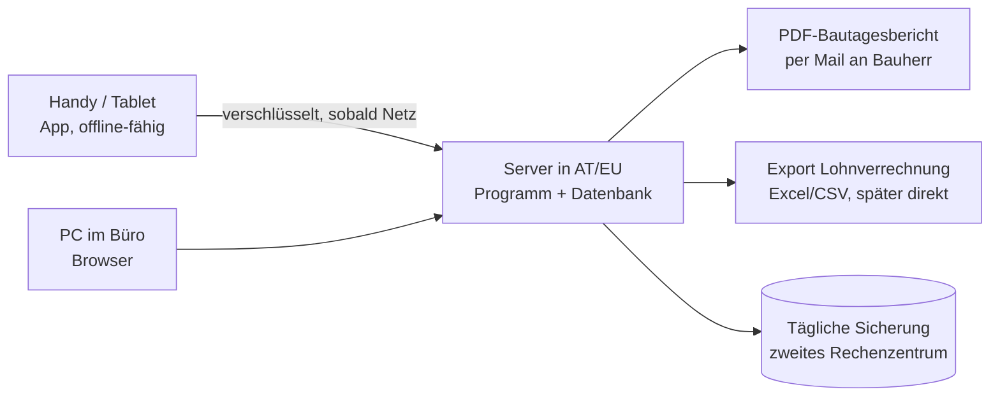

# Fachkonzept: Digitale Zeiterfassung, Bautagesbericht und Nachkalkulation

**Michael Pichler – Erdbau · Pflasterungen · Asphaltierungen · Transporte · Kieswerk, 2624 Breitenau**

| | |
|---|---|
| Dokument | Fachkonzept als Grundlage für die Entscheidung und für das Einholen von Angeboten |
| Stand | 12. November 2026, Version 1.0 (Entwurf zur Besprechung) |
| Begleitend | Klickbarer Prototyp (Ordner `prototype/`), Papiervorlage `docs/vorlage/Vorlage_Bautagesbericht.pdf` |
| Wichtiger Hinweis | Dieses Konzept ersetzt keine Rechts-, Steuer- oder Lohnverrechnungsberatung. Alles, was mit **Prüfen:** markiert ist, muss vor der Umsetzung mit der genannten Stelle geklärt werden. |

**Inhalt**

0. Zusammenfassung
1. Ausgangslage und Ziele
2. Rollen, Berechtigungen und Geräte
3. Funktionen im Detail
4. Innovative Funktionen und Benutzerfreundlichkeit
5. Servicebuch für Fahrzeuge und Geräte
6. Österreich-spezifische und rechtliche Punkte
7. Datenmodell und Rechenlogik
8. Technik und Betrieb
9. Kaufen oder bauen?
10. Umsetzung in Phasen, Kosten, Einführung
11. Offene Fragen an den Betrieb
- Quellen
- Anhang: Begriffe

---

## 0 Zusammenfassung

**Was ist geplant?** Eine App für Handy, Tablet und PC. Es ist eine einzige Web-App (PWA), die auch ohne Empfang funktioniert. Sie umfasst sechs Teile:

1. **Stempeln:** Jeder stempelt selbst, oder der Polier stempelt die ganze Partie mit einem Tipp. Der Standort wird nur im Moment des Stempelns erfasst.
2. **Bautagesbericht:** im Aufbau Ihrer Papiervorlage, vorbefüllt aus den Stempelungen. Der Bauherr unterschreibt am Tablet oder per SMS-Link, und das PDF geht sofort per Mail hinaus. Papierberichte lassen sich einscannen und werden mit Prüfschritt erkannt.
3. **Preise und Nachkalkulation je Baustelle:** Kosten, Erlös, Deckungsbeitrag, Hochrechnung bis Bauende und eine Ampel. Dazu ein **Budget-Alarm** gegen die Auftragssumme inkl. Nachträgen: bei 80/90/100 % sowie wenn die Kosten deutlich vor dem Leistungsstand liegen.
4. **Monatsabschluss:** Geprüfte Stunden, Abwesenheiten, Schlechtwetter und SEG-Zulagen gehen als Export an Lohnverrechnung und BUAK.
5. **Für die Baustelle gemacht (Kapitel 4):**
   - höchstens drei Tipps, große Knöpfe, fünf Sprachen;
   - Wetter und Schlechtwetter-Vorschlag automatisch;
   - Warnungen bei Pause und Höchstarbeitszeit;
   - Gerätestunden per NFC-/QR-Tag;
   - Bericht diktieren und Lieferscheine fotografieren. Die KI schlägt vor, der Polier bestätigt.
6. **Servicebuch für Fahrzeuge und Geräte (Kapitel 5):** alle PKW, Busse, LKW, Anhänger, Baumaschinen und Kleingeräte mit Reparaturen, Services und Prüfungen (Pickerl, Kranprüfung, Tacho).
   - Kilometer- und Betriebsstundenstände kommen vom Fahrer bzw. aus den Bautagesberichten.
   - Meldung 3 Monate vor jedem Termin, auch bei Stunden- und km-Intervallen über ein voraussichtliches Datum.
   - Mängelmeldung von der Baustelle; Status „gesperrt“.
   - Kosten sieht nur, wer das Preisrecht hat.

**Wer sieht was (Kapitel 2.2):**

- Preise, €-Werte und die Nachkalkulation sehen nur Büro/Lohnverrechnung und die Geschäftsführung. Annahme: Der Inhaber hat vollen Zugriff.
- Der **Bauleiter** sieht sie nur für seine eigenen Baustellen: ohne Einzellöhne, ohne Bearbeitung, ohne Lohnauswertung. Budget-Alarme gehen nur an Bauleiter, Büro und Geschäftsführung.
- **Polier und Mitarbeiter sehen sie nie.** Das ist fest gesperrt und auch per Ausnahme nicht freischaltbar. Diese Daten werden auf ihre Geräte gar nicht erst übertragen.
- Das PDF für den Auftraggeber enthält keine internen Werte.

**Warum?** Heute wird jede Stunde mehrfach geschrieben. Zettel kommen spät oder gehen verloren, Regie wird nicht immer verrechnet, und ob eine Baustelle verdient hat, weiß man erst lange nach der Schlussrechnung. Wir schätzen das Potenzial auf **rund 40.000–50.000 € pro Jahr** (Kapitel 1).

**Unsere Empfehlung:**

- **Eine eigene, schlanke Web-App bauen lassen.** Kein geprüftes Standardprodukt bildet in einem Guss ab: Ihren Bericht, die Nachkalkulation mit eigenen Preisen, die österreichischen Besonderheiten (BUAK, Schlechtwetter, SEG), die strengen Sichtbarkeitsregeln und die gewünschten Neuerungen.
- **Nicht selbst bauen:** Lohnverrechnung, BUAK-Meldung, Buchhaltung und Angebotskalkulation. Dafür liefert die App nur die Daten (Hybrid-Lösung).
- **Innovation mit Augenmaß:**
  - Was verlässlich funktioniert, kommt gleich in Phase 1.
  - KI-Diktat, Lieferschein- und Papier-Erkennung kommen erst nach einem Test mit echten Aufnahmen und Formularen (Dialekt, Baulärm, Handschrift).
  - Geofence-Hinweis und „KI-Fragen an die Daten“ sind optional und kommen später.
- **Gegenprobe:** Vor der Beauftragung zwei Wochen lang 123erfasst testen. Passt es ohne Verbiegen, ist Kaufen deutlich günstiger (Kapitel 9).
- **Vor dem Start:** Betriebsvereinbarung bzw. schriftliche Zustimmung jedes Mitarbeiters (Standort, Rollen, KI-Funktionen).

**Kosten (Richtwerte, netto):**

| Baustein | Einmalig | Laufend |
|---|---|---|
| Phase 0 und 1: Klärung, KI-Test, Stempeln und digitaler Bautagesbericht (MVP) inkl. Rollen und Rechte, Baustellen-Modus, 2 Fremdsprachen, AZG-Wächter, Wetter, Fernunterschrift, Stunden-Alarm, Papier-Ablage | 43.000–88.000 € | |
| Phase 2: Preise, Nachkalkulation mit Hochrechnung, Budget-Alarm, Geräte-Tags, weitere Sprachen | 25.500–54.000 € | |
| Phase 2, nur nach erfolgreichem Test: KI-Diktat, Lieferschein- und Papier-Erkennung | 14.500–37.000 € | |
| Geräte: 6–8 robuste Tablets, NFC-Chips, Geräte-Tags, Halterungen | 4.000–7.500 € | |
| Betrieb: Hosting, Wartung, Support, KI-Dienste, SMS, Mobilfunk | | ca. 400–1.000 € pro Monat |

**Zeitplan:**

- Feinkonzept, KI-Test und Angebote: bis Mitte Dezember 2026
- Entwicklung: Jänner bis März 2027
- Pilot mit einer Partie: April bis Mitte Mai 2027 (Saisonstart), Papier läuft parallel
- Alle Partien: ab Mitte Mai 2027
- Nachkalkulation und Budget-Alarm: ab Juli 2027
- **Alles voll funktionsfähig: Ende September 2027**

**Wie lange dauert es?**

- Realistisch **rund 10 Monate** ab Start, also bis Ende September 2027.
- Im besten Fall ca. 7½ Monate (Ende Juni 2027), wenn es zäh läuft 13–14 Monate (Jänner 2028).
- Die reine Programmierung dauert mit 2 Entwicklern nur ca. 4–7 Monate. Den Termin bestimmen die Abstimmung des Lohnexports, die Betriebsvereinbarung, der KI-Test und der Pilot in der Bausaison (Kapitel 10.2).
- Die optionale Phase 3 dauert weitere 3–4 Monate (bis ca. März 2028).

Förderung: KMU.DIGITAL prüfen (Kapitel 10).

**Nächste Schritte:**

1. Die offenen Fragen (Kapitel 11) und die Rechte-Matrix mit Büro und einem Polier klären.
2. Das Exportformat mit der Lohnverrechnung abstimmen; Mitarbeiter bzw. Betriebsrat informieren.
3. Den Prototyp mit zwei Polieren testen, den KI-Test machen (ca. 20 Diktate, 30 Lieferscheine, 20 ausgefüllte Papierberichte) und die Gegenprobe mit 123erfasst starten.
4. Angebote von 2–3 Entwicklern einholen und entscheiden.

---

## 1 Ausgangslage und Ziele

### 1.1 Der Betrieb

Der Betrieb hat rund 30 Mitarbeiter: Poliere, Vorarbeiter, Pflasterer bzw. Facharbeiter, Maschinisten, LKW-Fahrer, Hilfsarbeiter und Lehrlinge. Zur Firma gehören fünf Sparten (Erdbau, Pflasterungen, Asphaltierungen, Transporte, Kieswerk). Typisch sind viele kurze Baustellen, die gleichzeitig laufen, mit wechselnden Partien und Geräten. Auftraggeber sind Private, Gemeinden und Firmen. Das Kieswerk liefert Eigenmaterial (z. B. Frostschutz, Splitt) auf die eigenen Baustellen, und die LKW sind teils für Baustellen, teils für Transportaufträge unterwegs.

### 1.2 Der heutige Ablauf auf Papier

Den folgenden Ablauf nehmen wir an; bitte bestätigen oder korrigieren (siehe Kapitel 11):

1. Der Polier schreibt täglich je Baustelle einen Bautagesbericht auf Papier: Personal mit Uhrzeiten, Geräte, Material, Leistung, Regie und Vorkommnisse.
2. Stunden werden zusätzlich auf Stundenzetteln oder in Listen für die Lohnverrechnung geführt.
3. Die Zettel kommen gesammelt ins Büro, oft erst am Wochen- oder Monatsende.
4. Das Büro tippt die Stunden ins Lohnprogramm, die Regie in die Rechnung und, wenn Zeit bleibt, die Mengen in eine Excel-Nachkalkulation.

### 1.3 Was das heute kostet

| Problem | Folge | Grobe Größenordnung (Annahme, im Pilot prüfen) |
|---|---|---|
| Doppelte Erfassung (Polier schreibt, Büro tippt ab) | Büro-Zeit, Tippfehler | Bei 6 Partien sind das ca. 125 Berichte pro Monat zu je 10 Minuten, dazu Stundenlisten und Rückfragen: ca. 45 Std. pro Monat, rund **24.000 € pro Jahr** |
| Zettel kommen spät, sind nass, unleserlich oder verloren | Rückfragen, Schätzungen, Streit über Stunden | Schwer messbar, bindet aber Polier und Büro |
| Regie nicht oder spät unterschrieben | Regie wird nicht oder nur gekürzt verrechnet | Bei 2 nicht verrechneten Stunden pro Woche für Partie und Gerät à 150 € und 40 Saisonwochen: rund **12.000 € pro Jahr** |
| Poliere füllen Zettel und Bericht doppelt aus | Zeitverlust am Abend | 10 Min. pro Tag × 6 Poliere × 210 Tage ≈ 210 Std., rund **11.500 € pro Jahr** |
| Nachkalkulation spät oder nie | Falsche Preise werden im nächsten Angebot wiederholt | Nicht bezifferbar, aber vermutlich der größte Hebel |
| Schlechtwetter schlecht dokumentiert | Rückerstattung durch die BUAK gefährdet | Je nach Saison |
| Verstöße gegen das Arbeitszeitgesetz fallen erst im Nachhinein auf | Strafrisiko bei Kontrollen | – |
| Pfandpaletten nicht nachverfolgt | Pfand geht verloren | Klein, aber laufend |

Zusammen sind das **rund 40.000–50.000 € pro Jahr** an messbarem Potenzial, ohne den Effekt besserer Angebotspreise.

### 1.4 Ziele (messbar)

| Ziel | Messgröße | Zielwert | Wann |
|---|---|---|---|
| Keine Papier-Stundenzettel mehr | Anteil digital erfasster Stunden | 100 % | 3 Monate nach Rollout |
| Bericht am selben Tag fertig | Berichte abgeschlossen bis 20:00 Uhr | ≥ 90 % | ab Rollout |
| Regie bestätigt | Regieleistungen mit Unterschrift des Bauherrn innerhalb von 24 Std. | ≥ 80 % | ab Rollout |
| Kein Bericht geht verloren | Fehlende Berichte je Monat | 0 | ab Rollout |
| Schnellerer Monatsabschluss | Büro-Aufwand für den Lohnabschluss | ≤ ½ Tag (heute erheben) | nach 3 Monaten |
| Nachkalkulation aktuell | Daten in der Nachkalkulation | Stand Vortag; Endergebnis ≤ 5 Arbeitstage nach Fertigstellung | ab Phase 2 |
| Akzeptanz | Mitarbeiter, die die App „einfach“ finden (Kurzumfrage) | ≥ 80 % | Ende Pilot |

---

## 2 Rollen, Berechtigungen und Geräte

### 2.1 Wer nutzt was?

| Rolle | Typische Aufgaben in der App | Gerät |
|---|---|---|
| **Mitarbeiter** (Facharbeiter, Hilfsarbeiter, Lehrling; auch LKW-Fahrer und Maschinisten) | Optional selbst stempeln; „Meine Woche“ ansehen; Urlaub beantragen; Korrektur melden. Fahrer und Maschinisten zusätzlich: Fahrt- und Ladezeit, Fahrzeug bzw. Gerät wählen, später Transport-/Lieferschein | Eigenes Handy (freiwillig), Firmenhandy oder gar keines, weil der Polier stempelt |
| **Polier / Vorarbeiter** | Partie stempeln, Baustelle wechseln, Schlechtwetter melden, Bautagesbericht, Fotos, Unterschrift mit Bauherrn, Korrekturen in der eigenen Partie | Robustes Firmen-Tablet, zusätzlich das Firmenhandy |
| **Bauleiter** (falls vorhanden; in kleineren Betrieben übernimmt das oft die Geschäftsführung) | Betreut mehrere Baustellen: Berichte prüfen und freigeben, Schlechtwetter bestätigen, Regie und Nachträge; sieht für **seine eigenen Baustellen** Preise und Nachkalkulation (Lohn über Kostensätze je Lohngruppe, keine Einzellöhne); bearbeitet keine Preise | Tablet / Handy und PC |
| **Büro / Lohnverrechnung** | Stunden prüfen und freigeben, Abwesenheiten, Korrekturen, Stammdaten, Preise, Nachkalkulation, Monatsabschluss, Exporte | PC |
| **Geschäftsführung (Admin)** = Inhaber | Übersicht „Wer ist wo“, Preise, Nachkalkulation, Auswertungen; vergibt Rollen und Rechte. Annahme: behält immer vollen Zugriff | PC und Handy |
| **Bauherr / Vertreter des Auftraggebers** (extern) | Unterschreibt am Tablet oder per SMS-/Mail-Link und bekommt das PDF; kein eigener Zugang | Tablet des Poliers bzw. eigenes Handy |
| **Steuerberater / externe Lohnverrechnung** (extern) | Bekommt die Exportdatei; auf Wunsch Lesezugang nur zu den Lohndaten | PC |

### 2.2 Rollen & Berechtigungen

> **Grundregel:**
> - Preise, €-Werte und die Nachkalkulation sehen **Büro/Lohnverrechnung, Geschäftsführung und Bauleiter**. Annahme: Der Inhaber als Geschäftsführung behält immer vollen Zugriff.
> - Für den **Bauleiter** gilt das nur für seine **eigenen Baustellen**. Er darf Preise sehen, aber **nicht bearbeiten**. Er hat **keine Lohnauswertung, keinen Lohnexport und keine Einzellöhne**; die Nachkalkulation rechnet Lohn mit den Kostensätzen je Lohngruppe.
> - **Polier/Vorarbeiter und Mitarbeiter** sehen Preise, €-Werte, Nachkalkulation und Löhne **nie**. Das ist eine feste Regel, die auch per Ausnahme nicht freigeschaltet werden kann. Sie sehen **Mengen und Stunden** ihrer Partie bzw. ihrer Baustellen.
> - Was jemand nicht sehen darf, wird auf sein Gerät gar nicht erst übertragen.

**Berechtigungsmatrix (Standardeinstellung, je Benutzer anpassbar):**

| Funktion | Mitarbeiter | Polier / Vorarbeiter | Bauleiter | Büro / Lohnverrechnung | Geschäftsführung (Admin) |
|---|---|---|---|---|---|
| Eigene Zeiten stempeln und sehen („Meine Woche“) | ja | ja | ja | ja | ja |
| Urlaub beantragen, Korrektur melden | ja | ja | ja | ja | ja |
| Partie stempeln, Baustellenwechsel für die Partie | – | eigene Partie | eigene Baustellen | ja | ja |
| Zeiten anderer sehen | – | eigene Partie | eigene Baustellen | alle | alle |
| Zeiten anderer korrigieren (immer mit Grund) | – | eigene Partie, bis zur Freigabe | eigene Baustellen, bis zur Freigabe | ja | ja |
| Zeiten freigeben, Monat abschließen | – | – | – | ja | ja |
| Abwesenheiten (K/U/ZA) erfassen bzw. genehmigen | nur Antrag | sieht nur das Kürzel in der Partie, ohne Gründe | sieht Kürzel | ja | ja |
| Schlechtwetter melden bzw. bestätigen | – | melden | bestätigen | bestätigen | ja |
| Bautagesbericht erstellen, Fotos, Unterschrift Auftragnehmer, Versand | – | ja (eigene Baustellen) | ja | nur korrigieren | ja |
| Bautagesbericht prüfen und freigeben | – | – | ja | ja | ja |
| Papier-Bericht fotografieren bzw. hochladen | – | eigene Baustellen | eigene Baustellen | ja | ja |
| Erkannten Papier-Bericht prüfen und bestätigen | – | eigene Berichte | eigene Baustellen | ja | ja |
| Mengen, Leistungsstand, Geräte- und Materialmengen | – | eigene Baustellen, **ohne €** | eigene Baustellen | ja | ja |
| Stundenrahmen der Baustelle (Soll-/Ist-Stunden, ohne €) | – | optional je Baustelle | ja | ja | ja |
| Hinweise ohne € (z. B. Regie nicht unterschrieben, Angebotsmenge überschritten, Stunden ohne Leistungsmeldung) | – | eigene Baustellen | eigene Baustellen | ja | ja |
| Einheitspreise, Angebotssummen, Regiesätze sehen | **nie** | **nie** | eigene Baustellen | ja | ja |
| Interne Kostensätze sehen (Lohn je Lohngruppe, Geräte, Material-Einkauf) | **nie** | **nie** | ja, für die eigenen Baustellen (Lohn nur je Lohngruppe) | ja | ja |
| Preise und Kostensätze bearbeiten | **nie** | **nie** | nein | ja | ja |
| Nachkalkulation, Hochrechnung, Hinweise mit €-Werten | **nie** | **nie** | eigene Baustellen (Lohn über Kostensätze je Lohngruppe, keine Einzellöhne) | ja | ja |
| Auftragssumme und Nachträge sehen | **nie** | **nie** | eigene Baustellen | ja | ja |
| Auftragssumme und Nachträge erfassen bzw. ändern | **nie** | **nie** | nein (Nachtrag nur als Hinweis ohne Betrag melden) | ja | ja |
| Budget-Alarm erhalten (In-App, Push, E-Mail) | **nie** | **nie** | eigene Baustellen | ja | ja |
| Stunden-Alarm erhalten (ohne €) | – | – | eigene Baustellen | ja | ja |
| Alarm-Schwellen und Empfänger einstellen | – | – | – | je Baustelle | ja, alle |
| Lohnauswertung je Person (Einzellöhne, SEG, Taggeld, Mehrstunden), Lohn- und BUAK-Export | nur eigene Stundenliste, ohne € | **nie** (für andere) | nein | ja | ja |
| Stammdaten (Baustellen, Geräte, Material, Positionen; ohne Preise) | – | – | Baustellen und Positionen anlegen | ja | ja |
| Benutzer anlegen, PIN zurücksetzen, Gerät abmelden | – | – | – | ja | ja |
| Rollen und Ausnahmen vergeben | – | – | – | – | ja |
| Servicebuch: Status der Fahrzeuge/Geräte sehen, Mangel melden, Zählerstand eintragen (ohne €) | ja | ja | ja | ja | ja |
| Servicebuch pflegen (Anlagen, Pläne, Einträge, Sperre), Recht `fuhrpark` | per Ausnahme (z. B. Werkstatt) | per Ausnahme | per Ausnahme | ja | ja |
| Reparatur- und Servicekosten sehen | **nie** | **nie** | nur lesen | ja | ja |
| Änderungsprotokoll einsehen | eigene Daten | eigene Partie (ohne Preise) | eigene Baustellen | ja | alles, inkl. Rechte |
| KI-Fragen an die Daten (Phase 3, optional) | – | – | im Rahmen der eigenen Rechte | im Rahmen der eigenen Rechte | ja |

„**nie**“ bedeutet: technisch gesperrt und auch per Ausnahme nicht freischaltbar. „Eigene Partie“ und „eigene Baustellen“ ergeben sich aus der Zuordnung Polier ↔ Partie und Bauleiter ↔ Baustellen; diese Zuordnung pflegt das Büro. Annahme: Die Geschäftsführung (Inhaber) behält immer vollen Zugriff, und dieses Recht kann ihr in der App niemand entziehen.

**Ausnahmen je Benutzer:** Die Geschäftsführung kann einzelnen Personen Rechte zusätzlich geben oder wegnehmen, auf Wunsch befristet. Beispiele:

- Ein Vorarbeiter vertritt zwei Wochen lang einen Polier und darf in dieser Zeit „Partie Huber stempeln“.
- Ein Bauleiter betreut vertretungsweise eine weitere Baustelle und sieht in dieser Zeit auch deren Nachkalkulation.
- Eine Büro-Teilzeitkraft bekommt keine Einsicht in Lohndaten.

**Grenze:** Für die Rollen Polier/Vorarbeiter und Mitarbeiter bietet die Ausnahme-Funktion Preis-, €-, Nachkalkulations- und Lohnrechte gar nicht an. Soll ein Polier solche Daten sehen, muss er bewusst die Rolle Bauleiter bekommen, und das steht im Protokoll. Dem Bauleiter können Preis-Bearbeitung, Lohnauswertung und Einzellöhne ebenfalls nicht per Ausnahme gegeben werden; dafür ist die Rolle Büro nötig. Die App zeigt außerdem eine Liste „Wer darf mehr oder weniger als seine Rolle“. Wir empfehlen, sie einmal im Quartal durchzusehen.

**Änderungsprotokoll:**

- Jede Änderung an Rechten, Rollen, Preisen, Kostensätzen, Zeiten und Berichten wird mit Person, Zeitpunkt, altem und neuem Wert und Grund gespeichert.
- Das Protokoll kann niemand löschen, auch kein Admin.
- Es gibt mindestens **zwei Admins** (Geschäftsführung und Stellvertretung), damit sich niemand aussperrt.
- Änderungen an Lohnkostensätzen und Rechten sieht die zweite Admin-Person in ihrer Übersicht (Vier-Augen-Hinweis).

**Technischer Grundsatz: Rechte werden am Server durchgesetzt, nicht in der Oberfläche.**

- Der Server prüft bei jeder Anfrage, wer fragt, welche Rolle und Ausnahmen gelten und für welchen Bereich (alles, eigene Baustellen, eigene Partie, nur selbst).
- Er liefert **nur die Daten, für die ein Recht besteht**. Preise, Kostensätze, €-Werte, Nachkalkulation und Lohndaten verlassen den Server nie in Richtung der Geräte von Polieren und Mitarbeitern, auch nicht in den Offline-Speicher. Der Bauleiter bekommt nur die Preise und Nachkalkulation seiner eigenen Baustellen und nie Einzellöhne. Die Positionsliste für die Leistungsmeldung kommt beim Polier ohne Einheitspreise an.
- Bloßes Ausblenden in der Oberfläche wäre unsicher, weil technisch versierte Nutzer versteckte Daten auslesen könnten.
- Exporte (Lohn, BUAK, Nachkalkulation) erzeugt nur der Server, und nur für berechtigte Rollen.
- Automatische Tests prüfen bei jedem Update, dass die Antworten an Polier- und Mitarbeiterrollen keine Preis- oder Lohnfelder enthalten.

**Das PDF für den Auftraggeber enthält nie interne Werte:**

- Bautagesbericht und Regieschein für den Auftraggeber enthalten **keine Kosten, keine Kostensätze, keinen Deckungsbeitrag, keine Löhne und überhaupt keine €-Werte**. Regiepreise stehen erst auf der Rechnung.
- Die Kürzel **K und U erscheinen nicht** im PDF für den Auftraggeber, denn ein Krankenstand geht ihn nichts an. **SW** bleibt, weil es den Bauablauf betrifft.
- Für das Büro gibt es eine interne Fassung mit allen Kürzeln. Beide Fassungen kommen aus getrennten Vorlagen und werden automatisch getestet.
- **Prüfen:** ob Mitarbeiternamen im PDF für den Auftraggeber nötig sind, oder ob Funktion und Kürzel reichen (Datenminimierung).

**Datenschutz: Lohndaten von Kollegen.**

- Löhne, Lohngruppen, Kostensätze sowie SEG- und Taggeld-Beträge sind vertrauliche personenbezogene Daten. Sehen darf sie nur, wer sie für seine Aufgabe braucht, also Büro und Geschäftsführung (DSGVO: Datenminimierung, Vertraulichkeit, Sicherheit der Verarbeitung).
- Der Bauleiter sieht in der Nachkalkulation Lohnkosten nur über die **Kostensätze je Lohngruppe**. Das sind Durchschnittssätze, keine Einzellöhne. Bei einer Lohngruppe mit nur einer Person wird mit der nächsten Gruppe zusammengefasst, damit man nicht auf den Lohn eines Einzelnen schließen kann.
- Der Polier sieht die Stunden seiner Partie, weil er sie verantwortet, aber nicht deren Löhne.
- Beim Krankenstand wird nur das Kürzel „K“ gespeichert, nie eine Diagnose. Die Krankmeldung als Beleg sieht nur das Büro.
- Das Rollenkonzept wird Teil der Betriebsvereinbarung bzw. der Mitarbeiterinformation (Kapitel 6.7).

**Verlorene oder gemeinsam genutzte Geräte:**

- **Automatische Sperre:** Das Polier-Tablet sperrt nach ca. 10 Minuten ohne Bedienung und wird mit der PIN entsperrt. Sitzungen von Büro und Geschäftsführung enden nach ca. 30 Minuten.
- **Gemeinsames Tablet** (Bauhof, Bus): Nach jeder Stempelung wird sofort wieder abgemeldet. „Meine Woche“ ist nur nach PIN-Eingabe sichtbar und schließt sich nach 60 Sekunden.
- **Fernabmeldung:** Büro oder Admin melden ein Gerät bzw. einen Benutzer aus der Ferne ab. Beim nächsten Netzkontakt werden noch offene Daten übertragen und danach der lokale Speicher gelöscht. Die Geräteverwaltung kann zusätzlich das ganze Firmengerät sperren oder löschen.
- **Wenig Daten am Gerät:** Am Gerät liegt nur das Nötigste (Stammdaten, eigene Partie, letzte 14 Tage), verschlüsselt und **ohne Preise**. Ein verlorenes Polier-Tablet verrät also weder Preise noch Löhne.
- **PIN-Fehlversuche:** Nach 5 Fehlversuchen wird gesperrt. Das Büro entsperrt.

### 2.3 Mitarbeiter ohne Smartphone

Nicht jeder hat ein Smartphone oder will das private Handy dienstlich verwenden. Niemand soll dazu gezwungen werden.

| Möglichkeit | So funktioniert es | Bewertung |
|---|---|---|
| **Partie-Stempeln durch den Polier** | Der Polier hakt am Tablet an, wer da ist, und stempelt alle mit einem Tipp ein. Jede Stempelung trägt den Vermerk „erfasst durch Polier …“. | **Empfohlen als Standard.** Am wenigsten Aufwand, entspricht dem heutigen Ablauf. |
| **Gemeinsames Baustellen-Tablet** | Das Tablet liegt im Bus bzw. auf der Baustelle. Jeder stempelt dort mit Personalnummer und PIN selbst. | Gut, wenn Mitarbeiter selbst stempeln wollen. Braucht etwas Disziplin. |
| **NFC-Chip (Schlüsselanhänger)** | Der Mitarbeiter hält seinen Chip an das Tablet des Poliers. | Schnell und ohne PIN. **Funktioniert in einer Web-App nur auf Android-Geräten mit Chrome**, nicht am iPhone/iPad. Chips kosten ca. 3–5 € pro Stück. |
| **QR-Code am Firmenausweis oder Helm** | Die Kamera des Poliers liest den Code. | Funktioniert auf allen Geräten. Billig, aber weniger robust (Schmutz). |
| **Papierformular mit QR-Code als Reserve** | Vorbefülltes Formular je Baustelle; wird abends fotografiert und eingescannt (Kapitel 4.12) | Gut für Ausfälle (Akku, Gerät kaputt) und Subunternehmer. Wegen des Prüfschritts nicht als Dauerlösung für alle gedacht. |
| **Terminal im Bauhof / Kieswerk** | Fix montiertes Tablet für Werkstatt und Kieswerk | Sinnvoll für Mitarbeiter, die immer am selben Ort arbeiten |
| **Privates Handy (freiwillig)** | Stempeln, „Meine Woche“, Urlaubsantrag | Nur freiwillig, nie Pflicht. Den Umgang mit privaten Geräten in der Betriebsvereinbarung regeln. |

> **Empfehlung:** Standard ist das Partie-Stempeln durch den Polier. Wer mit dem eigenen Handy stempeln will, darf das. Für Bauhof und Kieswerk kommt ein fixes Tablet dazu. NFC-Chips sind eine Option, wenn die Firmen-Tablets Android-Geräte sind, was wir ohnehin empfehlen (Kapitel 8).

### 2.4 Ein Tag mit der App (Beispiel)

| Uhrzeit | Was passiert | In der App |
|---|---|---|
| 06:45 | Partie Huber trifft sich im Bauhof und lädt Rüttelplatte und Splitt | Polier: „Partie stempeln“ → Tätigkeit *Laden Bauhof*, KST der Baustelle |
| 07:05 | Fahrt zur Baustelle Hofeinfahrt Musterstraße | „Fahrt“; der LKW-Fahrer wählt sein Fahrzeug |
| 07:30 | Ankunft, Arbeitsbeginn | „Baustelle“; einmalig wird der Standort gespeichert (im Umkreis der Baustelle: ja/nein). Ab Phase 3 optional: Hinweis am Gerät „Musterstraße erreicht – jetzt einstempeln?“ |
| 07:40 | Der Maschinist startet den Bagger | Er hält das Handy an den NFC-/QR-Tag in der Kabine, und die Gerätestunden laufen auf die KST (ab Phase 2) |
| 10:15 | Bauherr ordnet zusätzlich das Abtragen eines Gartenmäuerchens an | Polier: „Regie starten“ für 2 Mann und den Bagger 2,7 t |
| 12:00–12:30 | Mittagspause | Pause wird automatisch laut Vereinbarung gebucht, oder per Taste. Der AZG-Wächter würde erinnern, wenn nach 6 Std. noch keine Pause gebucht ist. |
| 14:00 | Starkregen | Die App zeigt den Niederschlag der nächsten Messstation und schlägt „Schlechtwetter ab 14:00?“ vor. Der Polier entscheidet und bestätigt; das gilt für alle Anwesenden. |
| 14:20 | Ein Mitarbeiter fährt zur Werkstatt | Einzeln: „Baustelle wechseln“ → *Werkstatt* |
| 16:30 | Bericht | Der Assistent hat alles vorbefüllt, das Wetter ist schon eingetragen. Der Polier diktiert: „180 m² Pflaster verlegt, Rüttelplatte 4 Stunden, 2 Fuhren Frostschutz“. Die KI trägt das in die Felder ein (ab Phase 2), der Polier prüft. Den Lieferschein fotografiert er, 3 Fotos kommen dazu. |
| 16:40 | Unterschrift | Der Bauherr ist nicht da. Er bekommt einen SMS-Link und unterschreibt am Abend am Handy. Das PDF geht an Bauherr und Büro. |
| am nächsten Morgen | Büro / Bauleiter | Bericht vollständig, eine AZG-Warnung (Ruhezeit) zu prüfen, Regie bereit zur Verrechnung. Hochrechnung: erwarteter Deckungsbeitrag 18 % (nur Büro, GF, Bauleiter) |

---

## 3 Funktionen im Detail

### 3.1 Zeiterfassung

**Stempelarten (Handy und Tablet):**

| Taste | Bedeutung | Zuordnung (KST) |
|---|---|---|
| **Arbeitsbeginn** (großer Knopf) | Beginn mit Auswahl der Baustelle; zuletzt genutzte und geplante Baustellen stehen oben | Baustelle |
| **Pause** / **Weiter** | Ruhepause | – (keine Arbeitszeit) |
| **Baustelle wechseln** | Ende auf Baustelle A, Beginn auf Baustelle B (Fahrt dazwischen wird automatisch erkannt) | A, Fahrt, B |
| **Tätigkeit** | *Baustelle* (Standard), *Fahrt*, *Laden* (Bauhof/Kieswerk), *Werkstatt*, *Kieswerk*, *Transport* | Baustelle bzw. Gemeinkosten-KST (Bauhof, Werkstatt, Kieswerk, Transporte) |
| **Regie** an/aus | Kennzeichnet die laufende Zeit als Regie | Baustelle, Kennzeichen Regie |
| **Arbeitsende** | Tagesende | – |

**Partie-Stempeln:** Der Polier pflegt seine Partie. Die Mitglieder sind vorgeschlagen und können für den Tag geändert werden, z. B. wenn ein Mann ausgeborgt ist. Ein Tipp stempelt alle Angehakten. Wer selbst gestempelt hat, wird nicht doppelt erfasst: Die App zeigt dem Polier „bereits gestempelt um 07:28“. Jeder Mitarbeiter sieht unter „Meine Woche“, was für ihn gebucht wurde, und kann eine Korrektur melden.

**Fahrzeit, Ladezeit, Werkstatt:** Diese Zeiten werden **getrennt erfasst**, damit die Lohnverrechnung richtig entscheiden kann, was davon Arbeitszeit bzw. zu bezahlen ist. Für den Bau gilt laut WKO-Erläuterungen zum KV: Fährt der Arbeiter zuerst zum Bauhof, beginnt die zu vergütende Arbeitszeit grundsätzlich erst auf der Baustelle. Ausgenommen sind Tätigkeiten, die er vorher im Auftrag des Arbeitgebers erledigt, etwa das Laden. **Prüfen:** Wie das Lenken des Firmenfahrzeugs und das Mitfahren behandelt werden, mit der Lohnverrechnung bzw. der WKO klären. Die App bekommt dafür eine einstellbare Regel („Fahrt Bauhof → Baustelle: Arbeitszeit ja/nein, je Rolle Lenker/Mitfahrer“).

**Pausen:**

- **Erwachsene:** Bei mehr als 6 Stunden Arbeitszeit sind 30 Minuten Pause Pflicht (§ 11 AZG).
- **Jugendliche unter 18** (Lehrlinge): Bei mehr als 4½ Stunden sind 30 Minuten Pflicht, und die Pause darf nicht geteilt werden (KJBG).
- **Erleichterung:** Ist die Pausenlage per Betriebsvereinbarung bzw. schriftlicher Einzelvereinbarung festgelegt, z. B. „30 Minuten zwischen 11:30 und 13:00“, müssen Pausen nicht gesondert aufgezeichnet werden (§ 26 AZG).

> **Empfehlung:** Eine feste Pausenregel vereinbaren. Die App bucht die Pause dann automatisch, abweichende Pausen werden per Taste erfasst.

**Korrekturen mit Freigabe:**

1. Ein Mitarbeiter meldet in „Meine Woche“, dass ein Stempel fehlt oder falsch ist, und gibt einen Grund an.
2. Der Polier korrigiert Zeiten seiner Partie, ebenfalls mit Grund (Auswahlliste plus Text).
3. Das Büro sieht alle Korrekturen gesammelt und gibt frei oder lehnt ab.
4. **Nichts wird überschrieben.** Jede Änderung wird mit alter und neuer Zeit, Person, Zeitpunkt und Grund protokolliert. Das schützt den Betrieb bei Kontrollen und die Mitarbeiter bei Streitfragen.
5. Nach dem Monatsabschluss sind die Zeiten gesperrt. Spätere Änderungen sind nur noch durch das Büro möglich und werden in einer Nachtragsliste für die Lohnverrechnung vermerkt.

**Abwesenheiten:**

| Code | Bedeutung | Wer erfasst | Besonderheit |
|---|---|---|---|
| **K** | Krankenstand | Büro (nach Krankmeldung) | Bestätigung als Foto hochladbar; im Bericht als „K“ |
| **U** | Urlaub | Mitarbeiter beantragt, Büro genehmigt | Am Bau läuft das Urlaubsentgelt über die BUAK, deshalb fließt U in den BUAK-Export |
| **SW** | Schlechtwetter | Polier für die Partie (mit Uhrzeit und Grund), Büro bestätigt | Zähler je Mitarbeiter gegen die Höchstgrenzen; Export für die BUAK-Rückerstattung (Kapitel 6.4) |
| **ZA** | Zeitausgleich | Antrag oder Büro | Abbuchung vom Zeitkonto |
| FT | Feiertag | automatisch (Kalender Niederösterreich) | – |
| BS | Berufsschule (Lehrlinge) | Büro | Zählt bei Jugendlichen als Arbeitszeit (KJBG) |
| SD | Sonstige Dienstverhinderung (Arzt, Pflegefreistellung, Behörde …) | Büro | – |

**Warnungen (Arbeitszeitgesetz):** Die App warnt den Polier sofort und das Büro im Dashboard, z. B. bei:

- mehr als 10 Stunden am Tag (Hinweis) bzw. mehr als 12 Stunden (Grenze);
- weniger als 11 Stunden Ruhezeit;
- fehlender Pause;
- Wochensumme über 50 bzw. 60 Stunden;
- 17-Wochen-Schnitt über 48 Stunden;
- strengeren Grenzen für Jugendliche (8 Std. pro Tag, 40 Std. pro Woche, 12 Std. Ruhezeit).

Die App verhindert nichts, sie macht aufmerksam. Entscheiden müssen Polier und Büro. Als Push-Nachricht aufs Handy („AZG-Wächter“, inkl. „Ausstempeln vergessen?“) siehe Kapitel 4.

**Offline-Betrieb (Baustellen ohne Empfang):**

- Alles funktioniert ohne Netz: stempeln, Bericht, Fotos, Unterschrift.
- Die Daten werden verschlüsselt am Gerät gespeichert und automatisch übertragen, sobald wieder Empfang da ist. Ein Symbol zeigt „3 Einträge noch nicht übertragen“.
- Stammdaten (Baustellen, Mitarbeiter, Geräte, Material, Positionen) liegen am Gerät und werden bei jeder Verbindung aktualisiert.
- Uhrzeit: Die App merkt sich beim Stempeln die Gerätezeit. Beim Übertragen vergleicht sie diese mit der Serverzeit. Größere Abweichungen (verstellte Uhr) werden markiert.
- Ist ein Gerät länger als 2 Tage nicht synchronisiert, bekommt das Büro einen Hinweis.

**Standort, nur beim Stempeln:**

- Beim Arbeitsbeginn, beim Baustellenwechsel und beim Arbeitsende wird **einmal** der Standort abgefragt.
- Gespeichert wird vor allem die Information „im Umkreis der Baustelle: ja/nein“ (z. B. 300 m). Die Koordinaten werden nach dem Monatsabschluss plus 2 Monaten gelöscht.
- **Keine laufende Ortung, kein Bewegungsprofil, keine Ortung in Pausen oder nach Arbeitsende.**
- Wer nicht zustimmt, stempelt ohne Standort. Dann bestätigt der Polier die Anwesenheit.
- Die rechtlichen Hintergründe stehen in Kapitel 6.7.

### 3.2 Bautagesbericht

**Ablauf als Assistent (Schritt für Schritt):**

1. **Kopf:** Datum, Baustelle/KST, Auftraggeber, Bauvorhaben (alles vorbefüllt), Wetter.
2. **Personal:** Liste aus den Stempelungen mit Zeitblöcken, Pause und Stunden. Codes K/U/SW sind übernommen.
3. **SEG-Zulagen:** Tätigkeit und Stunden je Person.
4. **Geräte:** Geräte des Tages mit Stunden (Vorschlag aus Stempelungen und Vortag).
5. **Material:** Aushub, Bruch, Frostschutz, Grädermaterial, Splitt mit Menge und Einheit.
6. **Arbeitsleistung:** Positionen aus dem Angebot mit Menge, Freitext bleibt möglich.
7. **Materialbeistellung und Paletten retour.**
8. **Regieleistungen.**
9. **Besondere Vorkommnisse und Fotos.**
10. **Kontrolle und Unterschriften**, dann PDF und Mail.

Jeder Schritt kann leer bleiben („heute keine Regie“). Der Bericht ist auch am Handy ausfüllbar, das Tablet ist aber angenehmer. Statt alles zu tippen, kann der Polier diktieren und Lieferscheine fotografieren; Wetter und Geräte-Tags füllen Felder automatisch vor (Kapitel 4).

**Feldzuordnung: jedes Feld der Papiervorlage und sein digitales Gegenstück**

| Nr. | Feld auf der Vorlage | Digitales Gegenstück | Datenquelle / Vorbefüllung | Wofür danach verwendet |
|---|---|---|---|---|
| 1 | Firmenkopf (Logo, Adresse, Telefon) | Fester PDF-Kopf | Firmenstammdaten | – |
| 2 | Datum | Berichtsdatum | Heutiges Datum bzw. Datum der Stempelungen | Lohn; Preisgültigkeit in der Nachkalkulation |
| 3 | KST | Kostenstelle = Baustellennummer | Baustelle, die beim Arbeitsbeginn gewählt wurde | Zuordnung aller Kosten und Erlöse |
| 4 | Auftraggeber | Kunde | Baustellen-Stammdaten | PDF-Empfänger, Rechnung |
| 5 | Bauvorhaben | Bezeichnung und Adresse der Baustelle | Baustellen-Stammdaten | – |
| 6 | Personal: Name (6 Zeilen) | Personalliste ohne Zeilenbegrenzung | Alle Mitarbeiter mit Stempelung auf dieser KST an diesem Tag; die Partie wird vorgeschlagen | Lohn, Nachkalkulation |
| 7 | Arbeitszeit von–bis (1. Block) | Erster Zeitblock | Stempel Arbeitsbeginn bis Pause bzw. Wechsel | Arbeitszeitaufzeichnung (AZG) |
| 8 | Arbeitszeit von–bis (2. Block) | Zweiter Zeitblock; weitere Blöcke möglich und im PDF als Zusatzzeile | Stempel nach Pause bzw. Rückkehr | wie oben |
| 9 | Pause | Pausendauer | Pausenstempel oder Standardpause laut Vereinbarung | AZG-Prüfung |
| 10 | Arbstd. | Arbeitsstunden je Person | Berechnet: Zeitblöcke minus Pause (Fahrt und Laden als eigene Spalte, siehe Kapitel 11) | Lohn, Nachkalkulation |
| 11 | Gesamtstunden | Summe | Berechnet | Nachkalkulation (Lohnstunden) |
| 12 | K = Krank, U = Urlaub, SW = Schlechtwetter | Kennzeichen je Person in der Stundenspalte | Abwesenheiten (Büro bzw. Antrag) oder Schlechtwetter-Meldung des Poliers | Lohn, BUAK (Schlechtwetter-Rückerstattung) |
| 13 | SEG-Zulagen: Tätigkeit | Zulagenart aus dem Firmenkatalog, z. B. Heißasphalt, Arbeiten in Künette | Polier wählt; Vorschlag aus Tätigkeit bzw. Position | Lohn; Nachweis für § 68 EStG |
| 14 | SEG-Zulagen: Stunden | Stunden je Person und Zulagenart | Vorschlag = Arbeitsstunden, Polier korrigiert | Lohn |
| 15 | Geräte: LKW mit Kran 3-A / 4-A, LKW 2-/3-/4-Achser, LKW Zug oder Sattel, LKW mit Tieflader | Konkretes Fahrzeug (Kennzeichen/Inventarnr.) mit Stunden | Fahrzeug, das der Fahrer beim Stempeln gewählt hat; Stunden = seine Stempelzeit | Nachkalkulation (interner Satz), Regie, Auslastung |
| 16 | Geräte: Leerzeile in der Liste | „Sonstiges Gerät“ | Auswahl aus der ganzen Geräteliste, auch Mietgeräte | wie oben |
| 17 | Verlegemaschine, Schneidgerät, Kompressor, Dumper | Gerät mit Stunden | Polier; Vorschlag aus dem Vortag auf dieser Baustelle; ab Phase 2 per Geräte-Tag (NFC/QR) | wie oben |
| 18 | Bobcat, Bagger 1,5 / 2,7 / 9 / 23 to., Radlader, Gräder | Gerät mit Stunden | Stempelzeit des Maschinisten, der das Gerät gewählt hat; ab Phase 2 per Geräte-Tag (NFC/QR) | wie oben |
| 19 | Bomag BW 177, Hamm Walz 2 to., Handwalze, Rüttelplatte, Grabenwalze | Gerät mit Stunden | Polier; Vorschlag aus dem Vortag; ab Phase 2 per Geräte-Tag | wie oben |
| 20 | Material: Aushub, Betonbruch, Asphaltbruch (to/m³) | Menge, Einheit (t oder m³) und Ziel (Deponie, Kieswerk/Recycling, andere Baustelle) | Polier (auch per Diktat); ab Phase 2 Lieferschein-Foto, später digitaler Wiegeschein | Nachkalkulation (Entsorgungskosten), Abrechnung, Recyclingmengen |
| 21 | Material: Frostschutz, Grädermaterial, Splitt (to.) | Menge in t mit Herkunft | Polier (auch per Diktat); ab Phase 2 Lieferschein-Foto, später digitaler Lieferschein des Kieswerks | Nachkalkulation, Abrechnung |
| 22 | Arbeitsleistung (Freitextzeilen) | Leistungsmeldung: Position aus dem Angebot, Menge und Einheit; Freitext weiter möglich | Polier wählt aus der Positionsliste der Baustelle | Erlös (Einheitspreis × Menge), Soll/Ist, Aufwandswerte |
| 23 | Materialbeistellung: Eigenmaterial | Material und Menge, Herkunft „Eigen (Kieswerk/Lager)“ | Polier | Nachkalkulation zum internen Verrechnungspreis |
| 24 | Materialbeistellung: Fremdmaterial | Material und Menge, dazu Lieferant mit Lieferschein-Nr. oder „vom Bauherrn beigestellt“ | Polier; Foto vom Lieferschein, ab Phase 2 liest die KI Lieferant, Material und Menge | Nachkalkulation (Einkaufspreis bzw. 0 € bei Beistellung), Rechnungsprüfung |
| 25 | Paletten retour: Euro | Anzahl Europaletten | Polier | Palettenkonto je Baustelle und Lieferant |
| 26 | Paletten retour: Weissenböck | Anzahl zurückgegebener Leerpaletten des Lieferanten Weissenböck (vom Betrieb bestätigt); weitere Lieferanten einstellbar | Polier | Pfand-Gutschrift kontrollieren |
| 27 | Regieleistungen (Zeilen) | Regieposition: Beschreibung, Personen mit Stunden, Geräte mit Stunden, Material | Mit „Regie“ gekennzeichnete Stempelungen; Polier ergänzt | Regierechnung zu Regiesätzen; eigener Regieschein-Ausdruck |
| 28 | Besondere Vorkommnisse (z. B. Anweisungen AG, Beschädigungen, Sonstiges) | Einträge mit Kategorie (Anweisung AG, Behinderung/Wartezeit, Beschädigung, Unfall/Beinahe-Unfall, Mangel, Sonstiges), Text und Fotos | Polier | Sofortige Nachricht ans Büro; Grundlage für Mehrkostenforderungen |
| 29 | Unterschrift Auftragnehmer oder dessen Beauftragter | Unterschrift des Poliers am Gerät mit Name und Zeitpunkt | Angemeldeter Polier | Abschluss des Berichts |
| 30 | Unterschrift Bauherr oder dessen bevollmächtigter Vertreter | Unterschrift am Tablet mit Name in Druckschrift und Funktion; alternativ „nicht anwesend“ mit Versand zur Bestätigung | Bauherr vor Ort | Beweis, Bestätigung der Regie |
| neu | (nicht auf Papier) Wetter | Temperatur, Niederschlag, Wind | Automatisch (z. B. GeoSphere Austria, nächste Messstation); der Polier kann ergänzen; daraus Schlechtwetter-Vorschlag | Nachweis für Schlechtwetter und Behinderung |
| neu | (nicht auf Papier) Fotos | Fotos mit Zeitstempel | Kamera | Dokumentation |
| neu | (nicht auf Papier) Status und Versand | Entwurf, abgeschlossen, unterschrieben (vor Ort oder per SMS-/Mail-Link), versendet, geprüft | Automatisch | Nachvollziehbarkeit |

**Plausibilitätsprüfungen beim Abschließen:**

- Die Stunden im Bericht stimmen mit den Stempelzeiten überein. Abweichungen sind möglich, brauchen aber einen Grund.
- Ein Gerät hat nicht mehr Stunden als die Partie anwesend war und ist nicht gleichzeitig auf zwei Baustellen.
- Mengen sind plausibel. Beispiel: 400 t Frostschutz an einem Tag mit einem LKW ergeben eine Rückfrage.
- Leistung ohne Personal oder Personal ohne Leistung erzeugt einen Hinweis.
- Regie ohne Unterschrift des Bauherrn erzeugt einen Hinweis an das Büro.

**Änderungen nach der Unterschrift:** Der unterschriebene Bericht wird als PDF eingefroren. Spätere Änderungen erzeugen eine neue Version mit dem Vermerk „geändert nach Unterschrift am …, Grund …“. Diese Version geht erneut an den Bauherrn. Die alte Version bleibt erhalten.

### 3.3 Fotos, Unterschrift, PDF und Mail

- **Fotos:** Die App verkleinert Fotos automatisch (ca. 300–500 KB), damit die Übertragung auch bei schlechtem Netz klappt. Zu jedem Foto gibt es Zeitstempel, Baustelle und Kategorie (Leistungsstand, Vorkommnis, Lieferschein, Mangel). Personen sollen nicht im Mittelpunkt der Fotos stehen.
- **Unterschrift:** Der Bauherr unterschreibt mit Finger oder Stift am Tablet, darüber steht eine Zusammenfassung des Berichts. Gespeichert werden das Unterschriftsbild, der Name in Druckschrift, Zeitpunkt, Gerät und eine Prüfsumme des PDFs. So ist erkennbar, falls das PDF später verändert wurde.
- **Ist der Bauherr nicht vor Ort,** bekommt er einen Link per SMS oder Mail und unterschreibt am eigenen Handy (Fernunterschrift, Kapitel 4). Wird der Bericht nicht binnen einer vereinbarten Frist beanstandet, wird das vermerkt (Kapitel 6.9).
- **PDF:** Gleicher Aufbau und gleiche Reihenfolge wie die Papiervorlage, damit Bauherren und Bauleiter ihn sofort wiedererkennen. Fotos kommen auf Folgeseiten, Regie zusätzlich als eigener Regieschein.
- **Zwei Fassungen:** Die Fassung für den Auftraggeber enthält nie €-Werte und keine Kürzel K/U. Die interne Fassung ist vollständig (Kapitel 2.2).
- **Mail:** Das PDF geht automatisch an den Ansprechpartner des Auftraggebers und ans Büro, auf Wunsch auch an die örtliche Bauaufsicht. Jeder Versand wird protokolliert.

### 3.4 Preise und Nachkalkulation

**Wer sieht das?** Preise und Nachkalkulation sehen Büro/Lohnverrechnung und Geschäftsführung, der Bauleiter nur für seine eigenen Baustellen und ohne Einzellöhne. Polier und Mitarbeiter sehen nie €-Werte (Kapitel 2.2).

**Stammdaten Preise.** Jeder Preis hat ein „gültig ab“-Datum. Eine Preisänderung wirkt also nicht rückwirkend auf alte Baustellen.

| Preisart | Kostenseite (für die Nachkalkulation) | Verkaufsseite (für Angebot und Regie) | Woher kommt der Wert? | Pflege |
|---|---|---|---|---|
| **Lohn** je Lohngruppe (Polier, Vorarbeiter, Facharbeiter, Maschinist, LKW-Fahrer, Hilfsarbeiter, Lehrling) | **Lohnkostensatz** €/Std. = Ist-Lohn × Lohnnebenkosten-Faktor (inkl. Sonderzahlungen, BUAK-Zuschläge, SV, Ausfallzeiten) | **Mittellohnpreis bzw. Regiesatz** €/Std. = Kosten plus Gesamtzuschlag (Geschäftsgemeinkosten, Wagnis, Gewinn) | Eigene K3-Kalkulation nach ÖNORM B 2061; Hilfe: Mittellohnpreis-Broschüre der Bundesinnung Bau | Jährlich zum 1. Mai (KV-Erhöhung) |
| **Geräte** je Gerät (ohne Bediener) | **Interner Gerätesatz** €/Std. = (Abschreibung + Verzinsung + Reparatur) pro Monat ÷ Einsatzstunden pro Monat + Betriebsstoffe pro Stunde | **Regiesatz** €/Std., meist mit Fahrer (Achtung, siehe unten) | Baugeräteliste (BGL 2025, gemeinsame dt.-österr. Ausgabe) als Richtwert, eigene Werte gehen vor | Jährlich, bei Neuanschaffung |
| **Material** | **Einkaufspreis** €/Einheit (bei Eigenmaterial aus dem Kieswerk: interner Verrechnungspreis) | Verkaufspreis bzw. Einkaufspreis plus Materialzuschlag | Lieferanten, Kieswerk-Preisliste | Laufend |
| **Fremdleistungen** (Subunternehmer, Deponie, Mietgeräte) | Betrag laut Eingangsrechnung | – | Buchhaltung (Import je KST) oder händische Eingabe | Monatlich |
| **Leistungspositionen** je Baustelle | Optional: kalkulierte Kosten je Einheit bzw. Aufwandswert (Std. je Einheit) | **Einheitspreis** (EP) laut Angebot, Pauschalen | Angebot (Excel-Import, später ÖNORM-Datenträger) | Je Auftrag |

> **Wichtig: nicht doppelt zählen.** Im Bautagesbericht stehen der Maschinist unter *Personal* und der Bagger unter *Geräte*. Deshalb muss der interne Gerätesatz **ohne Bediener** gerechnet werden. In der Regie ist es oft umgekehrt („Bagger 9 t mit Fahrer“). Die App kennt bei jedem Regiesatz das Merkmal „inkl. Bediener ja/nein“ und rechnet die Fahrerstunden dann nicht ein zweites Mal ab.

**Formeln (in Worten):**

- **Lohnkosten** = Arbeitsstunden je Person × Lohnkostensatz ihrer Lohngruppe (gültig an diesem Tag)
- **Gerätekosten** = Gerätestunden × interner Gerätesatz
- **Materialkosten** = Menge × Einkaufspreis bzw. Verrechnungspreis (vom Bauherrn beigestelltes Material: 0 €)
- **Fremdleistungen** = Summe der Eingangsrechnungen mit dieser KST
- **Ist-Kosten** = Lohn + Geräte + Material + Fremdleistungen
- **Erlös (Leistung)** = gemeldete Menge × Einheitspreis, plus Regiestunden × Regiesatz, plus Regiematerial, plus Pauschalen × Fertigstellungsgrad
- **Deckungsbeitrag (DB)** = Erlös − Ist-Kosten, **DB-Quote** = DB ÷ Erlös

Der DB ist der Betrag, der zur Deckung von Büro, Bauhof, Geschäftsführung (Geschäftsgemeinkosten) und Gewinn übrig bleibt. Wer will, kann zusätzlich einen Gemeinkostenzuschlag (z. B. 12 %) abziehen und sieht dann das „Ergebnis nach Gemeinkosten“.

**Rechenbeispiel: Pflasterung einer Hofeinfahrt, 220 m², 3 Arbeitstage.** Alle Preise sind **Beispielwerte zur Veranschaulichung** und müssen durch Ihre eigenen ersetzt werden. Zum Vergleich: Der KV-Mindestlohn für Facharbeiter (Lohngruppe IIb) beträgt ab 1. 5. 2026 laut WKO 19,99 €/Std. Der Lohnkostensatz liegt wegen der Lohnnebenkosten deutlich darüber.

*Ist-Kosten:*

| Kostenart | Menge | Satz | Betrag |
|---|---|---|---|
| Lohn Polier | 27 Std. | 52,00 €/Std. | 1.404 € |
| Lohn Facharbeiter (2 Pflasterer) | 54 Std. | 46,00 €/Std. | 2.484 € |
| Lohn Hilfsarbeiter | 27 Std. | 40,00 €/Std. | 1.080 € |
| Lohn LKW-Fahrer | 8 Std. | 44,00 €/Std. | 352 € |
| **Summe Lohn** | **116 Std.** | | **5.320 €** |
| Bagger 2,7 t | 10 Std. | 28 €/Std. | 280 € |
| Radlader | 4 Std. | 38 €/Std. | 152 € |
| Rüttelplatte | 12 Std. | 6 €/Std. | 72 € |
| Verlegemaschine | 8 Std. | 30 €/Std. | 240 € |
| Schneidgerät | 6 Std. | 8 €/Std. | 48 € |
| LKW 3-Achser | 8 Std. | 55 €/Std. | 440 € |
| **Summe Geräte** | | | **1.232 €** |
| Frostschutz (Eigenmaterial Kieswerk) | 60 t | 14 €/t | 840 € |
| Splitt 4/8 (Eigenmaterial) | 12 t | 28 €/t | 336 € |
| Pflastersteine (Zukauf) | 220 m² | 24 €/m² | 5.280 € |
| Aushub zur Deponie | 70 t | 9 €/t | 630 € |
| **Summe Material** | | | **7.086 €** |
| Fräsen alter Asphalt (Subunternehmer) | pauschal | | **650 €** |
| **Ist-Kosten gesamt** | | | **14.288 €** |

*Erlös:*

| Position (aus dem Angebot) | Menge | Einheitspreis | Betrag |
|---|---|---|---|
| Asphalt abtragen inkl. Fräsen und Entsorgung | 220 m² | 9,50 € | 2.090 € |
| Aushub und Abtransport | 66 m³ | 22,00 € | 1.452 € |
| Frostschutz liefern und einbauen, 30 cm | 220 m² | 9,80 € | 2.156 € |
| Pflaster liefern und verlegen inkl. Splittbett | 220 m² | 52,00 € | 11.440 € |
| Regie: Facharbeiter (Gartenmauer abtragen) | 4 Std. | 58,00 € | 232 € |
| Regie: Bagger 2,7 t mit Fahrer | 3 Std. | 85,00 € | 255 € |
| **Erlös gesamt** | | | **17.625 €** |

*Ergebnis:*

| | Soll (Angebot/Kalkulation) | Ist | Abweichung |
|---|---|---|---|
| Erlös | 17.138 € (ohne Regie) | 17.625 € | +487 € (Regie) |
| Kosten | 13.600 € | 14.288 € | +688 € |
| **Deckungsbeitrag** | **3.538 € (20,6 %)** | **3.337 € (18,9 %)** | −201 € |
| Lohnstunden | 100 Std. | 116 Std. | +16 % |

**Was die App daraus ableitet:** Die Ampel steht auf **Gelb**, weil die DB-Quote knapp unter dem Ziel von 20 % liegt. Die Lohnstunden sind um 16 % überschritten. Davon sind 7 Std. Regie, die verrechnet wurde. Im Bericht vom 2. Tag steht unter „Besondere Vorkommnisse“: „1,5 Std. Wartezeit auf Pflasterlieferung, 4 Mann“, das sind 6 Std. Die App schlägt vor, zu prüfen, ob die Wartezeit dem Lieferanten oder Auftraggeber verrechnet werden kann. Der Ist-Aufwandswert „Pflaster verlegen“ (Std. je m²) wird für das nächste Angebot gespeichert.

**Soll/Ist gegenüber dem Angebot:**

- **Angebot mit Einheitspreisen:** Für jede Position werden Menge, Einheitspreis und, wenn vorhanden, die kalkulierten Kosten je Einheit (bzw. Stunden je Einheit) hinterlegt. Daraus ergeben sich die Soll-Kosten beim aktuellen Leistungsstand: gemeldete Menge × kalkulierte Kosten je Einheit. So sieht man schon am 2. Tag, ob die Baustelle aus dem Ruder läuft, und nicht erst am Ende.
- **Pauschalauftrag:** Der Polier oder Bauleiter schätzt einmal pro Woche den Fertigstellungsgrad in %. Der Erlös ergibt sich dann aus Pauschale × Fertigstellungsgrad.
- **Ohne Kalkulation:** Die App zeigt nur den Ist-DB. Das ist trotzdem viel mehr als heute.

**Ampel (Vorschlag, Schwellen einstellbar):**

| Ampel | Bedingung |
|---|---|
| **Grün** | DB-Quote ≥ Ziel (z. B. 20 %) und Ist-Kosten höchstens 5 % über den Soll-Kosten |
| **Gelb** | DB-Quote zwischen 10 % und dem Ziel, oder Ist-Kosten 5–15 % über Soll |
| **Rot** | DB-Quote unter 10 %, oder Ist-Kosten mehr als 15 % über Soll |
| **Grau** | Zu wenig Daten: Berichte fehlen seit über 2 Tagen oder Preise fehlen |

**Grenzen ehrlich benannt:**

- Die Nachkalkulation ist nur so gut wie die Bautagesberichte. Gerätestunden und Mengen werden anfangs geschätzt sein.
- Eingangsrechnungen kommen oft Wochen später. Deshalb gilt die Nachkalkulation bis zum Eingang aller Rechnungen als **„vorläufig“**. Fotografierte Lieferscheine (ab Phase 2, Kapitel 4) dienen bis dahin als vorläufiger Wert.
- Hochrechnung bis Bauende und automatische Hinweise: siehe Kapitel 4.9. Auftragssumme, Nachträge und Budget-Alarm (80/90/100 %, „Kosten deutlich über Leistungsstand“): siehe Kapitel 4.11.

### 3.5 Auswertungen und Exporte

| Auswertung / Export | Inhalt | Für wen | Phase |
|---|---|---|---|
| **Dashboard „Heute“** | Wer ist wo, fehlende Stempel, offene Berichte, AZG-Warnungen, Regie ohne Unterschrift | Büro, Geschäftsführung, Bauleiter (eigene Baustellen) | 1 |
| **Monatsliste je Mitarbeiter** | Tage mit Beginn, Ende, Pause, Stunden; Normal- und Mehrstunden (Vorschlag), Fahrt, SW, U, K, ZA, FT, BS; SEG-Stunden je Art; Taggeld-Tage, Nächtigungen | Lohnverrechnung; auf Verlangen der Mitarbeiter bzw. Arbeitsinspektorat | 1 |
| **Export Lohnverrechnung** | CSV/Excel nach abgestimmter Vorlage; in Phase 3 direkt im Importformat des Lohnprogramms | Steuerberater / Lohnverrechnung | 1 / 3 |
| **BUAK-Vorbereitung** | Je Mitarbeiter: Beschäftigungstage, Urlaub, Schlechtwetterstunden mit Datum, Zeit und Grund | Lohnverrechnung (die Meldung selbst läuft weiter über eBUAK) | 1 |
| **Berichtsarchiv** | Alle Bautagesberichte einer Baustelle als PDF-Paket (ZIP), Regiescheine gesammelt | Büro, Bauleitung, Streitfall | 1 |
| **Nachkalkulation je Baustelle** | Kosten nach Kostenart, Erlös, DB, Soll/Ist, Ampel, Hochrechnung, Aufwandswerte | Büro, Geschäftsführung, Bauleiter (eigene Baustellen, ohne Einzellöhne) | 2 |
| **Budget-Übersicht** | Alle Baustellen mit Auftragssumme inkl. Nachträgen, Budget-Verbrauch, Leistungsstand, offenen Alarmen | Büro, Geschäftsführung, Bauleiter (eigene Baustellen) | 2 (Stunden-Variante: 1) |
| **Baustellenvergleich** | DB-Quote je Sparte (Pflaster, Asphalt, Erdbau) und je Auftraggeber | Büro, Geschäftsführung | 2 |
| **Geräteauslastung** | Stunden je Gerät und Monat, Stillstand | Büro, Geschäftsführung, Bauleiter | 2 |
| **Palettenkonto** | Offene Paletten je Lieferant | Büro | 2 |
| **Aufwandswerte-Bibliothek** | Ist-Stunden je Einheit aus abgeschlossenen Baustellen | Angebotskalkulation | 2 |

> **Grundsatz:** Die App **rechnet keine Löhne aus**. Sie liefert geprüfte Stunden mit allen Kennzeichen. Die Lohnberechnung, die Überstundenbewertung im Detail und die BUAK-Meldung bleiben im Lohnprogramm. Das hält die App schlank und vermeidet doppelte Pflege der KV-Regeln.

---

## 4 Innovative Funktionen und Benutzerfreundlichkeit

Der Auftraggeber wünscht eine **sehr innovative und äußerst benutzerfreundliche** Lösung. Unser Maßstab dafür: Eine Neuerung muss auf der Baustelle Zeit sparen oder im Büro Geld bringen. Was nur gut aussieht, nennen wir ehrlich so. Für alle KI-Funktionen gilt: **Die KI schlägt vor, der Mensch bestätigt.** Nichts wird von der KI automatisch unterschrieben, versendet oder an den Lohn übergeben.

### 4.1 Grundsätze der Bedienung

| Grundsatz | Was das konkret heißt |
|---|---|
| **3-Tap-Regel** | Die häufigsten Aufgaben brauchen höchstens drei Berührungen: einstempeln, Partie einstempeln, Pause, Baustelle wechseln, ausstempeln, Bericht abschließen. Beispiel: App öffnen → vorgeschlagene Baustelle passt → „Arbeitsbeginn“. |
| **Kaum Tippen** | Auswahl statt Eingabe. Stunden und Mengen über +/−-Tasten und Schnellwerte („ganzer Tag“, „½ Tag“, „1 Fuhre = 14 t“). Sprache statt Tastatur, Foto statt Abschreiben. |
| **Einhandbedienung** | Die wichtigen Knöpfe liegen im unteren Bildschirmdrittel, im Bereich des Daumens. Keine Wischgesten, die Präzision verlangen. |
| **Smarte Vorbelegung** | Baustelle aus der letzten Stempelung bzw. dem Plan, Partie von gestern, Geräte vom Vortag, Bericht aus den Stempelungen, Wetter automatisch. Der Polier muss nur noch korrigieren statt ausfüllen. |
| **Offline-first** | Jede Funktion arbeitet zuerst am Gerät, das Netz ist ein Bonus. Eine Anzeige zeigt immer „alles übertragen“ bzw. „3 offen“. |
| **Ohne Schulung bedienbar** | Wörter aus der Baustellensprache („Partie“, „Regie“, „Rüttelplatte“), Symbol und Wort zusammen. Eine Rückgängig-Taste (10 Sekunden) statt „Sind Sie sicher?“-Fragen. Keine versteckten Menüs, beim ersten Mal ein kurzer Hinweis. |
| **Fehlertoleranz** | Nichts geht verloren, Entwürfe werden laufend gespeichert. Fehlermeldungen in einfacher Sprache, immer mit Lösungsvorschlag. |
| **Klare Rückmeldung** | Vibration und deutliche Bestätigung, z. B. „Eingestempelt 07:30 – Musterstraße“. |
| **Barrierefreiheit** | Kontraste nach WCAG 2.1 AA als Richtschnur, Schrift vergrößerbar. Farbe trägt nie allein Information (Ampel immer mit Symbol und Wort). Bildschirmleser-tauglich, einfache Sprache. |

**Messbar machen:** Im Pilot gibt es einen kurzen Bedienungstest mit 5 Mitarbeitern, ohne Erklärung. Ziel: Mindestens 4 von 5 schaffen das Einstempeln in unter 30 Sekunden, und ein Polier schafft den vorbefüllten Bericht in unter 5 Minuten.

### 4.2 Überblick

| | Funktion | Nutzen in einem Satz | Unsere Einschätzung | Phase |
|---|---|---|---|---|
| A | Bautagesbericht per Sprache diktieren | Bericht in 1–2 statt 10 Minuten, auch mit Handschuhen | lohnt sich **nach Test** (Dialekt, Lärm) | Stufe 1: 1; Stufe 2 (KI): 2 |
| B | Lieferschein fotografieren, KI liest | Genaue Mengen ohne Abschreiben, Beleg für die Rechnungsprüfung | lohnt sich **nach Test** | 2 |
| C | Wetter automatisch und Schlechtwetter-Vorschlag | Nachweis für BUAK und Behinderungen ohne Mehrarbeit | **sicherer Gewinn** | 1 |
| D | AZG-Wächter (Pause, Höchstarbeitszeit, Ausstempeln vergessen) | Verstöße und vergessene Stempel fallen sofort auf, nicht erst bei der Kontrolle | **sicherer Gewinn** | 1 |
| D | Ankunfts-Hinweis per Geofence am Gerät | Erinnert beim Eintreffen ans Einstempeln | **Komfort, optional**; höchstes Akzeptanzrisiko | 3 |
| E | Geräte per NFC-/QR-Tag | Gerätestunden genau statt geschätzt, automatisch auf die KST | **sicherer Gewinn**, braucht Disziplin | 2 (Test in 1) |
| F | Mehrsprachigkeit und Baustellen-Modus | Jeder versteht die App, und sie ist bei Sonne und mit Handschuhen bedienbar | **sicherer Gewinn** | 1 (weitere Sprachen 2) |
| G | Nachkalkulation mit Hochrechnung und automatischen Hinweisen | Probleme am 2. Tag statt nach der Schlussrechnung erkennen | **sicherer Gewinn** | 2 |
| H | Fernunterschrift per SMS-Link | Unterschrift auch, wenn der Bauherr nicht vor Ort ist | **sicherer Gewinn** | 1 |
| I | Auftragssumme und Budget-Alarm (80/90/100 %, „Kosten deutlich über Leistung“) | Überschreitungen fallen auf, bevor das Geld weg ist | **sicherer Gewinn** | einfach (Stunden): 1; voll (€): 2 |
| J | Papier-Bautagesbericht einscannen und erkennen | Papier aus Übergangszeit, von Subunternehmern oder bei Geräteausfall ohne Abtippen ins System | lohnt sich **nach Test**, je nach Papiermenge | Ablage: 1; Erkennung: 2 |
| – | Plantafel / Einsatzplanung mit Push | Jeder weiß am Vortag, wo er morgen arbeitet | sinnvoll, **wenn** heute viel telefoniert wird | 3 |
| – | KI-Fragen an die Daten (Büro) | Fragen in Alltagssprache statt Auswertung suchen | **eher Spielerei**; Standardberichte decken das meiste ab | 3, optional |

### 4.3 (A) Bautagesbericht per Sprache diktieren

**So funktioniert es:** Der Polier drückt im Bericht die Mikrofon-Taste und spricht, etwa:

> „Heute 180 m² Pflaster verlegt, Bagger 2,7 Tonnen 6 Stunden, Rüttelplatte 4 Stunden, zwei Fuhren Frostschutz vom Kieswerk, 30 Europaletten retour. Bauherr will zusätzlich das Mäuerchen weg, 2 Stunden Regie mit zwei Mann.“

Die App ordnet das so zu:

- **Arbeitsleistung:** Position „Pflaster verlegen“, 180 m²
- **Geräte:** Bagger 2,7 t 6 Std., Rüttelplatte 4 Std.
- **Material:** Frostschutz 28 t, Eigenmaterial
- **Paletten:** 30 Euro
- **Regie:** 2 × 2 Std. mit Beschreibung

Der Polier sieht die Vorschläge markiert und bestätigt oder ändert sie mit einem Tipp.

- **Nutzen:** Der Bericht dauert 1–2 Minuten statt 10. Das hilft mit Handschuhen, bei Schreibschwäche und Mitarbeitern mit anderer Muttersprache (die KI versteht auch andere Sprachen und trägt auf Deutsch ein).
- **Technik heute:** Wir schlagen zwei Stufen vor.
  - *Stufe 1 (Phase 1, ohne Zusatzkosten):* Die eingebaute Diktierfunktion der Handy-Tastatur füllt Textfelder wie Arbeitsleistung und Vorkommnisse.
  - *Stufe 2 (Phase 2):* Spracherkennung und ein KI-Sprachmodell wandeln das Gesagte in strukturierte Felder um. Beides läuft über einen **in der EU gehosteten Dienst**, z. B. Mistral (Frankreich) oder die EU-Rechenzentren großer Anbieter (nicht im Detail geprüft).
  - Die KI bekommt nur die Auswahllisten der Baustelle (Positionen, Geräte, Material). Sie kann also nur zuordnen, was es gibt, und erfindet keine Geräte.
  - Ohne Netz wird die Aufnahme gespeichert und verarbeitet, sobald wieder Empfang da ist.
- **Ehrliches Risiko:**
  - Dialekt, Fachwörter („Gräder“, „Frostschutz 0/32“) und Lärm (Rüttelplatte, Bagger) können die Erkennung verschlechtern.
  - Deshalb machen wir in Phase 0 einen **Test mit ca. 20 echten Diktaten von 3 Polieren**. Ziel: mindestens 90 % der Felder richtig erkannt.
  - Wenn die Poliere lieber tippen, bleibt es bei Stufe 1. Dann war es eine Spielerei, die wenig gekostet hat.
- **Datenschutz und Arbeitsrecht:**
  - Die Stimme ist ein personenbezogenes Datum. Die Aufnahme dient nur der Umwandlung und wird danach gelöscht (höchstens 7 Tage für Fehlerprüfungen). Es bleibt nur der Text.
  - Auftragsverarbeitungsvertrag mit dem Anbieter, Verarbeitung in der EU, keine Verwendung zum Training seiner KI.
  - Keine Stimm-Identifikation (keine Biometrie). Die Funktion wird in die Betriebsvereinbarung aufgenommen.
- **Laufende Kosten:** Spracherkennung kostet laut Preisvergleichen ca. 0,3–1,6 US-Cent je Minute, die KI-Auswertung wenige Cent je Bericht. Bei ca. 130 Berichten im Monat sind das unter 20 € pro Monat.
- **Phase:** Stufe 1 in Phase 1, Stufe 2 in Phase 2 nach positivem Test.

### 4.4 (B) Lieferschein fotografieren

- **So funktioniert es:** Der Polier fotografiert den Lieferschein. Die KI liest Lieferant, Lieferschein-Nr., Datum, Material, Menge, Einheit und, wenn vorhanden, das Kennzeichen. Daraus wird ein Vorschlag für „Material“ bzw. „Materialbeistellung“, mit dem Foto als Beleg. Der Polier bestätigt.
- **Nutzen:**
  - genaue statt geschätzter Mengen;
  - die Buchhaltung kann Eingangsrechnungen gegen die Lieferscheine prüfen;
  - die Nachkalkulation hat schon vor der Rechnung einen Wert;
  - kein Abschreiben.
- **Technik heute:** Texterkennung (OCR) und KI-Auszug über einen EU-gehosteten Dienst. Laut Preisvergleichen kostet reine Texterkennung ab ca. 1,5–2 US-$ je 1.000 Seiten, strukturierte Auszüge ca. 10 US-$ je 1.000 Seiten.
- **Ehrliches Risiko:**
  - Zerknitterte, nasse oder handschriftliche Lieferscheine und viele verschiedene Formulare verschlechtern die Erkennung.
  - Deshalb testen wir vorher **ca. 30 echte Lieferscheine der 5 häufigsten Lieferanten**.
  - Für Material aus dem **eigenen Kieswerk** ist ein digitaler Lieferschein (Phase 3) besser als die Foto-Erkennung des eigenen Papiers.
- **Datenschutz:** Lieferscheine enthalten Fahrernamen und Kennzeichen. Sie werden nur für Abrechnung und Nachkalkulation verwendet und mit dem Bericht aufbewahrt (Kapitel 6.8).
- **Laufende Kosten:** wenige € pro Monat.
- **Phase:** 2, nach dem Test.

### 4.5 (C) Wetter automatisch und Schlechtwetter-Vorschlag

- **So funktioniert es:**
  - Für den Baustellenort holt die App stündliche Werte (Temperatur, Niederschlag, Wind, Schnee) der nächstgelegenen Messstation, z. B. vom **Data Hub der GeoSphere Austria**, und trägt sie in den Bericht ein.
  - Überschreitet ein Wert die Schlechtwetter-Kriterien der BUAK (z. B. über 32,5 °C im Schatten, Regen ab 1 mm), schlägt die App vor: „Schlechtwetter ab 13:00 prüfen?“
  - **Entscheiden muss der Arbeitgeber bzw. der Polier in seinem Auftrag (§ 5 BSchEG).** Die App entscheidet nie selbst.
  - Die Werte werden als Nachweis beim Bericht und für den eBUAK-Antrag gespeichert (Kapitel 6.4).
- **Nutzen:** Nachweis für die BUAK-Rückerstattung und für Behinderungen gegenüber dem Auftraggeber, ohne händisches Eintragen.
- **Technik heute:** Die Daten-Schnittstelle des GeoSphere Data Hub ist ohne Schlüssel nutzbar. Die Quellenangabe ist Pflicht, die Lizenz ist je Datensatz zu prüfen. Weil die nächste Station einige Kilometer entfernt sein kann, darf der Polier ergänzen („vor Ort stärker“).
- **Risiko:** gering.
- **Datenschutz:** keine personenbezogenen Daten.
- **Laufende Kosten:** voraussichtlich 0 € (offene Daten); ein kommerzieller Wetterdienst kostet 0–50 € pro Monat.
- **Phase:** 1.

### 4.6 (D) AZG-Wächter und Ankunfts-Hinweis

**AZG-Wächter (Phase 1).** Push-Nachrichten aufs Handy des Mitarbeiters bzw. auf das Tablet des Poliers für seine Partie, z. B.:

- „Seit 6 Stunden ohne Pause – Pause buchen?“ (bei Jugendlichen nach 4½ Stunden)
- „10. Stunde erreicht“ bzw. „Höchstarbeitszeit von 12 Std. in 30 Minuten erreicht“
- „Ruhezeit: frühestens morgen 06:15 beginnen“
- „Ausstempeln vergessen? Noch eingestempelt seit 18:30“
- „Partie Huber ist 15 Minuten nach dem üblichen Beginn noch nicht eingestempelt“

So funktioniert es technisch:

- Der Server rechnet nur aus den Stempelungen. **Standortdaten sind nicht nötig.**
- Die Nachrichten kommen als Web-Push: auf Android-Geräten problemlos, am iPhone ab iOS 16.4, wenn die App am Startbildschirm installiert ist.
- **Risiko:** Zu viele Nachrichten nerven und werden ignoriert. Deshalb gibt es wenige, gut gewählte Nachrichten, die Poliere einstellen können.
- **Kosten:** keine laufenden Kosten.

**Ankunfts-Hinweis per Geofence (Phase 3, optional).**

- **So funktioniert es:** Das Gerät kennt die Umkreise der heutigen Baustellen. Beim Betreten zeigt **das Gerät selbst** „Musterstraße erreicht – jetzt einstempeln?“. Der Standort wird dafür nicht an den Server geschickt, und es gibt kein Bewegungsprotokoll.
- **Technik:** Ehrlich gesagt geht das in einer reinen Web-App nicht im Hintergrund. Es braucht eine native „Hülle“ (z. B. Capacitor) mit der Geofencing-Funktion des Betriebssystems, die Berechtigung „Standort immer“ und eine Veröffentlichung über die App-Stores. Die Kosten der Entwicklerkonten liegen bei ca. 100 € pro Jahr.
- **Datenschutz und Arbeitsrecht:**
  - Die Berechtigung „Standort immer“ würde technisch eine Dauerortung erlauben, auch wenn die App sie nicht nutzt. Das ist eine Vertrauensfrage.
  - Deshalb nur auf Firmengeräten, nur mit Betriebsvereinbarung bzw. Zustimmung, abschaltbar, und mit dokumentiert geprüftem Programmcode. **Nie auf privaten Handys.**
- **Einschätzung:** Das ist Komfort, kein Muss. Die Uhrzeit-Erinnerung des AZG-Wächters erreicht den Großteil des Nutzens ohne Standort. Deshalb gibt es den Geofence-Hinweis erst, wenn die Mitarbeiter ihn ausdrücklich wollen.

### 4.7 (E) Geräte per NFC- oder QR-Tag

- **So funktioniert es:**
  - Jedes Gerät bekommt einen robusten NFC-Aufkleber bzw. ein QR-Schild in der Kabine.
  - Der Maschinist oder Polier hält das Handy bzw. Tablet hin, und die App meldet z. B. „Bagger 9 t – Musterstraße, Start 07:40“.
  - Die Gerätezeit endet beim Abmelden am Tag, spätestens beim Ausstempeln des Bedieners.
  - Die Stunden fließen automatisch in den Bericht (Abschnitt Geräte) und in die Nachkalkulation der KST.
- **Nutzen:**
  - Gerätestunden werden gemessen statt am Abend geschätzt, und Gerätekosten sind ein großer Kostenblock.
  - Das Büro sieht, welches Gerät auf welcher Baustelle steht.
  - Die Gerätestunden der Regie sind belegbar.
- **Technik heute:** NFC funktioniert in einer Web-App nur auf Android (Chrome), QR-Codes überall (Kamera). Richtwerte: metalltaugliche NFC-Tags ca. 2–10 € je Stück, QR-Schilder ca. 2–5 €. Bei ca. 40 Geräten sind das ca. 200–600 € einmalig.
- **Später möglich:** Betriebsstunden direkt aus der Maschinen-Telematik der Hersteller (bei neueren Geräten; nicht im Detail geprüft).
- **Ehrliches Risiko:**
  - Das Abmelden wird vergessen. Dagegen helfen die Regel „endet spätestens mit dem Ausstempeln des Bedieners“ und Plausibilitätsprüfungen.
  - Tags werden beschädigt. Dann dient der QR-Code als Reserve.
- **Datenschutz:** Geräte-Buchungen sind mit dem Bediener verknüpft und damit indirekt Arbeitszeitdaten; sie gehören in die Betriebsvereinbarung. Eine spätere GPS-Telematik der Maschinen wäre eine indirekte Ortung des Fahrers und ist **ausdrücklich in die Betriebsvereinbarung aufzunehmen**.
- **Laufende Kosten:** keine.
- **Phase:** 2. Ein Test an 5 Geräten ist schon im Pilot möglich.

### 4.8 (F) Mehrsprachigkeit und Baustellen-Modus

- **Sprachen:**
  - Deutsch, Bosnisch/Kroatisch/Serbisch (BKS), Ungarisch, Rumänisch und Türkisch. Jeder stellt seine Sprache selbst ein.
  - Das PDF für den Auftraggeber ist immer auf Deutsch.
  - Freie Texte (Vorkommnisse, Korrekturgrund) werden für das Büro automatisch ins Deutsche übersetzt; das Original bleibt sichtbar.
- **Baustellen-Modus:**
  - Ein Schalter, am Tablet auf Wunsch standardmäßig ein: sehr große Knöpfe (mind. ca. 15 mm), hoher Kontrast für direkte Sonne, keine Wischgesten, Bestätigung mit Vibration.
  - Handschuhtauglich, denn robuste Tablets haben einen Handschuh-Modus für den Bildschirm. Ein Stift ist die Alternative.
- **Technik heute:**
  - Die Texte der Oberfläche liegen in Übersetzungsdateien. Sie werden einmal professionell übersetzt (ca. 300–600 € je Sprache) und von einem Mitarbeiter mit dieser Muttersprache gegengelesen.
  - Die Übersetzung freier Texte läuft über einen EU-Dienst (z. B. DeepL; nicht im Detail geprüft).
- **Risiko:** gering. Jede neue Funktion braucht ihre Texte in allen Sprachen, das ist ein kleiner laufender Aufwand.
- **Laufende Kosten:** wenige € pro Monat für die Übersetzung freier Texte.
- **Phase:** Baustellen-Modus, das Grundgerüst und die 2 wichtigsten Fremdsprachen in Phase 1, die übrigen in Phase 2. Welche Sprachen wirklich gebraucht werden, steht in den offenen Fragen (Kapitel 11).

### 4.9 (G) Nachkalkulation mit Hochrechnung und automatischen Hinweisen

**Hochrechnung bis Bauende:**

- **Formel:** erwartete Endkosten = bisherige Ist-Kosten + Restmenge × bisherige Ist-Kosten je Einheit (je Position; bei Pauschalen über den Fertigstellungsgrad). Daraus ergibt sich der **erwartete End-Deckungsbeitrag**.
- **Am Beispiel aus Kapitel 3.4:**
  - Nach Tag 2 sind 65 % der Angebotssumme als Leistung gemeldet (ca. 11.140 € von 17.138 €). Die Ist-Kosten liegen bisher bei 9.400 €.
  - Hochrechnung der Endkosten: ca. 9.400 € ÷ 0,65 ≈ 14.460 €.
  - Erwarteter DB: ca. 2.680 € (15,6 %) statt kalkulierter 20,6 %.
  - Folge: **Ampel Gelb, schon am Abend des 2. Tages.** Ohne die App wäre das erst nach der Schlussrechnung aufgefallen.

**Automatische Hinweise:**

- **Mit €-Bezug** (Prognose, Mehrkosten, nicht verrechnete Regie in €) gehen sie nur an Büro, Geschäftsführung und Bauleiter.
- **Ohne €** gehen sie auch an den Polier (Kapitel 2.2). Beispiele:
  - Mehrverbrauch Material: „Frostschutz 15 % über dem Sollverbrauch je m²“
  - Regie erfasst, aber nach 2 Tagen noch nicht unterschrieben bzw. nach dem Monatsende nicht verrechnet
  - Stunden ohne Leistungsmeldung: 2 Tage gearbeitet, keine Menge gemeldet
  - Angebotsmenge überschritten, also Mehrmenge bzw. Nachtrag prüfen
  - Gerät steht seit 3 Tagen ohne Stunden auf der Baustelle (abziehen?)
  - Paletten seit über 30 Tagen nicht retour

**Weitere Punkte:**

- **Technik:** Das ist reine Rechenlogik, KI ist nicht nötig. Deshalb ist die Funktion robust und nachvollziehbar.
- **Risiko:** Sie ist nur so gut wie die Leistungsmeldungen. Hinweise gibt es sparsam (höchstens wenige pro Tag und Person), sonst werden sie ignoriert.
- **Laufende Kosten:** keine.
- **Phase:** 2.

### 4.10 (H) Fernunterschrift per SMS-Link

- **So funktioniert es:**
  - Ist der Bauherr nicht vor Ort, tippt der Polier „per SMS senden“.
  - Der Bauherr bekommt einen Link, der z. B. 7 Tage gültig ist. Er sieht den Bericht in der Fassung für den Auftraggeber, also ohne €, und unterschreibt mit dem Finger oder lehnt mit Kommentar ab.
  - Das Büro sieht den Status. Nach 2 Tagen geht automatisch eine Erinnerung hinaus.
- **Rechtlich:** Das ist eine einfache elektronische Signatur wie am Tablet (Kapitel 6.9). Der Beweiswert entsteht durch das Protokoll: Telefonnummer, Zeitpunkt, Einmal-Link, Prüfsumme des PDFs. Die Telefonnummer des Vertreters sollte im Auftrag als Kontakt festgehalten sein.
- **Laufende Kosten:** SMS über einen Anbieter in der EU kosten ca. 5–10 Cent je SMS (Richtwert), also wenige € pro Monat. Per Mail ist es kostenlos.
- **Phase:** 1.

### 4.11 (I) Auftragssumme und Budget-Alarm

**Was erfasst wird:**

- je Baustelle die **Auftragssumme netto** (Hauptauftrag);
- jeder **Nachtrag bzw. Zusatzauftrag** mit Nummer, Betrag und Status (angeboten, beauftragt, abgelehnt). Für den Alarm zählen nur beauftragte Nachträge, angebotene stehen daneben als „in Verhandlung“.

Auch bestätigte Regieleistungen zählen zur Basis, denn ihre Kosten sind ja in den Ist-Kosten enthalten. Daraus ergibt sich die **Budget-Basis**: Auftragssumme + beauftragte Nachträge + bestätigte Regie.

**Zwei Kennzahlen, immer gemeinsam betrachtet:**

- **Budget-Verbrauch** = Ist-Kosten ÷ Budget-Basis (in %)
- **Leistungsstand** = bisher erbrachte Leistung ÷ Budget-Basis (in %). Die erbrachte Leistung kommt aus den Leistungsmeldungen × Einheitspreis bzw. aus dem Fertigstellungsgrad, den der Bauleiter wöchentlich schätzt.

Ein Budget-Verbrauch von 80 % ist bei 95 % Leistungsstand gut (am Ende bleiben ca. 16 % Deckungsbeitrag). Bei 50 % Leistungsstand ist er ein Alarmzeichen. Deshalb zeigt die App beide Zahlen immer nebeneinander.

**Alarmregeln (Standard, je Baustelle einstellbar):**

| Stufe | Auslöser | Bedeutung |
|---|---|---|
| Info | Budget-Verbrauch erreicht 80 % | Das Ende ist in Sicht. Passt der Leistungsstand dazu? |
| Warnung | 90 % | Restleistung und Restbudget prüfen, Nachtrag nötig? |
| Alarm | 100 % | Die Kosten haben die Budget-Basis erreicht. Jede weitere Stunde ist Verlust, außer es kommt ein Nachtrag. |
| **Kritisch** | Budget-Verbrauch liegt **mehr als 10 Prozentpunkte über dem Leistungsstand** (z. B. 60 % Kosten bei 45 % Leistung) | Die Baustelle verliert schon auf die erbrachte Leistung Geld, unabhängig von den Schwellen. Diese Regel greift erst ab ca. 15 % Leistungsstand bzw. nach 3 Arbeitstagen, weil Anlaufkosten (Baustelleneinrichtung, Antransport) am Anfang verzerren. |

**Beispiel aus Kapitel 3.4:**

- Nach Tag 2 liegen die Kosten bei 9.400 € von 17.138 €, also **55 %**. Der Leistungsstand liegt bei **65 %**.
- Kein Alarm. Die feinere Hochrechnung (4.9) meldet trotzdem Gelb.
- Die beiden ergänzen sich: Der Budget-Alarm ist grob, aber robust und funktioniert auch ohne detaillierte Positionen, etwa bei Pauschalaufträgen.

**Empfänger und Kanäle:**

- **Empfänger:** Bauleiter (nur eigene Baustellen), Büro und Geschäftsführung, einstellbar je Rolle und Person (z. B. die Geschäftsführung nur bei „Alarm“ und „Kritisch“). **Nie Polier oder Mitarbeiter**; das ist fest gesperrt (Kapitel 2.2).
- **Kanäle:** In-App (Glocke und Dashboard), Push aufs Handy bzw. Tablet, E-Mail.
- **Push-Texte ohne Beträge**, weil sie am Sperrbildschirm sichtbar sind: „Musterstraße: Budget 90 % erreicht – Details in der App“. Beträge sieht man erst nach der Anmeldung.

**Gegen Alarm-Müdigkeit:**

- Jede Schwelle meldet sich je Baustelle **nur einmal**. Neu meldet sie sich erst, wenn sich die Lage ändert, z. B. wenn ein Nachtrag die Basis erhöht und die Schwelle später wieder überschritten wird.
- „Info“ und „Warnung“ kommen gesammelt in einer **Zusammenfassung** (z. B. Montag 07:00: „3 Baustellen über 80 %“). Sofort kommen nur „Alarm“ und „Kritisch“.
- Mit **Quittieren und Notiz** („Nachtrag 3 angeboten“) ist bis zur nächsten Stufe Ruhe.
- Keine Push-Nachrichten nachts und am Wochenende, außer bei „Kritisch“ (einstellbar).
- Sehr kleine Baustellen (z. B. unter 5.000 €) erscheinen nur in der Zusammenfassung.

**Grenzen:**

- Die Ist-Kosten sind nur so aktuell wie Berichte und Eingangsrechnungen. Bis alle Rechnungen da sind, ist der Verbrauch „vorläufig“ und eher zu niedrig.
- Ohne Leistungsmeldung gibt es keinen Leistungsstand. Dann erinnert die App den Bauleiter an seine wöchentliche Schätzung.

**Phase und Aufwand:**

- **Phase 1, einfach und ohne €: Stunden-Alarm.** Soll-Stunden je Baustelle (vom Büro eingetragen) gegen die gestempelten Stunden, mit den Schwellen 80/90/100 %, an Bauleiter, Büro und Geschäftsführung. 15–25 Std., ca. 1.500–3.000 €.
- **Phase 2, vollständig:** Auftragssumme, Nachträge, Budget-Verbrauch, Leistungsstand, die Regel „Kritisch“, alle Kanäle, Zusammenfassung, Quittieren. 30–50 Std., ca. 2.500–6.000 €.
- **Laufende Kosten:** keine nennenswerten.
- **Einschätzung:** **sicherer Gewinn**. Einfache Logik, keine KI.

### 4.12 (J) Papier-Bautagesbericht einscannen

**Kurz gesagt:** Ja, ein ausgefüllter Papierbericht lässt sich fotografieren bzw. scannen und automatisch auslesen. Mit Ihrer festen Vorlage geht das recht gut, aber **nie ohne Kontrolle durch einen Menschen**. Was man erwarten kann:

- Gedrucktes und Kästchen werden fast sicher erkannt.
- Saubere Ziffern meistens.
- Namen über den Abgleich mit der Mitarbeiterliste.
- Freitext ist brauchbar, muss aber geprüft werden.

**So funktioniert es:**

1. Der Polier fotografiert den Bericht mit der App, die beim Aufnehmen hilft (Kanten erkennen, gerade ziehen, Schatten entfernen). Alternativ scannt das Büro ihn mit 300 dpi.
2. Weil die Vorlage fix ist, weiß die Software, wo jedes Feld steht. Das ist **Formularerkennung mit festen Feldpositionen**, z. B. ein „Vorlagen-Modell“, das mit einigen ausgefüllten Mustern angelernt wird. Microsoft nennt als Untergrenze 5 Muster; wir planen mit 20–50.
3. Ein **KI-Dokumentenmodell** liest Druck- und Handschrift aus den Feldern. Es läuft EU-gehostet, z. B. über die EU-Rechenzentren großer Anbieter oder Mistral (nicht im Detail geprüft).
4. **Abgleich mit den Stammdaten:**
   - Namen → Mitarbeiterliste
   - Geräte-Zeilen sind vorgedruckt, also müssen nur die Stunden gelesen werden
   - KST und Datum → Baustelle, am besten per QR-Code
   - Uhrzeiten werden auf Plausibilität geprüft (von vor bis, Pause, Summe = Arbstd.)
5. **Prüfschritt (Pflicht):** Links steht der Scan, rechts die erkannten Felder. Unsichere Felder sind gelb oder rot markiert, je nach dem Vertrauenswert, den das Modell mitliefert. Erst nach Bestätigung durch einen Menschen werden daraus Stunden, Geräte und Mengen.
6. Der **Original-Scan** wird beim Bericht archiviert.

**Was man realistisch erwarten kann** (Erfahrungswerte und Anbieterangaben, im Test mit Ihren Formularen bestätigen):

| Inhalt | Erwartung | Bemerkung |
|---|---|---|
| Vorgedruckte Texte und Zeilen der Vorlage | praktisch 100 % | durch die Vorlage bekannt |
| Kreuze bzw. Kürzel in Kästchen (K/U/SW) | hoch, ca. 95 % und mehr | wenn es echte Kästchen gibt |
| Ziffern in sauberer Druckschrift (Uhrzeiten, Stunden, Mengen) | ca. 90–97 % je Feld | schlechter bei Schmutz, Nässe, „7½“ oder durchgestrichenen Werten |
| Handschriftliche Namen | roh oft nur 70–90 % | durch den Abgleich mit ca. 30 Mitarbeitern meist eindeutig |
| Freitext (Arbeitsleistung, Vorkommnisse) | Inhalt meist lesbar | Zuordnung zu Positionen per KI wie beim Diktat, immer prüfen |
| Schreibschrift, Bleistift, verschmierte Blätter | deutlich schlechter | dann Handeingabe |
| Unterschriften | nur „vorhanden ja/nein“ | die Unterschrift bleibt als Bild im Scan |

**Wichtig:** Ein Blatt hat 60–80 handschriftliche Felder. Selbst bei 95 % Genauigkeit je Feld bleiben im Schnitt 3–4 Fehler pro Bericht. Deshalb ist der Prüfschritt Pflicht. Der realistische Nutzen ist **Prüfen statt Abtippen**: ca. 1–3 statt 10 Minuten je Bericht.

**Wann es sinnvoll ist:**

- in der Übergangszeit und im Parallelbetrieb während des Pilots;
- für Subunternehmer oder Leihpersonal, die keine App bekommen;
- bei einem Ausfall (Tablet kaputt, Akku leer). Dafür liegt ein Papierformular als Reserve im Bus;
- für Poliere, die anfangs beim Papier bleiben wollen.

**Nicht empfohlen:** alte Berichte der letzten Jahre auslesen. Der Prüfaufwand ist hoch und der Nutzen gering. Höchstens als PDF-Archiv ohne Erkennung.

**So steigt die Trefferquote (Formular leicht anpassen):**

- Kästchen für Ziffern (eine Ziffer je Kästchen, Uhrzeit als „_ _ : _ _“) und Ankreuzfelder für K/U/SW.
- **QR-Code** mit Baustelle/KST und Datum aufdrucken. Die App druckt je Baustelle vorbefüllte Formulare, auf Wunsch mit den Namen der Partie. So geht die Zuordnung automatisch, und Namen müssen gar nicht mehr gelesen werden.
- Druckschrift, dunkler Kugelschreiber, kein Bleistift. Korrigiert wird durch Streichen und den neuen Wert daneben.
- Ein Bericht je Blatt, Format A4 bleibt. Optional die Personalnummer statt des Namens.
- Auf flacher Unterlage bei Tageslicht fotografieren; die App warnt bei Unschärfe.

**Datenschutz und Rechtliches:**

- Scans enthalten Namen, Arbeitszeiten und Unterschriften. Sie werden von einem EU-gehosteten Dienst mit Auftragsverarbeitungsvertrag verarbeitet, ohne Nutzung zum Training; Zwischendaten beim Anbieter werden gelöscht.
- Der Scan liegt beim Bericht und unterliegt denselben Rechten und Fristen (Kapitel 2.2 und 6.8).
- Steuerlich ist eine urschriftgetreue elektronische Aufbewahrung grundsätzlich möglich (§ 132 BAO). Für den Beweiswert der Unterschrift des Bauherrn empfehlen wir trotzdem, **unterschriebene Papier-Originale aufzubewahren**. **Prüfen:** Steuerberater bzw. Rechtsberatung.

**Kosten:**

- **Je Blatt:** reine Texterkennung ab ca. 1,5–2 US-$ je 1.000 Seiten; Formular- bzw. Vorlagenmodelle laut Preisvergleichen ca. 10–30 US-$ je 1.000 Seiten. Das sind **ca. 1–3 Cent je Blatt**, bei 150 Blatt pro Monat unter 10 €.
- **Entwicklung Phase 1:** Foto/Scan ablegen und per QR-Code der Baustelle zuordnen, Formular mit QR-Code drucken. 10–20 Std., ca. 1.000–2.500 €.
- **Entwicklung Phase 2:** automatische Erkennung mit Prüfschritt und Stammdaten-Abgleich. 60–120 Std., ca. 5.500–14.500 €. Dazu braucht es ca. 20–50 ausgefüllte Musterblätter aus dem Pilot.

**Phase und Einschätzung:**

- Test in Phase 0 mit ca. 20 echten ausgefüllten Berichten, gemeinsam mit dem KI-Test.
- **Phase 1:** Ablage mit QR-Code. Die Werte trägt man im Prüfbildschirm noch von Hand ein.
- **Phase 2:** automatische Erkennung nach bestandenem Test. Sie braucht ohnehin echte Musterblätter aus dem Pilot.
- **Ehrlich:** Der größte Bedarf besteht in der Übergangszeit, und die ist in Phase 2 großteils vorbei. Bleibt dauerhaft viel Papier im Spiel (Subunternehmer, Poliere, die beim Papier bleiben), lohnt die Erkennung trotzdem. Sonst reicht die Ablage.
- Wer viel Papier erwartet, kann die Erkennung in Phase 1 vorziehen. Das kostet ca. 2–3 Wochen mehr bis zum Pilot.
- **Einschätzung:** **lohnt sich nach Test**, abhängig von der Papiermenge.

### 4.13 Optional: Plantafel mit Push und KI-Fragen an die Daten

- **Plantafel / Einsatzplanung (Phase 3):**
  - Das Büro zieht Mitarbeiter und Geräte mit der Maus auf die Baustellen von morgen.
  - Jeder bekommt am Vortag eine Push-Nachricht, z. B. „Morgen 07:00 Musterstraße, Partie Huber, Treffpunkt Bauhof“.
  - Beim Stempeln schlägt die App dann die geplante Baustelle vor.
  - **Einschätzung:** sehr nützlich, wenn heute viel telefoniert wird oder eine Tafel im Büro hängt. Erst nach einer Saison mit der App entscheiden.
- **KI-Fragen an die Daten (Phase 3, optional):**
  - Büro und Geschäftsführung (und der Bauleiter im Rahmen seiner Rechte) fragen in Alltagssprache, z. B. „Wie viele Regiestunden haben wir heuer bei der Gemeinde X verrechnet?“.
  - Die KI erstellt die Abfrage und zeigt das Ergebnis mit der zugrunde liegenden Tabelle. Sie sieht nur Daten, die der Fragende sehen darf (Kapitel 2.2).
  - **Einschätzung:** eher Spielerei, weil die Standardauswertungen das meiste abdecken. Antworten der KI können falsch sein, deshalb wird die Rechengrundlage immer angezeigt. Nur machen, wenn nach einem Jahr Fragen offen bleiben, die die Auswertungen nicht beantworten.

### 4.14 Rechtlicher Rahmen für die KI-Funktionen

- **Vorschlag statt Automatik:** Die KI füllt Felder vor. Bestätigen, unterschreiben und freigeben tun Menschen.
- **EU-KI-Verordnung (VO (EU) 2024/1689):**
  - Wer KI im Betrieb einsetzt, muss für ausreichende **KI-Kompetenz** der Nutzer sorgen (Art. 4, laut Quellen seit 2. 2. 2025). Bei unseren Funktionen reicht voraussichtlich eine kurze Einweisung samt Merkblatt.
  - KI zur **Leistungsbewertung oder Verhaltensüberwachung von Beschäftigten** gilt als Hochrisiko (Anhang III Nr. 4; die Pflichten dafür wurden laut Quellen auf 2027 verschoben). Das machen wir ausdrücklich **nicht**: keine Bewertung von Polieren oder Mitarbeitern durch KI, keine Ranglisten je Person. Aufwandswerte werden je Baustelle und Position ausgewertet, nicht je Person.
  - **Prüfen:** die aktuelle Fassung, da 2026 Änderungen („Digital Omnibus“) diskutiert bzw. beschlossen wurden.
- **DSGVO:** Auftragsverarbeitungsverträge mit den KI-Anbietern, Verarbeitung in der EU, keine Nutzung der Daten zum Training, Löschung der Audioaufnahmen. Die Fotos bleiben beim Bericht.
- **Mitbestimmung:** Diktat, Papier-Erkennung, Geräte-Tags, AZG-Wächter und ein allfälliger Geofence werden in die Betriebsvereinbarung bzw. die Zustimmungserklärung aufgenommen (Kapitel 6.7).

### 4.15 Aufwand und laufende Kosten der Neuerungen

| Funktion | Phase | Aufwand | Einmalig (netto) | Laufend pro Monat |
|---|---|---|---|---|
| KI-Test (Diktat, Lieferscheine, Papierberichte) | 0 | 20–40 Std. | 2.000–4.500 € | – |
| Rollen & Berechtigungen am Server, Ausnahmen, Protokoll (Kapitel 2.2) | 1 | 15–25 Std. | 1.500–3.000 € | – |
| Baustellen-Modus und UX-Feinschliff inkl. Bedienungstest | 1 | 15–30 Std. | 1.500–3.500 € | – |
| Mehrsprachigkeit: Grundgerüst + 2 Sprachen | 1 | 15–25 Std. | 1.500–3.000 € + Übersetzung 600–1.200 € | wenige € |
| AZG-Wächter und Uhrzeit-Erinnerung (Push) | 1 | 25–40 Std. | 2.500–5.000 € | – |
| Wetter automatisch und Schlechtwetter-Vorschlag | 1 | 20–35 Std. | 2.000–4.000 € | 0–50 € |
| Fernunterschrift per SMS-/Mail-Link | 1 | 15–25 Std. | 1.500–3.000 € | wenige € (SMS) |
| Diktat Stufe 1 (Tastatur-Diktat) | 1 | im MVP enthalten | – | – |
| Stunden-Alarm (ohne €) | 1 | 15–25 Std. | 1.500–3.000 € | – |
| Papier-Bericht fotografieren, per QR-Code ablegen, Formular mit QR-Code drucken | 1 | 10–20 Std. | 1.000–2.500 € | – |
| Hochrechnung und automatische Hinweise | 2 | 40–70 Std. | 3.500–8.500 € | – |
| Geräte per NFC-/QR-Tag | 2 | 30–50 Std. | 2.500–6.000 € + Tags 200–600 € | – |
| Auftragssumme, Nachträge und Budget-Alarm | 2 | 30–50 Std. | 2.500–6.000 € | – |
| Diktat Stufe 2 (KI füllt Felder) | 2, nach Test | 60–110 Std. | 5.500–13.000 € | unter 20 € |
| Lieferschein-Erkennung | 2, nach Test | 40–80 Std. | 3.500–9.500 € | wenige € |
| Papier-Bautagesbericht automatisch erkennen (mit Prüfschritt) | 2, nach Test | 60–120 Std. | 5.500–14.500 € | unter 10 € |
| 3 weitere Sprachen | 2 | 10–20 Std. | 1.000–2.500 € + Übersetzung 900–1.800 € | – |
| Ankunfts-Hinweis per Geofence (native Hülle) | 3, optional | 60–100 Std. | 5.500–12.000 € | ca. 10 € (Store-Konten) |
| Plantafel / Einsatzplanung mit Push | 3 | 80–150 Std. | 7.000–18.000 € | – |
| KI-Fragen an die Daten | 3, optional | 40–80 Std. | 3.500–9.500 € | 5–30 € |

Alle Werte sind Richtwerte bei 90–120 €/Std. Sie sind in den Phasen in Kapitel 10 enthalten.

---

## 5 Servicebuch für Fahrzeuge und Geräte

> Wunsch des Inhabers (13.11.2026): „Eine Art Servicebuch, wo von allen Geräten, PKWs, LKWs, Bussen usw. die Reparaturen hineinkommen und auch wann welches Service fällig ist, mit Meldung 3 Monate vor dem Termin. Eventuell auch Kilometer, Betriebsstunden usw.“

**Kurz gesagt:** Jedes Fahrzeug und jedes Gerät bekommt eine eigene Seite: Stammdaten, Zählerstände, alle fälligen Termine und ein lückenloses Servicebuch. Die App weiß, was als Nächstes fällig ist (Pickerl, Kranprüfung, Tacho, Ölwechsel nach Betriebsstunden …), und meldet es rechtzeitig. Das gilt auch für Termine nach Stunden oder Kilometern: Aus den Zählerständen errechnet sie, **wann** das voraussichtlich ist.

Die Umsetzung baut auf der bestehenden App auf (Rechte, Benachrichtigungen, Bautagesbericht mit Gerätestunden). Der technische Vertrag für die Entwickler steht in `app/SERVICEBUCH_ENTWURF.md`.

### 5.1 Was das Servicebuch leistet

| Baustein | Was es tut | Wer nutzt es |
|---|---|---|
| **Anlagenregister** | Alle Fahrzeuge, Baumaschinen, Anhänger und Kleingeräte mit Kennzeichen, Fahrgestell- bzw. Seriennummer, Baujahr, Erstzulassung und Standort | Büro, Werkstatt |
| **Zählerstände** | Kilometer, Betriebsstunden und Brecherstunden. Sie kommen vom Fahrer am Handy, als Schätzung aus den Gerätestunden der Bautagesberichte und bei jedem Service. Mit Plausibilitätsprüfung und Verlauf. | alle (Eingabe), Büro (Korrektur) |
| **Wartungs- und Prüfplan** | Je Anlage: gesetzliche Prüfungen, Herstellerservice, eigene Kontrollen und Vertragsfristen. Intervalle nach Datum, Stunden oder km, je nachdem, was zuerst eintritt. | Büro, Werkstatt |
| **Erinnerungen** | Standard 3 Monate vorher (höchstens ⅓ des Intervalls), dann „fällig“ und „überfällig“ | Büro, Geschäftsführung, Werkstatt, zuständiger Fahrer/Maschinist |
| **Servicebuch** | Jede Reparatur, jedes Service, jede Prüfung mit Datum, Zählerstand, Werkstatt, Arbeiten, Teilen, Kosten, Rechnungsnummer und später Belegen | Büro, Werkstatt (Kosten nur mit Preisrecht) |
| **Mängelmeldung** | Jeder kann von der Baustelle in 3 Tipps einen Mangel melden, bei Gefahr mit „sofort stilllegen“ | alle |
| **Ampel und Status** | Einsatzbereit, Service bald, fällig/überfällig, gesperrt; sichtbar auch für Polier und Fahrer, ohne Kosten | alle |
| **Übersicht und Exporte** | Fristenliste der nächsten Monate, Ampel-Übersicht, Servicebuch als PDF, CSV für Werkstatt und Steuerberater, Reparaturkosten je Betriebsstunde | Büro, Geschäftsführung |

### 5.2 Anlagenregister

**Klassen:** PKW, Bus (Mannschaftsbus), LKW, Anhänger/Auflieger, Baumaschine, Walze, Brecher, Kleingerät, Sonstiges. Die Klasse bestimmt, welche Prüf-Vorlagen vorgeschlagen werden (Kapitel 5.4).

**Je Anlage:**

- Bezeichnung (z. B. „Kettenbagger CAT 320“) und interne Nummer
- Kennzeichen, Fahrgestellnummer (FIN) bzw. Seriennummer
- Hersteller, Typ, Baujahr, Erstzulassung, EG-Fahrzeugklasse (M1, N1, N3, O4 …), höchstzulässiges Gesamtgewicht
- Eigentum, Leasing oder Miete, mit Leasingende bzw. Mietende
- Versicherung (Polizze, Hauptfälligkeit)
- zuständige Person (Fahrer bzw. Maschinist; bekommt die Zählerabfrage), aktueller Standort (Bauhof oder Baustelle)
- Verknüpfung mit dem **Gerät der Papiervorlage** (z. B. „Bagger 23 to.“) und damit mit der Nachkalkulations-Position (z. B. „Kettenbagger CAT 320 23,0 t“)
- Zähler (km, Betriebsstunden, Brecherstunden), Notiz, Status, „ausgeschieden am“ (Verkauf, Verschrottung; das Servicebuch bleibt erhalten)

**Bautagesbericht und echte Maschine:** Der Bautagesbericht kennt nur Gerätetypen (eine Zeile „Radlader“). Der Betrieb hat aber z. B. zwei Radlader (CASE 721 und CAT 950 M). Deshalb gilt:

- **Ein Gerät je Typ:** Die Stunden werden dieser Maschine automatisch zugerechnet.
- **Mehrere Geräte je Typ:** Der Polier wählt im Bericht mit einem Tipp, welches Gerät es war. Die App schlägt das zuletzt auf dieser Baustelle verwendete vor.
- **Nicht zugeordnet:** Solche Stunden zeigt das Büro als Hinweis „12 Std. Radlader nicht zugeordnet“.

Nebenbei ergibt sich daraus der Standort („zuletzt verwendet auf KST 26-041 am 12.11.“).

**Fuhrpark laut Gerätepreisliste 2026** (Startbestand; PKW, Busse, Anhänger und Kleingeräte ergänzt das Büro):

| Gruppe | Anlagen | Zähler |
|---|---|---|
| Bagger | Minibagger Cat 1,8 t; Minibagger Takeuchi 3,0 t; Mobilbagger 7–11 t; Kettenbagger CAT 320 23,0 t | Betriebsstunden (Mobilbagger zusätzlich km möglich) |
| Lader | Minilader CASE 3,5 t; Radlader CASE 721 2,5 m³; Radlader CAT 950 M 3,5 m³ | Betriebsstunden |
| Walzen | Walze HAMM 3,0 t; Walze BOMAG 7,0 t | Betriebsstunden |
| LKW | LKW 3-Achser; 3-Achser mit Kran; 4-Achser; 4-Achser Mulde und Kran; Zug/Sattel (mit Auflieger); LKW mit Tieflader | km (Kran: zusätzlich Kran-Betriebsstunden, falls vorhanden) |
| Brecher | Mobilbrecher RM 100 | Betriebs- bzw. Brecherstunden |
| PKW, Busse | laut Fuhrparkliste | km |
| Anhänger | Sattelauflieger, Tieflader-Anhänger, Pkw-Anhänger | – (datumsbasiert) |
| Kleingeräte | Rüttelplatten, Grabenwalze, Schneidgerät, Kompressor, Dumper, Verlegemaschine, Handwalze | Betriebsstunden, wo ein Zähler vorhanden ist, sonst nur Datum |

### 5.3 Zählerstände: Kilometer, Betriebsstunden, Brecherstunden

Je Anlage gibt es einen oder mehrere Zähler: Kilometer, Betriebsstunden, Brecherstunden, Kranstunden und optional die Hubzahl, sofern die Kransteuerung sie anzeigt.

**Woher die Werte kommen:**

1. **Fahrer bzw. Maschinist am Handy.** Bei der zuständigen Person fragt die App beim Ausstempeln nach, wenn der letzte Stand älter als 7 Tage ist: „Kilometerstand LKW NK-…?“ Das ist ein großes Zahlenfeld mit zwei Tipps. Montags kommt zusätzlich eine Sammelerinnerung, falls etwas fehlt. Eintragen dürfen alle, weil Fahrer wechseln. Jeder Eintrag wird mit Person und Zeit protokolliert.
2. **Schätzung aus den Bautagesberichten.** Gerätestunden aus unterschriebenen bzw. freigegebenen Berichten werden ab dem letzten echten Ablesewert dazugezählt. Die App zeigt das als „≈ 4.312 Std. (geschätzt)“. Ein echter Ablesewert hat immer Vorrang.
3. **Bei jedem Service und jeder Reparatur** ist der Zählerstand ein Pflichtfeld. Damit startet auch das nächste Stunden- bzw. km-Intervall.
4. **Korrektur durch das Büro** (Recht Fuhrpark), immer mit Grund. Es gibt einen eigenen Ablauf für den Zählertausch (alter Endstand, neuer Anfangsstand).

**Plausibilität:**

- Ein Stand **kleiner** als der letzte gültige wird abgelehnt (Ausnahme: Korrektur oder Zählertausch durch das Büro).
- **Unrealistische Sprünge** werden gespeichert, aber als „unplausibel“ markiert und dem Büro vorgelegt:
  - mehr als 24 Betriebsstunden je Kalendertag;
  - mehr als 1.500 km je Tag (LKW) bzw. 1.200 km je Tag (PKW/Bus).
- **Abgleich mit dem Bautagesbericht:** Weicht der abgelesene Zuwachs stark von den berichteten Gerätestunden ab (unter 50 % oder über 200 %, ab 30 Std.), gibt es einen Hinweis. Das ist ein guter Kontrollpunkt für vergessene Gerätestunden im Bericht.

**Verlauf und Prognose:**

- Je Zähler gibt es eine **Verlaufskurve** mit echten Ablesewerten als Punkten und Schätzungen gestrichelt.
- Der **Wochenschnitt** errechnet sich aus den echten Ständen der letzten 8 Wochen (mindestens 2 Werte im Abstand von mindestens 14 Tagen). Ersatzweise nimmt die App den Schnitt der Berichtsstunden.
- Damit wird jedes Stunden- oder km-Intervall zu einem **voraussichtlichen Datum**, z. B.:

> Kettenbagger CAT 320: Stand 4.180 Std., Service 4.500 Std. fällig, Schnitt 22 Std./Woche → noch 320 Std. ≈ 14½ Wochen → **voraussichtlich fällig am 23.02.2027**.

So greift die „Meldung 3 Monate vorher“ auch bei Betriebsstunden und Kilometern. Im Winter, wenn Maschinen stehen, verschiebt sich die Prognose von selbst nach hinten. Bei Stillstand ohne Zuwachs gibt es keine Prognose, nur den Abstand in Stunden.

### 5.4 Wartungs- und Prüfpläne: „was zuerst eintritt“

Jede Anlage hat einen Plan aus Planpositionen. Eine Position hat:

- eine **Art**: gesetzliche Prüfung, Herstellerservice, eigene Kontrolle oder Vertragsfrist;
- ein **Intervall**: in Monaten, Betriebsstunden und/oder km, je nachdem, was zuerst eintritt. Für das Pickerl gibt es eine Folge wie „3-2-1 Jahre ab Erstzulassung“;
- eine **Toleranz** (z. B. beim Pickerl Monate davor und danach);
- eine **Vorwarnzeit**;
- das Merkmal **„sperrt bei Überfälligkeit“**, z. B. Pickerl oder Kranprüfung.

Das Büro übernimmt Positionen aus **Vorlagen je Klasse** (unten) und passt sie an. Herstellerintervalle kommen aus Betriebsanleitung bzw. Serviceheft der jeweiligen Maschine.

**Vorlagen (Startvorschlag, Stand Recherche 13.11.2026, jeweils mit „Prüfen“ gekennzeichnet; Details in 5.10):**

| Klasse | Gesetzlich (Vorlage) | Hersteller / intern (Vorlage, an Serviceheft anpassen) |
|---|---|---|
| PKW, Bus bis 9 Sitze (M1) | §57a-Begutachtung 3-2-1 ab Erstzulassung (ab 19.5.2027 voraussichtlich 4-2-2-2-1); Verbandkasten-Sichtprüfung jährlich | Service laut Serviceheft (z. B. 30.000 km oder 1 Jahr); Reifenwechsel Herbst/Frühjahr |
| Bus über 9 Sitze (M2/M3) | §57a jährlich | Service laut Serviceheft |
| LKW über 3,5 t (N2/N3) | §57a jährlich; Fahrtenschreiber-Nachprüfung alle 2 Jahre; Massenspeicher auslesen alle 90 Tage; Winterausrüstung bis 31.10.; Verbandkasten; Feuerlöscher alle 2 Jahre | Service z. B. jährlich oder laut km-Intervall; Bremsen- und Achsprüfung |
| LKW mit Ladekran | zusätzlich Kranprüfung nach AM-VO jährlich, längstens 15 Monate (sperrt) | Kranservice laut Hersteller |
| Anhänger über 3,5 t (O3/O4) | §57a jährlich | Bremsen, Reifen |
| Anhänger bis 3,5 t (O1/O2) | §57a wie PKW | – |
| Bagger, Radlader | Prüfung nach AM-VO, wenn zum Heben von Einzellasten verwendet (Intervall Prüfen); Feuerlöscher | 250 / 500 / 1.000 / 2.000 Betriebsstunden (z. B. Cat PM1–PM4), mindestens jährlich |
| Walzen, Minilader, Dumper | – (Evaluierung, Prüfen) | laut Hersteller, meist 250/500 Std. bzw. jährlich |
| Mobilbrecher | – (Evaluierung, Prüfen) | laut Hersteller nach Brecherstunden, Verschleißteile |
| Kleingeräte | – | jährliche Sichtprüfung bzw. laut Hersteller |
| alle | Vertragsfristen: Versicherung, Leasing- bzw. Mietende, Garantieende, Vignette bzw. GO-Box | – |

**Wann ist etwas fällig? (vereinfacht; die exakte Rechnung steht im Entwurf)**

- **Nach Datum:** letzte Durchführung + Intervall. Beim Pickerl zählt der **Begutachtungsmonat** ab Erstzulassung. Eine vorzeitige oder verspätete Begutachtung innerhalb der Toleranz verschiebt den Rhythmus nicht.
- **Nach Stunden bzw. km:** Zählerstand bei der letzten Durchführung + Intervall. Daraus folgen der Abstand („noch 320 Std.“) und das voraussichtliche Datum aus dem Wochenschnitt.
- **Mehrere Kriterien:** Es gilt, was zuerst eintritt. Mit der Durchführung (Eintrag im Servicebuch) beginnen alle Kriterien neu.

### 5.5 Erinnerungen ohne Alarm-Müdigkeit

- **Vorwarnung:** Standard **3 Monate vorher**, aber höchstens ein Drittel des Intervalls. Für „Massenspeicher alle 90 Tage“ sind das also 30 Tage, nicht 3 Monate. Bei Stunden und km kommt die Vorwarnung zusätzlich, sobald der Rest unter 50 Std. bzw. 2.000 km fällt. Alles ist je Position einstellbar.
- **Fällig:** am Fälligkeitstag bzw. beim Erreichen des Zählerstands.
- **Überfällig:** nach Ablauf der Toleranz bzw. 14 Tage nach dem Fälligkeitstag. Bei Positionen mit „sperrt“ gilt die Anlage dann als **gesperrt**.
- Jede Stufe meldet sich **einmal**. Danach erscheint die Position nur noch in der **Montags-Zusammenfassung** („2 überfällig, 5 in den nächsten 3 Monaten“).
- **Empfänger:**
  - alle mit Recht **Fuhrpark** (Büro, Geschäftsführung, Werkstatt);
  - die **zuständige Person** der Anlage (ohne Kosten);
  - bei „überfällig/gesperrt“ zusätzlich der **Polier der Baustelle**, auf der das Gerät gerade steht, damit es dort nicht weiter verwendet wird.
- **Kanäle:** Glocke in der App (vorhanden). E-Mail und Push, sobald die Integrationen angebunden sind; bis dahin werden sie ehrlich als „nicht angebunden“ angezeigt.

### 5.6 Servicebuch-Einträge

Ein Eintrag hat diese Felder:

- Art: Service, Reparatur, Prüfung, Reifen, Sonstiges
- Datum, Werkstatt (intern oder externer Betrieb)
- **Zählerstände** (Pflicht, wo ein Zähler existiert)
- durchgeführte Arbeiten, verwendete Teile, interne Arbeitsstunden
- **Kosten netto** und **Rechnungsnummer**
- bei Prüfungen das **Ergebnis** (ohne Mängel, leichte Mängel, schwere Mängel) und der Prüfer bzw. die Prüfstelle
- welche Planpositionen damit **erledigt** sind (setzt deren Fälligkeit neu)
- verknüpfte Mängelmeldungen
- später Belege und Fotos (Rechnung, Prüfbefund; vorgesehen, sobald der Datei-Upload kommt)

Einträge werden nie gelöscht, nur storniert (mit Grund, im Protokoll).

### 5.7 Mängel von der Baustelle und Status „gesperrt“

**Mängel melden:**

- Jeder (auch Mitarbeiter und Polier) wählt das Gerät, schreibt bzw. diktiert den Mangel und wählt die Dringlichkeit: *Hinweis*, *bald beheben* oder *sofort stilllegen*.
- Bei „sofort stilllegen“ ist das Gerät **sofort gesperrt**: Sicherheit geht vor. Werkstatt bzw. Büro bekommen eine Nachricht.
- Die Meldung läuft über die Stufen offen → in Arbeit → behoben (verknüpft mit dem Servicebuch-Eintrag) bzw. verworfen. Die meldende Person sieht den Status.

**Status je Anlage:**

| Status | Bedeutung |
|---|---|
| Einsatzbereit (grün) | nichts in Vorwarnung oder fällig |
| Service bald (gelb) | mindestens eine Position in Vorwarnung |
| Fällig/überfällig (rot) | mindestens eine Position fällig oder überfällig |
| Gesperrt (rot mit Schloss) | von Hand gesperrt, „sofort stilllegen“ gemeldet oder eine sperrende Prüfung überfällig |

**Gesperrte Geräte im Bautagesbericht:** Wählt der Polier ein gesperrtes Gerät, zeigt die App einen deutlichen Hinweis „gesperrt seit … – Grund …“. Die Erfassung wird nicht verhindert, weil Stunden ehrlich dokumentiert werden sollen, aber der Vorgang wird dem Büro gemeldet.

### 5.8 Wer sieht was

| Funktion | Mitarbeiter | Polier | Bauleiter | Büro | GF | Werkstatt (Recht „Fuhrpark“ als Ausnahme) |
|---|---|---|---|---|---|---|
| Anlagen, Status, Ampel, nächste Termine sehen (ohne €) | ja | ja | ja | ja | ja | ja |
| Mangel melden, Zählerstand eintragen | ja | ja | ja | ja | ja | ja |
| Servicebuch lesen (ohne €) | – | ja | ja | ja | ja | ja |
| Anlagen, Pläne, Einträge, Mängel bearbeiten; sperren/entsperren | – | – | – | ja | ja | ja |
| Kosten, Rechnungsbeträge, Kosten je Betriebsstunde | **nie** | **nie** | nur lesen (Preisrecht) | ja | ja | nur mit Preisrecht |

- **Neues Recht `fuhrpark`:** Standard für Büro und Geschäftsführung. Es kann einzelnen Personen gegeben werden, z. B. dem Werkstattleiter, auch wenn er die Rolle Mitarbeiter oder Polier hat.
- **€-Werte nur mit `preise_sehen`.** Dieses Recht bleibt für Polier und Mitarbeiter **technisch gesperrt**. Ein Werkstattmitarbeiter mit `fuhrpark` pflegt also alles, sieht aber keine Beträge. Wie überall werden die Beträge dann gar nicht erst übertragen.

### 5.9 Übersicht, Auswertungen, Exporte

- **Fuhrpark-Übersicht (PC/Tablet):** Ampel-Kacheln (einsatzbereit / bald / fällig / gesperrt), eine Liste mit Filtern (Klasse, Status, Standort) und die **Fristenliste** der nächsten 3, 6 bzw. 12 Monate. Sie ist nach Datum sortiert; Stunden- und km-Termine stehen dort mit ihrem voraussichtlichen Datum.
- **Anlagenseite:** Stammdaten, Zähler mit Verlaufskurve, Plan mit Fälligkeiten, Servicebuch als Zeitleiste und offene Mängel.
- **Kosten** (nur mit Preisrecht):
  - Reparatur- und Servicekosten je Anlage und Jahr;
  - **Kosten je Betriebsstunde** im Vergleich zum Gerätesatz der Preisliste. Das zeigt, wann eine Maschine teurer wird, als sie einbringt.
  - Reparaturkosten werden **nicht** automatisch in die Nachkalkulation der Baustellen gebucht, denn die Verrechnungssätze der Preisliste enthalten Reparaturen schon. Optional kann eine Reparatur einer Baustelle als Fremdleistung zugeordnet werden, z. B. bei einem Schaden durch Dritte.
- **Exporte:** Servicebuch je Anlage als PDF (ohne €; mit € nur mit Preisrecht), Fristenliste und Einträge als CSV.

### 5.10 Österreichische Pflichten und gute Praxis (Recherche)

Stand der Recherche: 13.11.2026, über Websuche; Gesetzestexte nicht direkt im RIS geöffnet. **Alles vor Übernahme in die Vorlagen prüfen** (Prüfstelle bzw. Werkstatt, WKO, AUVA bzw. Arbeitsinspektorat, Steuerberater).

| Thema | Was gilt (laut Quellen) | Prüfen |
|---|---|---|
| **§57a-Begutachtung („Pickerl“) PKW, Kleinbus M1, Anhänger bis 3,5 t** | Derzeit 3-2-1-1… Jahre ab Erstzulassung; Toleranz: 1 Monat vor bis 4 Monate nach dem Begutachtungsmonat. Mit der **42. KFG-Novelle (BGBl. I Nr. 79/2026)** gilt laut Quellen ab **19.05.2027** für M1 der Rhythmus **4-2-2-2-1**, auch für bereits zugelassene Fahrzeuge. Die WKO-Tabelle nennt eine Toleranz von −4/+0 Monaten. | Endfassung, Toleranz und Übergang im RIS. Die Vorlage hat deshalb ein Gültig-ab-Datum. |
| **§57a LKW über 3,5 t, Busse über 9 Sitze, Anhänger über 3,5 t** | jährlich; Toleranz laut Quellen nur **vorher** (bis 3 Monate), nicht danach | Toleranz; Einstufung von **N1** (Pritschen- und Kastenwagen bis 3,5 t) |
| **Fahrtenschreiber-Nachprüfung** | mindestens alle **2 Jahre** in einer ermächtigten Werkstatt (Art. 23 VO (EU) 165/2014) | österreichische Durchführung (KFG) |
| **Tacho-Daten herunterladen** | Fahrerkarte spätestens alle **28 Tage**, Massenspeicher spätestens alle **90 Tage** bzw. 3 Monate (WKO) | Rechtsgrundlage und Aufbewahrungsdauer (Quellen: 1 bzw. 2 Jahre). Die Fahrerkarte betrifft Personen, nicht Fahrzeuge; das Servicebuch erinnert nur an den Massenspeicher. |
| **Ladekran auf LKW** | wiederkehrende Prüfung **mindestens einmal im Kalenderjahr, längstens alle 15 Monate** (§ 8 AM-VO); Prüfbefund (§ 11 AM-VO), Kopie am Einsatzort; Prüfung durch fachkundige Personen (§ 8 Abs. 3 iVm § 7 AM-VO) | Wer intern prüfen darf; Lastaufnahme- und Anschlagmittel |
| **Bagger/Radlader im Hebezeugbetrieb** (Heben von Einzellasten) | wiederkehrend prüfpflichtig nach § 8 AM-VO; laut WKO-Merkblatt bei Prüfung durch eigene Fachkundige **mindestens alle 4 Jahre extern** | genaues Intervall und Einstufung je Maschine (Lasthaken, Überlastwarneinrichtung) |
| **Sonstige Erdbaumaschinen, Walzen, Brecher** | keine eigene Frist in § 8 AM-VO gefunden → Herstellervorgaben und Arbeitsplatz-Evaluierung | mit AUVA bzw. Arbeitsinspektorat |
| **Winterausrüstung LKW über 3,5 t** | 1.11.–15.4.: Winterreifen mindestens an einer Antriebsachse und Schneeketten für 2 Antriebsräder mitführen (§ 102 KFG) | Busse (abweichende Regeln), Ausnahmen |
| **Verbandkasten** | in jedem Kfz Pflicht (§ 102 KFG), **kein** gesetzliches Ablaufdatum; Erneuerung der sterilen Teile nach spätestens ca. 5 Jahren empfohlen | – |
| **Feuerlöscher** (Fahrzeuge, Werkstatt, Kieswerk) | Überprüfung alle **2 Jahre** nach ÖNORM F 1053 ist gängige Praxis (AUVA-Checkliste) | wo genau Pflicht (Arbeitsstätte, Fahrzeug) |
| **Herstellerservice Baumaschinen** | z. B. Caterpillar Planned Maintenance: **250 / 500 / 1.000 / 2.000 Std.** (PM1–PM4); Motoröl oft 500 Std., bei schwerem Einsatz kürzer | immer die Betriebsanleitung der Maschine (Garantie hängt daran) |
| **Vertragsfristen** | Versicherung (Hauptfälligkeit), Leasing- bzw. Mietende, Garantie, Vignette (Fahrzeuge bis 3,5 t) bzw. GO-Box (über 3,5 t) | Daten aus den Verträgen |
| **Aufbewahrung** | Rechnungen 7 Jahre (§ 132 BAO); Prüfbefunde nach AM-VO mindestens bis zur nächsten Prüfung, besser bis zum Ausscheiden des Geräts | genaue Fristen. Empfehlung: Servicebuch bis zum Verkauf + 7 Jahre, auch als Nachweis beim Verkauf. |

**Praxis-Empfehlungen für einen Betrieb mit 30 Mitarbeitern:**

- Eine Person (z. B. Werkstattleiter oder Büro) ist für den Fuhrpark verantwortlich und bekommt das Recht `fuhrpark`.
- Beim Start alle Pickerl-Monate, die letzten Kranprüfungen und die Tacho-Nachprüfungen aus den Papieren übernehmen. Das sind ca. 1–2 Stunden je 10 Anlagen.
- Prüfbefunde (Kran, Hebezeug) sollen auch auf der Baustelle verfügbar sein. Das PDF des Servicebuchs bzw. später der hochgeladene Befund am Handy erfüllt das voraussichtlich. **Prüfen** mit dem Arbeitsinspektorat.

### 5.11 Umsetzung, Aufwand, Grenzen

- **Umfang** laut `app/SERVICEBUCH_ENTWURF.md`: Anlagen, Zähler, Pläne mit Vorlagen, Fälligkeitsrechnung, Erinnerungen, Einträge, Mängel, Sperre, Übersicht, PDF und CSV, Demo-Fuhrpark.
- **Aufwand:** ca. **150–240 Std.**; davon Backend 70–110, Oberfläche 60–100 und Tests 20–30. Das sind ca. **13.500–29.000 € netto**. Mit zwei Entwicklern dauert es **3–5 Wochen**.
- **Ersetzt** die bisherige Phase-3-Position „Geräteverwaltung“ in Kapitel 10.1.
- **Laufende Kosten:** keine zusätzlichen. E-Mail und Push kommen erst mit diesen Integrationen.
- **Später:** Belege und Fotos hochladen; QR-/NFC-Aufkleber am Gerät (Kapitel 4.7) öffnen direkt die Anlagenseite und die Mängelmeldung; Hersteller-Telematik für Betriebsstunden; digitale Prüfbefunde.
- **Ehrliche Grenzen:**
  - Die Vorlagen sind ein Startvorschlag und ersetzen keine Prüfung der eigenen Pflichten.
  - Schätzungen aus Berichten sind nur so gut wie die erfassten Gerätestunden.
  - Die App erinnert, aber die Verantwortung für Prüfungen bleibt beim Betrieb.

---

## 6 Österreich-spezifische und rechtliche Punkte

Stand der Recherche: 12. November 2026. Die Quellen stehen am Ende des Dokuments. Die Gesetzestexte konnten aus der Arbeitsumgebung nicht direkt im RIS geöffnet werden. Die Aussagen beruhen auf Fundstellen von Gesetzesportalen, WKO, BUAK und Fachverlagen. **Vor der Umsetzung im RIS (ris.bka.gv.at) bzw. mit den genannten Stellen gegenprüfen.**

### 6.1 Arbeitszeitgesetz (AZG)

- **Aufzeichnungspflicht (§ 26 AZG):** Der Arbeitgeber muss Aufzeichnungen über die geleisteten Arbeitsstunden führen, und zwar so, dass Dauer und Lage der Arbeitszeit samt Pausen überprüfbar sind.
  - Auch wenn Mitarbeiter selbst stempeln, **bleibt der Arbeitgeber verantwortlich**. Er muss anleiten, die Aufzeichnungen einsammeln und kontrollieren. In der App ist das die Freigabe durch das Büro.
  - Mitarbeiter haben einmal monatlich Anspruch auf eine kostenlose Übermittlung ihrer Aufzeichnungen, wenn sie diese nachweislich verlangen. Die App erledigt das mit „Meine Woche“ bzw. dem Monats-PDF.
- **Pausen-Erleichterung (§ 26 AZG):** Ist die Pause per Betriebsvereinbarung (ohne Betriebsrat: schriftliche Einzelvereinbarung) mit Beginn und Ende oder mit einem Zeitrahmen festgelegt, entfällt die Pflicht, Pausen aufzuzeichnen. Die Arbeitszeit selbst muss weiter aufgezeichnet werden.
- **Höchstgrenzen (§ 9 AZG):** 12 Stunden pro Tag und 60 Stunden pro Woche. Im Durchschnitt von 17 Wochen höchstens 48 Stunden.
- **Ruhepause (§ 11 AZG):** 30 Minuten bei mehr als 6 Stunden Arbeitszeit. Teilung ist unter Voraussetzungen möglich.
- **Tägliche Ruhezeit (§ 12 AZG):** mindestens 11 Stunden. Der KV kann Abweichungen vorsehen.
- **Überstundenzuschlag:** gesetzlich 50 % (§ 10 AZG). Der Bau-KV regelt Zuschläge für Überstunden-, Sonn-, Feiertags-, Nacht- und Schichtarbeit in einem eigenen Anhang.
- **Strafen (§ 28 AZG):** Verstöße sind Verwaltungsübertretungen. Die Strafbestimmungen wurden zuletzt 2025 geändert und sind abgestuft nach Schwere der Überschreitung.

**Für die App heißt das:** lückenlose, unveränderbare Aufzeichnung mit Änderungsprotokoll, Warnungen bei Grenzwerten, Freigabe durch das Büro und ein Export je Mitarbeiter und Monat.

### 6.2 Lehrlinge und LKW-Lenker

- **Jugendliche unter 18 (KJBG):**
  - höchstens 8 Stunden pro Tag und 40 Stunden pro Woche;
  - bei mehr als 4½ Stunden mindestens 30 Minuten Pause, nicht teilbar;
  - 12 Stunden Ruhezeit;
  - die Berufsschulzeit zählt zur Arbeitszeit;
  - Überstunden unter 16 Jahren gar nicht, zwischen 16 und 18 nur in Ausnahmefällen.

  Die App braucht deshalb das Merkmal „jugendlich bis Datum“ und strengere Warnregeln.
- **LKW-Lenker:** Für Lenker gelten zusätzlich die EU-Lenk- und Ruhezeiten (Verordnung (EG) Nr. 561/2006, Tachograph) und die Sonderbestimmungen für Lenker im AZG. **Die App ersetzt den Tachographen nicht.** Sie erfasst nur Arbeits-, Fahrt- und Ladezeit für Lohn und Nachkalkulation. **Prüfen** (WKO / Fachgruppe Güterbeförderung): ob und welche Ausnahmen für Baustellenverkehr gelten.

### 6.3 Kollektivvertrag Bauindustrie und Baugewerbe (Arbeiter)

- **Normalarbeitszeit:** Die Lohntafel geht von einer 39-Stunden-Woche aus (169,5 Std. pro Monat).
- **Löhne:** Neue Löhne gelten jeweils ab 1. Mai. Laut WKO gilt ab 1. 5. 2026 für Facharbeiter (IIb) ein Mindestlohn von 19,99 €/Std. Seit 2025 gibt es optional ein **Jahresarbeitszeitmodell**. **Prüfen:** welches Arbeitszeitmodell im Betrieb gilt (Kapitel 11).
- **Taggeld, Nächtigungsgeld, Reiseaufwandsvergütung:**
  - Taggeld gebührt grundsätzlich bei Einsatz auf Baustellen außerhalb des ständigen Betriebs mit täglicher Heimkehr, und zwar unabhängig davon, ob von zu Hause, vom Bauhof oder vom Quartier aus gefahren wird.
  - Die Höhe hängt u. a. von der Dauer des Arbeitstages und von einer Nächtigung ab.
  - Eine Übernachtung gilt laut WKO-Erläuterung als angeordnet, wenn die Baustelle mindestens 100 km vom Wohnort entfernt ist oder die Heimfahrt nachweislich unzumutbar ist.
  - **Für die App:** Baustellen bekommen die Merkmale Entfernung bzw. Taggeld-relevant. Die App macht einen **Taggeld-Vorschlag** je Tag, die Lohnverrechnung entscheidet. Die Sätze werden jährlich in den Stammdaten aktualisiert.
- **Fahrzeit:** siehe Kapitel 3.1. Bei Fahrt über den Bauhof beginnt die vergütungspflichtige Arbeitszeit laut WKO-Erläuterung grundsätzlich auf der Baustelle, außer bei Tätigkeiten vorher im Auftrag des Arbeitgebers.

**Prüfen** (Lohnverrechnung / WKO Landesinnung Bau NÖ): Zuschlagssätze, Taggeld-Regeln und Fahrzeitregeln im Detail, weil sie direkt in Export und Warnregeln einfließen.

### 6.4 Schlechtwetter (BSchEG)

- **Wer entscheidet:** Der Arbeitgeber entscheidet nach Anhörung des Betriebsrats, ob wegen Schlechtwetters die Arbeit eingestellt, fortgesetzt oder wieder aufgenommen wird (§ 5 BSchEG). In der Praxis handelt der Polier im Auftrag. Während des Schlechtwetters müssen Arbeiter andere zumutbare Arbeit im Betrieb leisten.
- **Höhe:** 60 % des Lohnes für die ausgefallenen Stunden (§ 6 BSchEG).
- **Höchstausmaß (§ 4 Abs. 3 BSchEG):**
  - Winterperiode (1. 11.–30. 4.): 200 Stunden
  - Sommerperiode (1. 5.–31. 10.): 120 Stunden
  - Nicht verbrauchte Sommerstunden können in den folgenden Winter übertragen werden.
- **Rückerstattung:** Der Betrieb zahlt aus und beantragt die Rückerstattung bei der BUAK über eBUAK. Laut WKO wird zusätzlich ein Pauschalzuschlag von 30 % für Lohnnebenkosten erstattet. Laut BUAK-Folder ist der Antrag binnen drei Monaten nach Ablauf des Abrechnungszeitraums einzubringen.
- **Kriterien (u. a. laut BUAK und WKO):**
  - Hitze über 32,5 °C im Schatten, gemessen an der nächstgelegenen Messstelle;
  - Kälte, Neuschnee und Niederschlag nach bestimmten Schwellen (z. B. Neuschnee ab 5 cm, Regen ab 1 mm);
  - jede Stunde über 32,5 °C ist eine Schlechtwetterstunde, bei 3 Stunden in Folge gilt der Rest des Tages als Schlechtwetter.

**Für die App:** Schlechtwetter-Meldung je Partie mit Uhrzeit von–bis, Grund und Wetterwerten, auf Wunsch automatisch von einem Wetterdienst wie GeoSphere Austria. Dazu ein Stundenzähler je Mitarbeiter gegen 200/120 Stunden und ein Export für den eBUAK-Antrag.

**Prüfen:** Laut einer Rechtsdatenbank wurde das BSchEG 2026 geändert (Inkrafttreten 1. 8. 2026). Die aktuellen Grenzwerte und Fristen deshalb bei der BUAK bestätigen lassen.

### 6.5 BUAK (Urlaubs- und Abfertigungskasse)

- Bauarbeitgeber melden monatlich über das eBUAK-Portal. Die BUAK rechnet daraus die Zuschläge und schickt eine Vorschreibung. Urlaubsmeldungen fließen in die monatliche Zuschlagsmeldung ein.
- **Frist:** Ältere Angaben nennen den 1. bis 15. des Folgemonats, eine BUAK-Anleitung aus 2025 nennt künftig den 22. des Folgemonats. **Prüfen** bei der BUAK bzw. der Lohnverrechnung.
- **Für die App:** keine eigene BUAK-Schnittstelle in Phase 1. Die App liefert die Zahlen geprüft und vollständig: Tage, Urlaub, Schlechtwetter. Gemeldet wird weiter aus dem Lohnprogramm. Eine direkte Übergabe kann in Phase 3 geprüft werden (eBUAK bietet eine Datenübertragung an).

### 6.6 SEG-Zulagen (§ 68 EStG)

- **Was steuerfrei ist:** Schmutz-, Erschwernis- und Gefahrenzulagen sind zusammen mit Sonn-, Feiertags- und Nachtzuschlägen (und den dazugehörigen Überstundenzuschlägen) bis zu einem gemeinsamen Höchstbetrag steuerfrei. Nach der aktuellen Fassung von § 68 Abs. 1 EStG sind das **400 € pro Monat**; früher waren es 360 €. Seit 2026 ist auch das Feiertagsarbeitsentgelt ausdrücklich in diesem Rahmen.
- **Voraussetzungen:** Die Steuerfreiheit gilt nur, wenn die Zulage auf einer lohngestaltenden Vorschrift beruht (z. B. KV, Betriebsvereinbarung) und die Arbeiten überwiegend unter verschmutzenden, erschwerenden bzw. gefährlichen Umständen erfolgen. Die Zulage muss außerdem angemessen sein.
- **Sozialversicherung:** Laut Fachliteratur ist nur die (steuerfreie) Schmutzzulage beitragsfrei, Erschwernis- und Gefahrenzulagen sind beitragspflichtig.
- **Für die App:** Genau dafür ist das SEG-Feld im Bautagesbericht da, als **tagesgenauer Nachweis von Tätigkeit und Stunden**. Die App führt einen Zulagenkatalog (welche Tätigkeit, welche Zulage, welcher Satz) und exportiert die Stunden je Art und Monat.

**Prüfen** (Steuerberater): aktuelle Höhe, Grundlage im Betrieb, Angemessenheit und Nachweisform.

### 6.7 Datenschutz, Standort und Mitbestimmung

- **DSGVO:**
  - Arbeitszeitaufzeichnungen sind gesetzlich vorgeschrieben (Rechtsgrundlage: rechtliche Verpflichtung).
  - Für die übrigen Daten (Bautagesbericht, Fotos, Standort) die Rechtsgrundlage mit einer Datenschutzberatung festlegen.
  - Pflichten: Information der Mitarbeiter, Verzeichnis der Verarbeitungstätigkeiten, Auftragsverarbeitungsvertrag mit Hoster und Entwickler, Löschkonzept.
  - Eine Datenschutz-Folgenabschätzung ist bei unserem Konzept (kein Tracking) voraussichtlich nicht zwingend, eine kurze Risikobewertung empfehlen wir trotzdem.
- **Betriebsrat vorhanden (ArbVG):**
  - Für Kontrollmaßnahmen und technische Systeme, die die Menschenwürde berühren, ist eine Betriebsvereinbarung zwingend (§ 96 Abs. 1 Z 3 ArbVG).
  - Für Personaldatensysteme gilt § 96a ArbVG: Zustimmung des Betriebsrats, die durch die Schlichtungsstelle ersetzt werden kann. Das gilt nicht, soweit die Daten nur zur Erfüllung gesetzlicher, kollektivvertraglicher oder arbeitsvertraglicher Pflichten verwendet werden.
- **Kein Betriebsrat (§ 10 AVRAG):** Kontrollmaßnahmen, die die Menschenwürde berühren, brauchen die **Zustimmung jedes einzelnen Mitarbeiters**. Nach unserem Verständnis ist diese Zustimmung widerrufbar, wenn keine Dauer vereinbart ist. **Prüfen.**
- **Rechtsprechung zu GPS:** Der OGH hat 2020 entschieden (9 ObA 120/19s): GPS-Ortung im Dienstwagen ohne Betriebsvereinbarung bzw. ohne Zustimmung kann Schadenersatz auslösen. Das ASG Wien sah 2022 auch die Ortung während der Arbeitszeit als zustimmungspflichtig.
- **Unsere Bewertung:** Ein einmaliger Standort beim Stempeln ist viel weniger eingreifend als eine laufende Ortung. Ob er die Menschenwürde „berührt“, ist aber nicht sicher abgegrenzt.

> **Empfehlung:**
> 1. Standort nur beim Stempeln, gespeichert als „bei der Baustelle ja/nein“; Koordinaten kurz aufbewahren.
> 2. Mit Betriebsrat eine **Betriebsvereinbarung**, sonst eine **schriftliche Zustimmung** jedes Mitarbeiters, mit klarer Beschreibung: was wird erfasst, wer sieht es, wie lange wird es gespeichert, wofür wird es *nicht* verwendet (keine Leistungsbewertung).
> 3. Ohne Zustimmung funktioniert die App ohne Standort.
> 4. **Prüfen:** Rechtsberatung oder WKO-Arbeitsrecht für den Text der Vereinbarung.

In die Betriebsvereinbarung bzw. Zustimmungserklärung gehören außerdem:

- das Rollen- und Rechtekonzept: Wer sieht welche Zeiten, wer sieht Lohndaten (Kapitel 2.2);
- die zusätzlichen Datenflüsse der Neuerungen: Sprachaufnahmen, Lieferschein-Fotos, eingescannte Papierberichte, Geräte-Tags, AZG-Wächter und ein allfälliger Geofence-Hinweis, der nur am Gerät ausgewertet wird (Kapitel 4.14).

### 6.8 Aufbewahrungsfristen

| Daten | Empfohlene Frist | Grundlage / Begründung |
|---|---|---|
| Arbeitszeitaufzeichnungen, Monatslisten, Lohnexporte | 7 Jahre ab Ende des Kalenderjahres | Lohnkonto und Lohnunterlagen nach § 132 BAO 7 Jahre. Im AZG haben wir keine eigene allgemeine Frist gefunden. Entgeltansprüche verjähren nach 3 Jahren (§ 1486 ABGB). **Prüfen:** Steuerberater |
| Bautagesberichte, Regiescheine, Fotos | mind. 7 Jahre nach Schlussrechnung | Belege für Rechnungen (BAO); Beweismittel für Gewährleistung (bei Bauwerken 3 Jahre) und Schadenersatz. **Prüfen:** Rechtsberatung, ggf. länger bei großen Aufträgen |
| Standort-Koordinaten | ca. 2–3 Monate nach Monatsabschluss | Datenminimierung: nur für die Klärung von Unstimmigkeiten nötig |
| Änderungsprotokoll | wie die zugehörigen Daten | Nachvollziehbarkeit |
| Ausgeschiedene Mitarbeiter (Stammdaten) | bis Ablauf der längsten zugehörigen Frist, dann löschen | DSGVO-Speicherbegrenzung |

Die App löscht nach diesen Fristen automatisch bzw. schlägt die Löschung vor.

### 6.9 Rechtliche Wirkung der elektronischen Unterschrift

- **Einfache elektronische Signatur:** Eine Unterschrift am Tablet ist eine einfache elektronische Signatur. Nach der eIDAS-Verordnung (Art. 25 Abs. 1) darf sie als Beweismittel nicht allein deshalb abgelehnt werden, weil sie elektronisch ist. Das Gericht würdigt sie frei, wie eine Unterschrift auf Papier, die bestritten wird.
- **Qualifizierte Signatur:** Nur die qualifizierte elektronische Signatur (z. B. mit ID Austria) ist der eigenhändigen Unterschrift gleichgestellt (eIDAS Art. 25 Abs. 2) und erfüllt eine gesetzliche Schriftform nach § 886 ABGB (§ 4 SVG).
- **Bautagesbericht:** Für ihn gibt es keine gesetzliche Schriftform. Er ist ein Beweismittel. Damit er wie ein Baubuch wirkt, muss das laut Fachliteratur **vertraglich vereinbart** werden.

> **Empfehlung:**
> 1. Tablet-Unterschrift mit Name, Zeitpunkt und Prüfsumme; **sofortiger Mail-Versand des PDFs** an den Auftraggeber (das stärkt den Beweiswert erheblich).
> 2. In Angebot bzw. Auftragsbestätigung einen Satz aufnehmen wie: „Bautagesberichte und Regieberichte werden elektronisch geführt, vor Ort elektronisch unterzeichnet bzw. per E-Mail übermittelt. Einwände sind binnen 5 Werktagen schriftlich zu erheben.“
> 3. Bei öffentlichen Auftraggebern (Gemeinden, Land NÖ) deren Vertragsbestimmungen beachten; manche verlangen eigene Formulare.
> 4. **Prüfen:** Rechtsberatung für die Vertragsklausel.

### 6.10 ÖNORMen

- **ÖNORM B 2110** (Werkvertragsnorm, aktuelle Ausgabe 2023-05-01; gilt nur, wenn sie vereinbart ist):
  - regelt eine allgemeine Dokumentationspflicht der Vertragspartner; Bautagesberichte führt der Auftragnehmer, das Baubuch ist davon zu unterscheiden;
  - laut WKO-Leitfaden zu Regieleistungen sind Regieberichte täglich zu führen und in kurzen Abständen (höchstens wöchentlich) zur Bestätigung vorzulegen;
  - Behinderungen und Mehrkosten sind rechtzeitig anzuzeigen; dafür ist das Feld „Besondere Vorkommnisse“ das Frühwarnsystem.
  - **Prüfen:** genaue Abschnitte und Fristen im Normtext bzw. mit der Landesinnung Bau.
- **ÖNORM B 2061** (Preisermittlung für Bauleistungen, Ausgabe 2020): Sie gliedert die Kalkulation in K-Blätter: K2 Gesamtzuschläge, K3 Personalpreis (Mittellohnpreis), K4 Material, K6 Geräte, K7 Preisermittlung. **Die Preis-Stammdaten der App folgen dieser Gliederung**, damit Kalkulation und Nachkalkulation dieselbe Sprache sprechen.
- **ÖNORM A 2063** (elektronischer Austausch von Leistungsverzeichnissen): Sie ist als späteres Importformat für Angebotspositionen interessant, wenn Ihr Angebotsprogramm sie unterstützt (nicht im Detail geprüft).

### 6.11 E-Rechnung

- **Bund:** Rechnungen an Bundesdienststellen müssen seit 2014 als strukturierte E-Rechnung über USP oder PEPPOL eingebracht werden.
- **Firmen (B2B) im Inland:** Laut Recherche gibt es Stand Herbst 2026 keine allgemeine Pflicht.
- **EU:** Für grenzüberschreitende B2B-Umsätze sieht das EU-Paket „ViDA“ ab 1. 7. 2030 E-Rechnungen vor.
- **Für die App:** keine eigene Rechnungslegung. Regie und Leistungsmengen werden an das bestehende Rechnungsprogramm übergeben (Phase 3).

### 6.12 Wer muss was prüfen?

| Thema | Stelle |
|---|---|
| Lohnarten, Exportformat, Überstunden- und Zuschlagslogik, Taggeld, Fahrzeit | Lohnverrechnung / Steuerberater; WKO Landesinnung Bau NÖ |
| SEG-Zulagen (Höhe, Grundlage, Nachweis), Aufbewahrungsfristen | Steuerberater |
| BUAK-Meldefristen, Schlechtwetter-Grenzen, Datenübergabe | BUAK, Lohnverrechnung |
| Betriebsvereinbarung bzw. Zustimmungserklärung, Datenschutz-Dokumente | Rechtsberatung oder WKO-Arbeitsrecht; Datenschutzberatung |
| Vertragsklausel elektronischer Bautagesbericht, ÖNORM B 2110 | Rechtsberatung, WKO Landesinnung Bau |
| Lenkzeiten, Tachograph, Ausnahmen Baustellenverkehr | WKO Fachgruppe Güterbeförderung |
| KI-Funktionen: EU-KI-Verordnung (KI-Kompetenz, keine Mitarbeiterbewertung), Verträge mit KI-, Übersetzungs- und SMS-Anbietern | Datenschutzberatung, Rechtsberatung |
| Rollenkonzept, Sichtbarkeit von Lohndaten, Mitarbeiternamen im PDF für den Auftraggeber | Datenschutzberatung, ggf. Betriebsrat |
| Nutzungsbedingungen der Wetterdaten (GeoSphere Austria) | Entwickler, beim Anbieter |

---

## 7 Datenmodell und Rechenlogik

### 7.1 Überblick

```mermaid
erDiagram
    AUFTRAGGEBER ||--o{ BAUSTELLE : beauftragt
    BAUSTELLE ||--o{ LV_POSITION : "Angebot"
    BAUSTELLE ||--o{ BAUTAGESBERICHT : "je Tag"
    BAUSTELLE ||--o{ ZEITBUCHUNG : "KST"
    BAUSTELLE ||--o{ FREMDLEISTUNG : "Eingangsrechnung"
    KOLONNE ||--o{ MITARBEITER : "Mitglieder"
    MITARBEITER ||--o| KOLONNE : "fuehrt als Polier"
    LOHNGRUPPE ||--o{ MITARBEITER : "Einstufung"
    MITARBEITER ||--o{ ZEITBUCHUNG : stempelt
    MITARBEITER ||--o{ ABWESENHEIT : hat
    ZEITBUCHUNG ||--o{ AENDERUNGSPROTOKOLL : "Aenderungen"
    MITARBEITER ||--o{ AENDERUNGSPROTOKOLL : "hat geaendert"
    ROLLE ||--o{ MITARBEITER : "Rolle"
    ROLLE ||--o{ ROLLENRECHT : umfasst
    RECHT ||--o{ ROLLENRECHT : "Teil von"
    MITARBEITER ||--o{ RECHTE_AUSNAHME : "Ausnahme"
    RECHT ||--o{ RECHTE_AUSNAHME : betrifft
    MITARBEITER ||--o{ ENDGERAET : "angemeldet auf"
    MITARBEITER |o--o{ BAUSTELLE : "Bauleiter von"
    GERAET ||--o{ GERAETEBUCHUNG : "Tag gescannt"
    BAUSTELLE ||--o{ GERAETEBUCHUNG : "KST"
    BAUSTELLE ||--o{ HINWEIS : "automatische Hinweise"
    BAUSTELLE ||--o{ NACHTRAG : "Nachtraege"
    BAUSTELLE ||--o{ BUDGET_ALARM : "Alarme"
    LOHNGRUPPE ||--o{ KOSTENSATZ : "gueltig ab"
    GERAET ||--o{ KOSTENSATZ : "gueltig ab"
    MATERIAL ||--o{ KOSTENSATZ : "gueltig ab"
    BAUTAGESBERICHT ||--o{ BERICHT_PERSONAL : Personal
    BERICHT_PERSONAL }o--|| MITARBEITER : betrifft
    BERICHT_PERSONAL ||--o{ SEG_EINTRAG : Zulagen
    SEG_EINTRAG }o--|| ZULAGENART : Art
    BAUTAGESBERICHT ||--o{ GERAETEEINSATZ : Geraete
    GERAETEEINSATZ }o--|| GERAET : betrifft
    BAUTAGESBERICHT ||--o{ MATERIALBEWEGUNG : Material
    MATERIALBEWEGUNG }o--|| MATERIAL : betrifft
    BAUTAGESBERICHT ||--o{ LEISTUNGSMELDUNG : Arbeitsleistung
    LEISTUNGSMELDUNG }o--o| LV_POSITION : "Position"
    BAUTAGESBERICHT ||--o{ REGIEPOSITION : Regie
    BAUTAGESBERICHT ||--o{ PALETTENBEWEGUNG : Paletten
    BAUTAGESBERICHT ||--o{ VORKOMMNIS : Vorkommnisse
    BAUTAGESBERICHT ||--o{ FOTO : Fotos
    BAUTAGESBERICHT ||--o{ UNTERSCHRIFT : Unterschriften
    BAUTAGESBERICHT ||--o{ LIEFERSCHEIN : Lieferscheine
    BAUTAGESBERICHT ||--o| PAPIERSCAN : "Scan"
```



### 7.2 Die wichtigsten Datenobjekte

| Objekt | Wichtige Inhalte |
|---|---|
| **Mitarbeiter (= Benutzer)** | Name, Personalnummer, Rolle, Lohngruppe, jugendlich bis (Datum), PIN (verschlüsselt), NFC-/QR-Kennung, Standort-Zustimmung ja/nein, Sprache, Baustellen-Modus ein/aus, Ein- und Austritt |
| **Rolle** | Mitarbeiter, Polier/Vorarbeiter, Bauleiter, Büro/Lohnverrechnung, Geschäftsführung (Admin); Kennzeichen „Preis-/Lohnrechte gesperrt“ (fix für Mitarbeiter und Polier) |
| **Recht / Rollenrecht** | Einzelrecht (z. B. „Nachkalkulation sehen“, „Preise bearbeiten“, „Partie stempeln“) mit Bereich (alles, eigene Baustellen, eigene Partie, nur selbst); Zuordnung Rolle ↔ Recht |
| **Rechte-Ausnahme** | Mitarbeiter, Recht, geben/entziehen, gültig von–bis, Grund, vergeben von. Preis- und Lohnrechte sind für gesperrte Rollen nicht vergebbar |
| **Endgerät** | Gerätekennung, Typ (Firmen-Tablet, Firmenhandy, privat, Terminal), angemeldeter Benutzer, letzte Synchronisierung, Status (aktiv, abgemeldet, gesperrt) |
| **Kolonne (Partie)** | Name, Polier, Mitglieder (mit Gültigkeitszeitraum) |
| **Auftraggeber** | Name, Adresse, Ansprechpartner, Mail für Berichte, UID |
| **Baustelle** | KST-Nummer, Bauvorhaben, Adresse, Koordinaten und Radius, Auftraggeber, Sparte, Status, **Auftragssumme netto**, Soll-Stunden, Ziel-DB, Alarm-Schwellen (Standard 80/90/100 %, Regel „Kritisch“ +10 Prozentpunkte), Taggeld-Merkmal / Entfernung |
| **Nachtrag** | Baustelle, Nummer, Bezeichnung, Betrag netto, Status (angeboten, beauftragt, abgelehnt), Datum |
| **Budget-Alarm** | Baustelle, Stufe (Info, Warnung, Alarm, Kritisch), Budget-Verbrauch und Leistungsstand zum Zeitpunkt, ausgelöst am, Empfänger, Kanal, quittiert von/am mit Notiz |
| **LV-Position** | Positionsnummer, Kurztext, Einheit, Angebotsmenge, Einheitspreis, Art (EP, Pauschale, Regie), optional Soll-Kosten bzw. Std. je Einheit |
| **Zeitbuchung** | Mitarbeiter, KST, Beginn, Ende, Art (Arbeit, Fahrt, Laden, Werkstatt, Kieswerk, Transport, Pause), Regie ja/nein, Fahrzeug/Gerät, Quelle (selbst, Polier, Büro), Gerätezeit / Synchronisierungszeit, „bei Baustelle ja/nein“, Status (offen, freigegeben, gesperrt) |
| **Abwesenheit** | Mitarbeiter, von–bis, Code (K, U, SW, ZA, FT, BS, SD), Stunden, Status, Beleg |
| **Änderungsprotokoll** | Objekt (Zeit, Bericht, Preis, Kostensatz, Recht, Rolle), alter Wert, neuer Wert, Grund, wer, wann, Freigabe; nicht löschbar |
| **Bautagesbericht** | Baustelle, Datum, Polier, Wetterwerte (Quelle, Station, Uhrzeit), Status, Version, PDF-Prüfsummen (Fassung Auftraggeber / intern), Versand- und Unterschriftsprotokoll (vor Ort, SMS- oder Mail-Link) |
| **Lieferschein** | Foto, erkannte Felder (Lieferant, Nummer, Datum, Material, Menge, Einheit, Kennzeichen), Erkennungsstatus, vom Polier bestätigt ja/nein |
| **Papierscan** | Original-Scan (Bild/PDF), QR-Inhalt (KST, Datum), erkannte Felder mit Vertrauenswert, Status (hochgeladen, erkannt, geprüft, übernommen), geprüft von/am |
| **Gerätebuchung** | Gerät, KST, Beginn, Ende, Bediener, Quelle (NFC, QR, händisch), Status |
| **Hinweis** | Baustelle, Art (Mehrverbrauch, Regie offen, Menge überschritten …), mit €-Bezug ja/nein (steuert, wer ihn sieht), Status (offen, erledigt) |
| **Einsatzplan** (Phase 3) | Datum, Baustelle, Mitarbeiter, Geräte, Treffpunkt, Push gesendet |
| **Anlage, Zähler, Zählerstand, Planposition, Servicebuch-Eintrag, Mangel** (Servicebuch, Kapitel 5) | Fahrzeug/Gerät mit Kennzeichen, FIN, Klasse, Verknüpfung zum Gerät der Papiervorlage; Zähler (km, Std.) mit Ablesewerten (Quelle, Plausibilität); Planpositionen (Intervall Monate/Std./km, Toleranz, Vorwarnung, sperrt); Einträge (Zählerstände, Arbeiten, Kosten nur mit Preisrecht); Mängel (Dringlichkeit, Status). Details: `app/SERVICEBUCH_ENTWURF.md` |
| **Berichtszeilen** | Personal (Zeitblöcke, Pause, Stunden, Code), SEG-Eintrag, Geräteeinsatz (Gerät, Stunden, Regie ja/nein), Materialbewegung (Material, Menge, Einheit, Richtung, Herkunft Eigen/Zukauf/Beistellung AG, Lieferschein), Leistungsmeldung (Position, Menge), Regieposition, Palettenbewegung (Art, Anzahl), Vorkommnis (Kategorie, Text), Foto, Unterschrift (Rolle, Name, Zeitpunkt, Bild) |
| **Gerät** | Inventarnummer, Bezeichnung, Kategorie (entspricht der Zeile in der Vorlage), Gewichtsklasse, Eigen- oder Mietgerät, NFC-/QR-Kennung |
| **Material** | Bezeichnung, Einheit, Umrechnung m³ ↔ t, Eigenmaterial (Kieswerk) ja/nein |
| **Kostensatz** | Bezug (Lohngruppe, Gerät oder Material), gültig ab, Kostensatz, Verkaufs- bzw. Regiesatz, Regiesatz inkl. Bediener ja/nein |
| **Zulagenart** | Bezeichnung, Typ (Schmutz, Erschwernis, Gefahr), Satz, Grundlage (KV oder Betriebsvereinbarung) |
| **Fremdleistung** | Baustelle, Lieferant, Rechnungsnummer, Datum, Betrag, Art (Subunternehmer, Material, Deponie, Miete) |
| **Monatsabschluss** | Monat, Status, Exportdateien, erstellt von / am |

### 7.3 Kernlogik

**A) Vom Stempel zum Bericht (je Baustelle und Tag):**

```
für jede Person mit Zeitbuchungen auf KST = Baustelle und Datum = Tag:
    Zeitblöcke = aufeinanderfolgende Buchungen der Art "Arbeit" zusammenfassen
    Pause      = Summe der Pausenbuchungen, sonst Standardpause laut Vereinbarung
    Arbstd.    = Summe(Zeitblöcke) − Pause
    Fahrt/Laden getrennt ausweisen (Anzeige im Bericht einstellbar)
    Code       = K/U/SW aus Abwesenheiten bzw. Schlechtwetter-Meldung
Gerätevorschlag = Fahrzeug/Gerät aus den Buchungen der Lenker/Maschinisten + Geräte vom Vortag
```

Der Polier kann alles übersteuern. Jede Abweichung von den Stempeln wird mit Grund im Änderungsprotokoll gespeichert.

**B) Nachkalkulation (je Baustelle, beliebiger Zeitraum):**

```
Lohnkosten     = Σ Arbstd.(Person, Tag) × Kostensatz(Lohngruppe der Person, gültig am Tag)
Gerätekosten   = Σ Gerätestd.(Gerät, Tag) × interner Satz(Gerät, gültig am Tag)
Materialkosten = Σ Menge × Preis(Material, gültig am Tag)    | Beistellung AG = 0
Fremdleistung  = Σ Eingangsrechnungen mit dieser KST
Ist-Kosten     = Lohn + Geräte + Material + Fremdleistung

Erlös = Σ Leistungsmenge(Position) × EP(Position)
      + Σ Regiestunden × Regiesatz   (Fahrerstunden nicht doppelt, wenn Satz "inkl. Bediener")
      + Σ Regiematerial × Preis × (1 + Materialzuschlag)
      + Σ Pauschale × Fertigstellungsgrad

DB = Erlös − Ist-Kosten          DB-Quote = DB / Erlös
Soll-Kosten (Leistungsstand) = Σ Leistungsmenge × kalkulierte Kosten je Einheit
Abweichung = Ist-Kosten − Soll-Kosten  → Ampel (Kapitel 3.4)
Ist-Aufwandswert(Position) = zugeordnete Lohnstunden / Leistungsmenge
```

**C) Regeln:**

- Preise wirken ab ihrem Gültigkeitsdatum.
- Nicht freigegebene Berichte erscheinen in der Nachkalkulation als „ungeprüft“.
- Fehlen noch Eingangsrechnungen, gilt das Ergebnis als „vorläufig“.
- Mengen werden über den Materialfaktor zwischen m³ und t umgerechnet.
- Regiestunden werden nicht zusätzlich in Leistungsmengen verrechnet.
- Gerätestunden aus NFC-/QR-Buchungen werden als Vorschlag in den Bericht übernommen. Der Polier kann sie korrigieren, und die Korrektur kommt ins Protokoll.

**D) Hochrechnung bis Bauende (Kapitel 4.9):**

```
Tageskosten auf die an diesem Tag gemeldeten Positionen verteilen
    (im Verhältnis der kalkulierten Kosten; der Polier kann genauer zuordnen)
je Position:  Ist-Kosten je Einheit = zugeordnete Ist-Kosten / gemeldete Menge
              Restkosten = (Angebotsmenge − gemeldete Menge) × Ist-Kosten je Einheit
              (bis ca. 20 % Leistungsstand mit den kalkulierten Kosten gemischt,
               weil Anfangswerte stark schwanken)
Prognose Endkosten = Ist-Kosten + Σ Restkosten + noch offene Fremdleistungen
Prognose End-DB    = Angebotssumme + Regie + Nachträge − Prognose Endkosten
```

**E) Berechtigungsprüfung (bei jeder Anfrage am Server, Kapitel 2.2):**

```
Rechte  = Rechte der Rolle + gewährte Ausnahmen − entzogene Ausnahmen   (nur gültige)
          Preis-, €-, Nachkalkulations- und Lohnrechte für Rolle Mitarbeiter/Polier: immer gesperrt
          Bauleiter: Preise lesen und Nachkalkulation, beides nur eigene Baustellen;
                     nie Preise bearbeiten, nie Lohnauswertung, nie Einzellöhne
Bereich = alles | eigene Baustellen (Bauleiter) | eigene Partie (Polier) | nur selbst
Antwort = nur Datensätze im Bereich und nur Felder mit Recht
          (Preis-, €- und Lohnfelder fehlen sonst schon im übertragenen Datensatz)
jede Änderung → Änderungsprotokoll (wer, wann, alt, neu, Grund)
```

**F) Budget-Alarm (Kapitel 4.11):**

```
Budget-Basis     = Auftragssumme + beauftragte Nachträge + bestätigte Regie
Budget-Verbrauch = Ist-Kosten / Budget-Basis                          (in %)
Leistungsstand   = erbrachte Leistung (Menge × EP bzw. Fertigstellungsgrad) / Budget-Basis
Stufe            = ab 80 % Info, ab 90 % Warnung, ab 100 % Alarm      (je Baustelle einstellbar)
Kritisch, wenn   Budget-Verbrauch − Leistungsstand > 10 Prozentpunkte
                 (erst ab ca. 15 % Leistungsstand bzw. 3 Arbeitstagen)
jede Stufe je Baustelle nur einmal; wieder aktiv, wenn sich die Budget-Basis ändert
Empfänger        = Bauleiter (eigene Baustelle), Büro, Geschäftsführung – nie Polier/Mitarbeiter
Info/Warnung     → Zusammenfassung; Alarm/Kritisch → sofort (Push ohne Beträge, E-Mail, In-App)
```

**G) Papier-Bautagesbericht (Kapitel 4.12):**

```
Scan → QR-Code lesen (KST, Datum) bzw. Baustelle wählen → Felder nach fester Vorlage lesen (mit Vertrauenswert)
     → Abgleich: Namen ↔ Mitarbeiter, Gerätezeilen ↔ Geräte, Uhrzeiten und Summen plausibel?
     → Prüfschritt: unsichere Felder markiert, Mensch bestätigt
     → übernommen wie ein digitaler Bericht; Original-Scan bleibt angehängt
```

---

## 8 Technik und Betrieb

### 8.1 Empfehlung: eine Web-App (PWA) für alle Geräte

Eine **Progressive Web App (PWA)** ist eine Webseite, die sich wie eine App am Startbildschirm installieren lässt und auch offline funktioniert. Sie hat eine Codebasis für PC, Handy und Tablet.

| | PWA (empfohlen) | Eigene Apps für Android und iPhone |
|---|---|---|
| Entwicklungsaufwand | 1 Codebasis | 2–3 Codebasen, deutlich teurer |
| Verteilung, Updates | Sofort, ohne App-Store | Über App-Stores, Prüfzeiten |
| Offline | Ja (Speicher im Gerät) | Ja |
| Automatische Übertragung im Hintergrund | Android: ja. **iPhone/iPad: nur wenn die App geöffnet wird** | Ja |
| NFC-Chips und Geräte-Tags lesen | **Nur Android (Chrome)**; QR-Codes überall | Ja |
| Kamera (Fotos, Lieferscheine, QR), Mikrofon (Diktat), Standort beim Stempeln, Unterschrift | Ja | Ja |
| Push-Nachrichten (AZG-Wächter, Einsatzplan) | Android: ja. iPhone/iPad: ja ab iOS 16.4, wenn die App am Startbildschirm installiert ist | Ja |
| Hinweis bei Ankunft (Geofence im Hintergrund) | **Nein** | Ja (mit Berechtigung „Standort immer“) |

> **Empfehlung:**
> - Eine PWA bauen. **Firmengeräte als Android-Geräte** anschaffen, weil dort Offline-Übertragung, Push und NFC voll funktionieren. Private iPhones (freiwillig) funktionieren für Stempeln und „Meine Woche“; die App zeigt dort deutlich an, wenn Daten noch nicht übertragen sind.
> - Wird später der Geofence-Hinweis gewünscht (Kapitel 4.6) oder NFC am iPhone, kann die PWA ohne Neuentwicklung in eine native „Hülle“ verpackt werden (z. B. Capacitor). Das braucht dann App-Store-Konten.

### 8.2 Aufbau



- **Server und Datenbank:** bewährte Standardtechnik, z. B. TypeScript bzw. Node.js oder vergleichbar, mit der Datenbank **PostgreSQL**. Kein Exot, damit auch ein anderer Entwickler später weiterarbeiten kann. PDF-Erstellung und Mailversand laufen am Server.
- **Synchronisierung:** Jede Buchung bekommt am Gerät eine eindeutige Nummer und kann nie doppelt ankommen. Konflikte (Polier und Mitarbeiter stempeln dieselbe Person) werden nicht automatisch überschrieben, sondern dem Polier bzw. Büro zur Entscheidung angezeigt.
- **Wetter:** Abfrage beim Data Hub der GeoSphere Austria (oder einem anderen Wetterdienst) für den Baustellenort, als Vorschlag im Bericht. **Prüfen:** Nutzungsbedingungen des Dienstes.
- **Rechte:** Die Rechteprüfung passiert am Server, bevor Daten das Haus verlassen. Preis- und Lohnfelder werden für nicht berechtigte Rollen gar nicht erst in die Antwort gepackt (Kapitel 2.2 und 7.3 E).
- **KI-Dienste (ab Phase 2):** Spracherkennung, Lieferschein- und Papier-Erkennung sowie Übersetzung laufen über austauschbare EU-gehostete Dienste mit Auftragsverarbeitungsvertrag. Die App bindet sie über eine eigene Zwischenschicht an, damit ein Anbieterwechsel ohne Umbau möglich ist. Fällt ein Dienst aus, arbeitet der Polier normal per Hand weiter.
- **Push und SMS:** Web-Push für den AZG-Wächter und Hinweise; SMS über einen EU-Anbieter für die Fernunterschrift.

### 8.3 Hosting in Österreich bzw. der EU

Die Daten sollen in einem Rechenzentrum in Österreich oder der EU liegen, mit Auftragsverarbeitungsvertrag nach DSGVO. Beispiele sind österreichische Anbieter wie Exoscale (Wien) oder Anexia (Klagenfurt/Wien) bzw. europäische Anbieter wie Hetzner (Deutschland/Finnland). Diese Beispiele wurden nicht im Detail geprüft. Größenordnung für einen Betrieb Ihrer Größe: **50–150 € pro Monat** inkl. Sicherung.

### 8.4 Anmeldung

| Wer | Wie |
|---|---|
| Mitarbeiter | Personalnummer und 4–6-stellige **PIN**; optional NFC-Chip oder QR-Ausweis am Polier-Tablet |
| Polier, Bauleiter | Gerät ist fix angemeldet, Entsperren mit PIN; Sperre nach ca. 10 Minuten Inaktivität |
| Büro, Geschäftsführung | Benutzername und Passwort plus **zweiter Faktor** (Code aus einer Authenticator-App) |
| Bauherr | Kein Konto; unterschreibt am Gerät des Poliers bzw. über einen einmaligen Bestätigungslink |

**Verlorenes oder gemeinsam genutztes Gerät:** Automatische Sperre, sofortige Abmeldung am gemeinsamen Tablet, Fernabmeldung durch das Büro und keine Preise am Gerät (Details in Kapitel 2.2). Die Daten am Gerät sind verschlüsselt und nur mit PIN zugänglich.

### 8.5 Datensicherung

- tägliche, verschlüsselte Sicherung in ein **zweites Rechenzentrum**;
- Aufbewahrung: 30 Tagessicherungen und 12 Monatssicherungen;
- vierteljährlich eine **Probe-Wiederherstellung**;
- die Geschäftsführung kann jederzeit **alle Daten exportieren** (Excel/CSV und PDF-Archiv). Damit sind Sie nicht vom Entwickler abhängig.

### 8.6 Sicherheit

- verschlüsselte Übertragung (HTTPS);
- Rechte nach Rolle, **am Server durchgesetzt**, mit automatischen Tests, dass Polier- und Mitarbeitergeräte keine Preis- oder Lohnfelder erhalten (Kapitel 2.2);
- Änderungsprotokoll;
- regelmäßige Updates;
- Firmengeräte über eine einfache Geräteverwaltung (z. B. Android Enterprise) mit Sperre, Fernlöschung und App-Modus;
- vor dem Start ein kurzer Sicherheits-Check durch einen Dritten (1–2 Tage, optional).

### 8.7 Geräte (Richtpreise, Stand Recherche, ohne Gewähr)

| Gerät | Zweck | Preis je Stück |
|---|---|---|
| Robustes Android-Tablet (z. B. Samsung Galaxy Tab Active-Klasse, 8–10 Zoll, mit Stift) | Polier: Partie stempeln, Bericht, Unterschrift | ca. 550–850 € (z. B. Tab Active5 Pro Enterprise Edition bei einem österr. Händler ca. 549 €, deutsche UVP 809 €) |
| Robustes Android-Handy (z. B. Galaxy XCover-Klasse) | LKW-Fahrer, Maschinisten, falls kein Firmenhandy vorhanden | ca. 300–650 € (XCover7 Pro: österr. Händler ca. 560 €, dt. UVP 609 €) |
| Normales Tablet mit Schutzhülle | Bauhof/Kieswerk-Terminal | ca. 250–450 € |
| NFC-Schlüsselanhänger | Stempeln ohne PIN | ca. 3–5 € |
| Metalltaugliche NFC-Tags bzw. QR-Schilder für Geräte | Gerätestunden per Tag (Kapitel 4.7) | ca. 2–10 € |
| Fahrzeughalterung und Ladekabel | Tablet im Bus/LKW | ca. 30–80 € |
| Datentarif | je Tablet/Handy | ca. 5–15 € pro Monat |

**Bedarf (Annahme):** 6–8 Tablets, 1 Terminal, NFC-Chips für alle, Tags für ca. 40 Geräte, dazu die vorhandenen Firmenhandys weiter nutzen. Das ergibt **ca. 4.000–7.500 €**.

### 8.8 Eigentum und Unabhängigkeit

Im Entwicklungsvertrag sollten folgende Punkte festgehalten werden:

- **Quellcode und Daten gehören dem Betrieb.**
- Der Quellcode liegt in einem Repository, auf das der Betrieb Zugriff hat.
- Es gibt eine Mindestdokumentation (Installation, Datenmodell, Exportformate).
- Es wird Standardtechnik verwendet.

So kann bei Bedarf ein anderer Entwickler übernehmen.

---

## 9 Kaufen oder bauen?

### 9.1 Marktüberblick

Alle Preise und Funktionsangaben beruhen auf öffentlich zugänglichen Angaben von Anbietern und Vergleichsportalen. **Stand Recherche, ohne Gewähr; vor einer Entscheidung beim Anbieter bestätigen lassen.**

| Produkt (Herkunft) | Schwerpunkt | Was es abdeckt | Was fehlt bzw. unklar ist | Preis, indikativ |
|---|---|---|---|---|
| **TimeTac** (Graz, AT) | Zeiterfassung | App mit Offline-Modus, GPS beim Stempeln, NFC, Terminals, Projektzeit; BMD-Export für die Lohnverrechnung; Seite für Baustellen und Außendienst | Kein Bautagesbericht im Sinne Ihrer Vorlage, keine Geräte- und Materialerfassung, keine Nachkalkulation mit eigenen Preisen; BUAK/Schlechtwetter unklar | Laut Vergleichsportalen ca. 4–5 € (Arbeitszeit) bis 9 € (Projektzeit) je Benutzer und Monat, plus Basisgebühr ca. 20 €/Monat; Terminal ab ca. 35 €/Monat Miete |
| **123erfasst** (DE; gehört laut Anbieterangabe zur NEVARIS-Gruppe) | Zeit- und Leistungserfassung Bau | Mobile Zeiterfassung (auch offline), Bautagebuch, Maschinen, Fotos; seit 2026 ein Kalkulationsmodul, das mit Zeiterfassung, Bautagebuch und Maschinen verknüpft ist; viele Lohnschnittstellen | Berichtsaufbau ist der eigene, nicht Ihre Vorlage. Österreichische Besonderheiten (BUAK, BSchEG, SEG, AT-Lohnprogramme) haben wir nicht belegt gefunden. Kieswerk- und Transportlogik unklar | Nicht öffentlich. Ältere Broschüre (2020): 4,90–9,90 € je Benutzer und Monat plus Zusatzmodule ab 1,90 € |
| **clockin** (DE) | Zeiterfassung und Dokumentation für Handwerk | Stempeln, Projektzeit, Fotos, Checklisten | Kein Bautagesbericht nach Vorlage, keine Nachkalkulation mit Gerätesätzen; AT-Lohn unklar | ca. 3–8 € je Benutzer und Monat, unter 5 Benutzern plus 10 €/Monat |
| **BauMaster** (PASit software, Seewalchen, AT) | Bauleiter-App | Bautagebuch, Mängel, Abnahmeprotokoll mit Unterschrift vor Ort, Hosting in Österreich | Keine Zeiterfassung für Arbeiter, keine Nachkalkulation | Tarif „Smart“ ca. 79 € je Nutzer und Monat (Jahresabo); günstigere Einstiegstarife genannt; Enterprise ab 30 Lizenzen |
| **PlanRadar** (Wien, AT) | Baudokumentation, Mängel, Formulare | Dokumentation, Fotos, Pläne, Berichte | Keine Zeiterfassung, keine Nachkalkulation | ca. 26 / 89 / 129 € je Nutzer und Monat (jährlich), monatlich teurer |
| **docu tools** (Wien, AT) | Baudokumentation | Fotos, Pläne, Protokolle | Keine Zeiterfassung, keine Nachkalkulation | ab ca. 22 € je Nutzer und Monat (laut Vergleichsportal) |
| **NEVARIS Success X** (vormals AUER Success, AT) | Bau-Software fürs Büro | Ausschreibung, Vergabe, Abrechnung (ÖNORM), Kalkulation, Controlling | Keine Baustellen-App im Produkt selbst (mobil eher über 123erfasst; eine direkte Verbindung haben wir nicht belegt gefunden); für 30 Mitarbeiter eher groß | Auf Anfrage |
| Weitere (nicht geprüft) | z. B. Capmo (DE, Baumanagement; Preis nach Bauvolumen), Streit V.1 (DE, Handwerkersoftware mit Bautagebuch), BRZ, ABK | | | |

### 9.2 Abdeckung Ihrer Anforderungen

| Anforderung | TimeTac | 123erfasst | BauMaster / PlanRadar | Eigenentwicklung |
|---|---|---|---|---|
| Stempeln am Handy, Partie durch Polier | ja (Partie unklar) | ja | nein | ja |
| Offline auf der Baustelle | ja (laut Anbieter) | ja (laut Anbieter) | teils | ja |
| Bautagesbericht **genau nach Ihrer Vorlage**, vorbefüllt aus Stempeln | nein | teilweise (eigenes Layout) | teilweise (eigenes Layout, ohne Stempeldaten) | ja |
| Geräte- und Materialmengen je Tag | nein | ja | teils | ja |
| Unterschrift Bauherr und PDF per Mail | unklar | unklar | ja (BauMaster) | ja |
| Nachkalkulation mit eigenen Lohn-, Geräte- und Materialsätzen, Soll/Ist, Ampel | nein | teilweise (Modul seit 2026, prüfen) | nein | ja |
| AT-Spezifika: BUAK, Schlechtwetter, SEG, Taggeld, Export an AT-Lohnprogramm | teilweise (BMD-Export) | unklar | nein | ja (nach Vorgabe der Lohnverrechnung) |
| Kieswerk und Transporte als eigene KST | über Projekte | unklar | nein | ja |
| Preise und € für Polier technisch gesperrt, Bauleiter nur eigene Baustellen | unklar | unklar | – | ja (Kapitel 2.2) |
| Neuerungen aus Kapitel 4 (Diktat mit KI, Lieferschein-Erkennung, Hochrechnung, Geräte-Tags, Baustellen-Modus, 5 Sprachen) | teilweise (NFC, Standort beim Stempeln) | unklar | teilweise (Fotos, Formulare) | ja, nach Kapitel 4 |

### 9.3 Drei Varianten im Vergleich (5 Jahre, netto, grob)

| | **A: Komplettlösung kaufen** (z. B. 123erfasst) | **B: Standard-Bausteine kombinieren** (TimeTac + Bautagebuch-App + Excel) | **C: Eigene schlanke App + bestehende Lohn- und Buchhaltungsprogramme** |
|---|---|---|---|
| Einmalig | 3.000–8.000 € (Einrichtung, Schulung) | 2.000–5.000 € | 68.000–141.500 € (Phasen 0–2 ohne KI-Module); mit KI-Modulen 82.500–178.500 € |
| Laufend pro Jahr | 3.600–9.000 € (30 Nutzer à ca. 10–25 €/Monat, Annahme) | 3.600–9.400 € | 4.400–10.300 € (Hosting, Wartung, KI-Dienste, SMS; unabhängig von der Mitarbeiterzahl) |
| **Summe 5 Jahre** | **ca. 21.000–53.000 €** | **ca. 20.000–52.000 €** plus laufende Excel-Arbeit | **ca. 90.000–193.000 €** (ohne KI-Module), **ca. 105.000–230.000 €** (mit) |
| Innovation und Bedienung (Kapitel 4) | Was der Anbieter liefert | Gering | Genau nach Kapitel 4 |
| Passt der Bautagesbericht? | Eigenes Layout, Anpassung unklar | Zwei getrennte Systeme, doppelte Eingabe | Genau Ihre Vorlage |
| Nachkalkulation | Teilweise, im Test prüfen | Nein (Excel) | Ja, mit Ihrer Struktur |
| Österreich-Spezifika | Prüfen | Teilweise | Ja |
| Start | Sofort | Sofort | Pilot ab April 2027, alles voll funktionsfähig realistisch Ende September 2027 (Kapitel 10.2) |
| Abhängigkeit | Vom Anbieter (Preise, Funktionen) | Von zwei Anbietern | Vom Entwickler; abgefedert durch Code-Eigentum und Standardtechnik |
| Geräte (in allen Varianten) | 4.000–7.500 € | 4.000–7.500 € | 4.000–7.500 € |

Geräte und Mobilfunk fallen in allen Varianten an und sind in der Summe nicht enthalten.

### 9.4 Empfehlung

**Variante C: eine eigene, schlanke App für die Kernabläufe** (Stempeln → Bautagesbericht → Nachkalkulation), angebunden an die bestehende Lohnverrechnung (Export), Buchhaltung (Import der Eingangsrechnungen je KST) und das Rechnungsprogramm.

**Begründung:**

1. Ihr eigentlicher Nutzen entsteht dort, wo Standardprodukte schwach sind: Der **Bautagesbericht genau in Ihrer Form**, vorbefüllt aus den Stempeln, und die **Nachkalkulation mit Ihren eigenen Sätzen**, einschließlich Kieswerk-Eigenmaterial und Transporten.
2. Eine Kombination mehrerer Standardprodukte (Variante B) bringt die Doppelerfassung zurück, die Sie loswerden wollen.
3. Der Auftraggeber hat **Innovation und Bedienbarkeit als Priorität** genannt (Kapitel 4). Bei einem Standardprodukt bekommt man nur, was der Anbieter gerade anbietet, und die strengen Sichtbarkeitsregeln für Preise (Kapitel 2.2) sind dort unklar.
4. **Ehrlich zu den Kosten:** Die Mehrkosten gegenüber dem Kauf liegen bei rund 70.000–140.000 € über 5 Jahre (ohne KI-Module). Dem steht ein geschätzter Nutzen von 40.000–50.000 € **pro Jahr** gegenüber (Kapitel 1), dazu genauere Geräte- und Materialmengen und bessere Angebotspreise. Rechnerisch amortisiert sich das in ca. 2–3½ Jahren. Die laufenden Kosten steigen nicht mit jedem zusätzlichen Mitarbeiter, Lehrling oder Saisonarbeiter.
5. Der klickbare Prototyp verkürzt die Abstimmung und senkt das Risiko, dass am Bedarf vorbei entwickelt wird.

**Sparvariante:** nur Phase 0 und 1, also ca. 43.000–88.000 €. Phase 2 kommt erst nach einer Saison Erfahrung, die KI-Module nur nach bestandenem Test. Wer nur die Pflicht will (Stempeln und Bericht, ohne die Neuerungen aus Kapitel 4), fährt mit Variante A deutlich günstiger.

**Was wir ausdrücklich nicht bauen würden:**

- Lohnverrechnung und BUAK-Meldung
- Buchhaltung
- Angebotskalkulation bzw. Ausschreibung, Vergabe, Abrechnung
- Tachograph-Auswertung
- Rechnungslegung inkl. E-Rechnung

Dafür gibt es bewährte Programme, und dort ändert sich jährlich viel (KV, Steuern).

**Die ehrliche Gegenprobe:** Testen Sie **vor** der Beauftragung zwei Wochen lang 123erfasst mit einem Polier und einer echten Baustelle. Kriterien:

- Ist der Bautagesbericht für Polier und Bauherrn so brauchbar wie Ihr Papier?
- Liefert der Lohnexport das, was Ihre Lohnverrechnung braucht (inkl. SW, SEG, Taggeld)?
- Lassen sich Ihre Gerätesätze und Kieswerkpreise abbilden, und wie hoch ist der Gesamtpreis?

- Lässt sich technisch sicherstellen, dass Poliere keine Preise sehen, und wie weit kommt das Produkt an die Neuerungen aus Kapitel 4 heran?

Sind diese Punkte klar erfüllt, **kaufen Sie**: Das ist dann günstiger und sofort verfügbar. Unsere Erwartung ist, dass Berichtsform, österreichische Lohnthemen, Kieswerk-/Transportlogik und die gewünschten Neuerungen die Knackpunkte sind.

---

## 10 Umsetzung in Phasen, Kosten, Einführung

### 10.1 Phasenplan

| Phase | Inhalt | Aufwand | Kosten (netto) | Zeitraum |
|---|---|---|---|---|
| **0 – Klärung** | Offene Fragen (Kapitel 11), Feinkonzept, Prototyp mit Polieren testen, Rechte-Matrix bestätigen, Exportformat mit der Lohnverrechnung, Betriebsvereinbarung bzw. Zustimmung, Stammdaten sammeln (Mitarbeiter, Geräte, Baustellen), **KI-Test** (ca. 20 Diktate, 30 Lieferscheine, 20 ausgefüllte Papierberichte), Auftragssummen erheben, Gegenprobe 123erfasst, Förderantrag | 50–90 Std. Entwickler, dazu interne Zeit | 4.500–11.000 € | Mitte Nov.–Ende Dez. 2026 |
| **1 – MVP: Stempeln und digitaler Bautagesbericht (Kern)** | Anmeldung (PIN); Stempeln inkl. Partie, Fahrt, Laden, Werkstatt, Pause, Baustellenwechsel, Regie-Kennzeichen; offline; Standort beim Stempeln; Abwesenheiten (K/U/SW/ZA); AZG/KJBG-Warnungen; Korrekturen mit Freigabe; Bautagesbericht nach Vorlage (alle Felder aus 3.2) mit Tastatur-Diktat (Stufe 1), Fotos, Unterschrift, PDF in zwei Fassungen (Auftraggeber ohne €/K/U, intern), Mail; Büro-Dashboard; Stammdaten; Monatsliste und Excel-Export für Lohn und BUAK; Sicherung | 280–400 Std. | 25.000–48.000 € | Jänner–März 2027 |
| **1 – MVP: Rechte und Basis-Neuerungen** | **Rollen & Berechtigungen am Server** (Matrix, Ausnahmen, Sperre der Preis- und Lohnrechte für Polier und Mitarbeiter, Protokoll, Fernabmeldung, automatische Sperre); Baustellen-Modus und Bedienungstest; Mehrsprachigkeit (Grundgerüst + 2 Sprachen); AZG-Wächter mit Push und Uhrzeit-Erinnerung; Wetter automatisch und Schlechtwetter-Vorschlag; Fernunterschrift per SMS-/Mail-Link; **Stunden-Alarm** (ohne €); **Papier-Bericht fotografieren und per QR-Code ablegen** (Details in Kapitel 2.2 und 4) | 130–225 Std. | 13.000–28.500 € (inkl. Übersetzung) | Jänner–März 2027 |
| **Pilot** | Eine Partie, 4–6 Wochen, Papier parallel; wöchentliche Verbesserungsrunde; Musterblätter für die Papier-Erkennung sammeln | 20–40 Std. Nachbesserung (in Phase 1 enthalten) | – | April–Mitte Mai 2027 (bei frühem Saisonstart ab März) |
| **Rollout** | Alle Partien, Bauhof, Kieswerk | Schulung, Begleitung | interne Zeit | Mitte Mai–Juni 2027 |
| **2 – Preise und Nachkalkulation** | Kostensätze mit Gültigkeit (Lohn je Lohngruppe, Geräte, Material), Angebotspositionen (Excel-Import), Leistungsmeldung auf Positionen, Fremdleistungen (Import aus der Buchhaltung), Nachkalkulation, Soll/Ist, Ampel, Aufwandswerte, Baustellenvergleich, Palettenkonto, Geräteauslastung; sichtbar nur für Büro, Geschäftsführung und Bauleiter (eigene Baustellen) | 160–240 Std. | 15.000–29.000 € | Mai–Juli 2027 (Start schon während des Pilots) |
| **2 – Neuerungen** | Hochrechnung bis Bauende und automatische Hinweise; **Auftragssumme, Nachträge und Budget-Alarm** (80/90/100 %, „Kritisch“, In-App/Push/E-Mail, Zusammenfassung); Geräte per NFC-/QR-Tag; 3 weitere Sprachen | 110–190 Std. | 10.500–25.000 € (inkl. Übersetzung) | Mai–Juli 2027 |
| **2 – KI-Module (nur nach bestandenem Test)** | Diktat Stufe 2 (KI füllt Geräte, Material, Leistung, Regie aus; Polier prüft); Lieferschein fotografieren (KI liest Lieferant, Material, Menge); **Papier-Bautagesbericht automatisch erkennen** (mit Prüfschritt) | 160–310 Std. | 14.500–37.000 € | Juli–August 2027 |
| **Stabilisierung und Abnahme** | Feinschliff aus dem Alltag aller Partien, Abnahme aller Funktionen der Phasen 1 und 2 → **alles voll funktionsfähig** | in den Phasen enthalten | – | September 2027 |
| **3 – Ausbau (nach Bedarf, je Modul entscheiden)** | Direkter Import ins Lohnprogramm (z. B. BMD/RZL) | 40–80 Std. | 4.000–10.000 € | ab Herbst 2027 |
| | Plantafel / Einsatzplanung mit Push aufs Handy (wer, welches Gerät, wo morgen) | 80–150 Std. | 7.000–18.000 € | |
| | Ankunfts-Hinweis per Geofence am Gerät (native Hülle, optional, nur mit Betriebsvereinbarung) | 60–100 Std. | 5.500–12.000 € | |
| | KI-Fragen an die Daten für Büro und Geschäftsführung (optional) | 40–80 Std. | 3.500–9.500 € | |
| | **Servicebuch für Fahrzeuge und Geräte** (Kapitel 5; ersetzt die frühere „Geräteverwaltung“): Anlagen, Zähler mit Prognose, Prüf- und Wartungspläne, Erinnerungen 3 Monate vorher, Reparaturen, Mängel, Sperre | 150–240 Std. | 13.500–29.000 € | Wunsch des Inhabers – kann vorgezogen werden (3–5 Wochen) |
| | Digitale Liefer- und Transportscheine (Kieswerk, Transporte; ggf. Waage-Schnittstelle) | 80–160 Std. | 7.000–19.000 € | |
| | Übergabe von Regie und Mengen an das Rechnungsprogramm (E-Rechnung bleibt dort) | 40–100 Std. | 4.000–12.000 € | |
| | Maschinen-Telematik (Betriebsstunden direkt aus neueren Geräten; nur mit Betriebsvereinbarung, falls GPS dabei) | 40–80 Std. | 3.500–9.500 € | |

### 10.2 Wie lange dauert es, bis alles voll funktionsfähig ist?

**Kurze Antwort:** realistisch **rund 10 Monate** ab Start (Mitte November 2026), also **Ende September 2027**.

- **Bestfall:** ca. 7½ Monate (Ende Juni 2027).
- **Wenn es zäh läuft:** 13–14 Monate (Dezember 2027 bis Jänner 2028).

Die reine Programmierarbeit ist kürzer: ca. 890–1.455 Stunden, mit 2 Entwicklern also ca. **4–7 Monate**. Den Kalender bestimmen Entscheidungen, die Abstimmung mit der Lohnverrechnung, die Betriebsvereinbarung und vor allem der **Pilot, der in die Bausaison fallen muss**.

**„Voll funktionsfähig“** heißt hier: alles aus den Phasen 0–2 ist im Alltag aller Partien erprobt. Das sind Stempeln, Bautagesbericht, Rechte, alle Basis-Neuerungen, Preise und Nachkalkulation mit Hochrechnung, Budget-Alarm, Geräte-Tags, fünf Sprachen, KI-Diktat sowie Lieferschein- und Papier-Erkennung. Die optionalen Ausbaustufen der Phase 3 (Plantafel, Geofence, KI-Fragen, direkter Lohnimport usw.) brauchen weitere 3–4 Monate. Sinnvoll ist der Winter 2027/28, sodass der **Vollausbau bis ca. März 2028** steht.

**Annahmen:**

- **Team:** 2 Entwickler (einer für Oberfläche und App, einer für Server und Daten), dazu Projektleitung und UX in Teilzeit (zusammen ca. 0,3 Stellen). Je Entwickler ca. 110–130 produktive Projektstunden pro Monat.
- **Gesamtaufwand Phasen 0–2:** ca. 890–1.455 Std. inkl. Test und Abstimmung, also ca. 82.000–178.000 € (siehe 10.1).
- **Entscheidungen:** Die Geschäftsführung entscheidet binnen einer Woche. Büro und ein Polier sind wöchentlich ca. 1 Stunde verfügbar. Aus dem Pilot kommen wöchentlich Rückmeldungen.
- **Ein Entwickler statt zwei:** Dann verlängert sich die Kalenderzeit um ca. 50–80 %.

**Ablauf (realistisch):**

| Abschnitt | Dauer | Zeitraum | Ergebnis |
|---|---|---|---|
| Phase 0: Klärung, Feinkonzept, KI-Test; Lohnexport und Betriebsvereinbarung anstoßen | 5–6 Wochen | Mitte Nov.–Ende Dez. 2026 | Entscheidung, Festpreisangebote, Testergebnisse |
| Phase 1: MVP inkl. Rechte und Basis-Neuerungen | 10–12 Wochen | Jänner–März 2027 | Stempeln, Bericht, Rechte, Baustellen-Modus, 2 Sprachen, AZG-Wächter, Wetter, Fernunterschrift, Stunden-Alarm, Papier-Ablage |
| Pilot mit einer Partie, Papier parallel | 4–6 Wochen | April–Mitte Mai 2027 | Nachbesserungen; Musterblätter für die Papier-Erkennung |
| Rollout auf alle Partien | 2–4 Wochen | Mitte Mai–Juni 2027 | Papier abgeschaltet, erster digitaler Monatsabschluss |
| Phase 2: Preise, Nachkalkulation, Hochrechnung, Budget-Alarm, Geräte-Tags, weitere Sprachen | 8–10 Wochen (Start schon während des Pilots) | Mai–Juli 2027 | Nachkalkulation und Budget-Alarm im Einsatz |
| Phase 2: KI-Module (Diktat, Lieferschein, Papier-Erkennung) | 6–8 Wochen | Juli–August 2027 | KI-Vorschläge im Alltag |
| Stabilisierung, Feinschliff, Abnahme | 3–4 Wochen | September 2027 | **alles voll funktionsfähig** |
| Phase 3 (optional) | 3–4 Monate | Winter 2027/28 | Plantafel, Geofence, KI-Fragen, direkter Lohnimport u. a. |

**Bandbreite:**

| Szenario | Alles voll funktionsfähig | Dauer ab Start | Voraussetzungen |
|---|---|---|---|
| Bestfall | Ende Juni 2027 | ca. 7½ Monate | Schnelle Entscheidungen, Lohnexport und Betriebsvereinbarung bis Jänner geklärt, KI-Test auf Anhieb gut, früher Saisonstart (Pilot ab März) |
| **Realistisch** | **Ende September 2027** | **ca. 10 Monate** | Annahmen wie oben |
| Wenn es zäh läuft | Dezember 2027 bis Jänner 2028 | ca. 13–14 Monate | Verzögerung bei Lohnexport oder Betriebsvereinbarung, die KI muss nachgebessert werden, der Pilot rutscht in die Hochsaison, nur 1 Entwickler |

**Kritischer Pfad: was den Termin wirklich bestimmt.**

1. **Abstimmung des Lohnexports** mit Steuerberater bzw. Lohnverrechnung: Lohnarten, Format und ein Testlauf mit echten Daten. Das muss vor dem ersten digitalen Monatsabschluss (Ende des Pilotmonats) fertig sein. Vorlauf 2–6 Wochen.
2. **Betriebsvereinbarung bzw. Zustimmungen** zu Standort, Rollen und KI-Funktionen: Sie müssen vor dem Pilot unterschrieben sein. Vorlauf 2–8 Wochen.
3. **KI-Test** im Dezember/Jänner: Er entscheidet, ob die KI-Module gebaut werden. Er braucht Diktate und ausgefüllte Formulare der Poliere; im Winter haben sie dafür Zeit.
4. **Pilot in der Saison:** Ohne laufende Baustellen gibt es keinen echten Test. Ist Phase 1 nicht bis Ende März fertig, rutscht der Pilot in die Hochsaison, wo niemand Zeit für Neues hat, und es droht eine Verschiebung um Monate. Deshalb wird der Umfang von Phase 1 strikt begrenzt.
5. **Preise und Stammdaten** (Kostensätze, Gerätesätze, Material, Auftragssummen) im Winter sammeln, sonst wartet Phase 2.
6. **Geräte** bestellen und einrichten: 2–4 Wochen Lieferzeit plus Geräteverwaltung.

**Was den Termin kaum bestimmt:** die reine Programmierung. Mehr als zwei Entwickler helfen nur begrenzt, weil Einarbeitung und Abstimmung mitwachsen.

### 10.3 Annahmen hinter den Kosten

- Stundensatz eines österreichischen Freelancers bzw. einer kleinen Agentur: **90–120 € netto**.
- Ein erfahrenes Team: 2 Entwickler mit Standardtechnik, dazu Projektleitung und UX in Teilzeit (Kapitel 10.2). Die Aufwände enthalten Test und Abstimmung.
- Der klickbare Prototyp dient als abgestimmte Vorlage für die Oberflächen.
- Das Büro liefert die Stammdaten als Excel-Listen. Die Geschäftsführung bzw. ein Polier stehen wöchentlich ca. 1 Stunde für Fragen zur Verfügung.
- KI-Funktionen nutzen fertige, EU-gehostete Dienste (Spracherkennung, Texterkennung, Sprachmodell). Es wird keine eigene KI trainiert.
- Keine Sonderwünsche außerhalb dieses Konzepts. Änderungen werden über eine kurze Änderungsliste mit Preis vereinbart.
- **Nicht enthalten:** Rechts- und Steuerberatung, Geräte, interne Arbeitszeit für Schulung und Stammdaten.

> **Empfehlung:** Angebote mit **Festpreis je Phase** und einer klaren Abnahmeliste einholen, dazu einen Wartungsvertrag mit festem Monatsbetrag. In die Abnahmeliste gehören die Felder aus 3.2, die Funktionen aus 3.1, die Rechte-Matrix aus 2.2 (mit Test „kein Preisfeld am Polier-Gerät“) und die UX-Ziele aus 4.1. Die KI-Module werden getrennt angeboten und erst nach dem Test beauftragt.

**Förderung:** Laut Recherche fördert **KMU.DIGITAL** Beratungen mit bis zu 3.000 € und Umsetzungsprojekte mit 30 % (max. 6.000 €) bei 2.000–30.000 € Projektvolumen. Voraussetzung ist eine vorherige Beratung durch einen zertifizierten Berater. **Prüfen** (WKO / aws): aktuelle Einreichphase, Budget und Bedingungen. Wichtig ist vor allem, ob vor der Beauftragung eingereicht werden muss.

### 10.4 Einführung: so gelingt die Umstellung

1. **Ein Polier als „Pate“:** Ein angesehener, technikoffener Polier ist von Anfang an dabei, testet den Prototyp und führt den Pilot. Kollegen hören eher auf ihn als auf das Büro.
2. **Ehrliche Information vorab:** eine Betriebsversammlung oder Info im Bauhof, ca. 30 Minuten. Die Kernbotschaften:
   - **„Kein Tracking.“** Der Standort wird nur beim Stempeln abgefragt.
   - **„Ihr seht alles, was über euch gespeichert ist“** („Meine Woche“). Das schützt auch vor vergessenen Überstunden.
   - **„Weniger Zettel für die Poliere, schneller richtiger Lohn.“**
   - **„Löhne und Preise sieht auf der Baustelle niemand, auch nicht die Löhne der Kollegen.“**
3. **Pilot mit einer Partie, 4–6 Wochen, Papier parallel.** Fehler im Pilot haben keine Folgen. Jede Woche gibt es 15 Minuten Rückmeldung, und kleine Verbesserungen kommen sofort.
4. **Schulung kurz und praktisch:**
   - Poliere 2 × 1 Stunde am eigenen Tablet;
   - Mitarbeiter 15 Minuten (nur „Meine Woche“, Korrektur melden, ggf. selbst stempeln);
   - Büro 1 Tag;
   - dazu eine laminierte Kurzanleitung im Bus.
5. **Rollout gleich nach dem Pilot** (geplant ab Mitte Mai 2027). Danach 4 Wochen „Sprechstunde“ für Fragen. In dieser Zeit ist ein Papierformular mit QR-Code als Reserve erlaubt; es wird eingescannt (Kapitel 4.12).
6. **Papier abschalten:** wenn 3 Wochen lang ≥ 95 % der Berichte digital und vollständig sind.
7. **Ältere Mitarbeiter und Mitarbeiter ohne Handy:** Für sie stempelt der Polier. Es gibt keinen Zwang zur Smartphone-Nutzung.
8. **Jeder in seiner Sprache:** Die App ist ab dem Pilot in Deutsch und den zwei wichtigsten Fremdsprachen verfügbar. Die Kurzanleitung gibt es ebenfalls in diesen Sprachen.
9. **Neuerungen schrittweise:** Im Pilot zuerst die Grundfunktionen. Diktat, Geräte-Tags und Lieferschein-Foto kommen erst, wenn das Stempeln sitzt, sonst ist es zu viel auf einmal.

### 10.5 Laufende Kosten (pro Monat, netto, Richtwerte)

| Posten | Betrag |
|---|---|
| Hosting inkl. Sicherung (AT/EU) | 50–150 € |
| Wartung, Updates, Support (Vertrag, ca. 3–5 Std. pro Monat) | 250–500 € |
| Mailversand, Domain, Zertifikate | 0–30 € |
| Mobilfunk für 6–8 Tablets | 40–120 € |
| KI-Dienste (Sprache, Lieferscheine, Papierberichte, Übersetzung), SMS, Wetterdaten | 20–90 € |
| Jährliche Anpassungen (KV-Sätze, Gesetzesänderungen), umgelegt | 50–100 € |
| **Summe** | **ca. 400–1.000 € pro Monat** (E-Mail-Versand der Budget-Alarme ist im Mailversand enthalten) |
| Nur bei Geofence-Hülle (Phase 3): App-Store-Konten | ca. 10 € |

### 10.6 Risiken und Gegenmaßnahmen

| Risiko | Gegenmaßnahme |
|---|---|
| Mitarbeiter lehnen die App ab | Polier-Pate, kein Tracking, Partie-Stempeln, Transparenz („Meine Woche“), Betriebsvereinbarung |
| Funklöcher, Datenverlust am Gerät | Vollständiger Offline-Betrieb, Anzeige offener Übertragungen, Android-Firmengeräte |
| Gerät kaputt oder verloren | Robuste Geräte, Ersatzgerät im Büro, Daten am Server, Fernabmeldung |
| Schlechte Datenqualität (Gerätestunden geschätzt) | Vorschläge aus Stempeln, Plausibilitätsprüfungen, Ampel „grau“ bei Lücken |
| Abhängigkeit vom Entwickler | Code- und Datenrechte beim Betrieb, Standardtechnik, Dokumentation, jederzeitiger Datenexport |
| „Es soll noch das und das können“ | Strikte Phasen, Festpreise, Phase 3 nur nach Nutzen |
| Rechtliche Änderungen (KV jährlich, BSchEG 2026, EU-KI-Verordnung) | Werte als Stammdaten statt im Programmcode, Wartungsvertrag |
| KI versteht Dialekt oder Baulärm schlecht | Test vor Beauftragung (Phase 0), KI nur als Vorschlag, Tastatur-Diktat und Handeingabe bleiben immer möglich |
| Neuerungen werden als Spielerei empfunden und nicht genutzt | Nur einführen, was im Pilot Zeit spart; Nutzung messen; Optionales (Geofence, KI-Fragen) erst auf Wunsch |
| Misstrauen gegenüber Standort oder Geofence | Standort nur beim Stempeln, Geofence nur am Gerät und nur optional, Betriebsvereinbarung, offene Information |
| Preise oder Löhne werden versehentlich sichtbar (Fehler in den Rechten) | Rechteprüfung am Server, Preisfelder für Polier und Mitarbeiter gar nicht übertragen, automatische Tests bei jedem Update, Quartalsdurchsicht der Ausnahmen |
| Abhängigkeit von einem KI-Anbieter | Austauschbare Anbindung über eine Zwischenschicht, Handeingabe als Rückfall |
| Alarm-Müdigkeit: zu viele Budget- und AZG-Meldungen werden ignoriert | Jede Schwelle nur einmal, Info und Warnung nur in der Zusammenfassung, Quittieren mit Notiz, keine Push-Nachrichten nachts, Schwellen je Baustelle einstellbar |
| Papier-Erkennung liest falsch (Handschrift, Schmutz) | Prüfschritt ist Pflicht, unsichere Felder markiert, Formular mit Kästchen und QR-Code, Test mit echten Blättern vor der Beauftragung |
| Termin rutscht, weil der Pilot in die Hochsaison fällt | Umfang von Phase 1 strikt begrenzen; Lohnexport, Betriebsvereinbarung und Stammdaten im Winter erledigen (Kapitel 10.2) |

---

## 11 Offene Fragen an den Betrieb

**Organisation und Arbeitszeit**

1. Wie viele Partien gibt es, wer ist jeweils Polier bzw. Vorarbeiter, und wie fix ist die Besetzung?
2. Gibt es einen **Betriebsrat**? (Davon hängt ab, ob eine Betriebsvereinbarung oder Einzelzustimmungen nötig sind.)
3. Welche Firmenhandys und Tablets gibt es heute? Wie viele Mitarbeiter haben ein Smartphone, und wer würde es freiwillig verwenden?
4. Wo beginnt die Arbeit praktisch: Treffpunkt Bauhof oder direkt auf der Baustelle? Wer lenkt, wer fährt mit? Wie werden Fahr- und Ladezeiten heute bezahlt?
5. Gibt es eine feste Pausenregel (Uhrzeit bzw. Zeitfenster)?
6. Welches Arbeitszeitmodell gilt (Durchrechnung, Jahresarbeitszeitmodell, Zeitausgleich)? Gibt es eine Betriebsvereinbarung dazu?
7. Welche Sprachen sprechen die Mitarbeiter? Welche zwei Fremdsprachen braucht es zuerst (Vorschlag: BKS, Ungarisch, Rumänisch, Türkisch)?

**Lohn und BUAK**

8. Wer macht die Lohnverrechnung (intern oder Steuerberater), mit welchem Programm (z. B. BMD, RZL, DPW)? Gibt es eine Liste der Lohnarten und eine Importvorlage?
9. Welche **SEG-Zulagen** werden heute für welche Tätigkeiten bezahlt, in welcher Höhe und auf welcher Grundlage?
10. Wie werden Taggeld und Nächtigungsgeld heute ermittelt?
11. Wer erstellt die BUAK-Meldungen und Schlechtwetter-Anträge, und wie wird Schlechtwetter heute dokumentiert?

**Bautagesbericht**

12. Was bedeutet „Materialbeistellung Fremdmaterial“ bei Ihnen: zugekauft, oder vom Bauherrn beigestellt, oder beides?
13. „Paletten retour“ (Leerpaletten; Weissenböck = Lieferant, bestätigt): Gibt es neben Euro- und Weissenböck-Paletten weitere Lieferanten mit Pfandpaletten? Wird das Pfand heute nachverfolgt?
14. Wofür werden die zwei „von–bis“-Blöcke heute genutzt (Vormittag/Nachmittag, zwei Baustellen)? Sollen Fahrzeiten im Bericht stehen?
15. Wie oft unterschreibt der Bauherr heute wirklich? Wer soll das PDF bekommen (Bauherr, Bauleitung, ÖBA)? Gibt es Auftraggeber mit eigenen Formularen (Gemeinden, Land NÖ, Generalunternehmer)?
16. Reicht der Bautagesbericht als Regienachweis, oder braucht es einen eigenen Regieschein?
17. Sollen Fotos Pflicht sein (z. B. mindestens ein Foto Leistungsstand pro Tag)?
18. Machen auch LKW-Fahrer bei reinen Transporten einen Bericht, oder einen Lieferschein bzw. Transportschein?

**Preise und Nachkalkulation**

19. Gibt es eine Mittellohnpreis-Kalkulation (K3) bzw. Kostensätze je Lohngruppe? Wer pflegt sie?
20. Gibt es interne Gerätesätze? Bitte eine Geräteliste mit Inventarnummern schicken. Haben die Geräte Betriebsstundenzähler?
21. Wie werden Angebote erstellt (Programm, Excel, Word)? Können die Positionen als Excel oder ÖNORM-Datei exportiert werden?
22. Kieswerk-Material: Soll die Baustelle mit Herstellkosten oder mit Marktpreis belastet werden?
23. Wie werden Eingangsrechnungen heute Baustellen bzw. KST zugeordnet, und in welchem Programm?
24. Welcher Deckungsbeitrag ist Ihr Ziel (für die Ampel), und gibt es Unterschiede je Sparte?

**Rollen und Berechtigungen**

25. Wer ist Bauleiter, und welche Baustellen betreut er? Wer vertritt die Geschäftsführung als zweiter Admin?
26. Passt die Rechte-Matrix aus Kapitel 2.2 so? Bitte besonders bestätigen:
    - der Bauleiter sieht Preise und Nachkalkulation seiner Baustellen, ohne Einzellöhne;
    - Poliere sehen nie €-Werte;
    - wer im Büro darf Lohndaten sehen?
27. Sollen Poliere einen Stundenrahmen ihrer Baustelle sehen (Soll-/Ist-Stunden, ohne €)?
28. Sollen Mitarbeiternamen im PDF für den Auftraggeber stehen, oder reichen Funktion und Kürzel?

**Neuerungen**

29. Wären zwei bis drei Poliere bereit, für den KI-Test ca. 20 Berichte zu diktieren und ca. 20 Papierberichte auszufüllen? Welche 5 Lieferanten bringen die meisten Lieferscheine?
30. Wie viele Geräte sollen einen NFC-/QR-Tag bekommen? Haben neuere Maschinen Hersteller-Telematik?
31. Haben Sie Handynummern der Ansprechpartner Ihrer Auftraggeber für die Fernunterschrift per SMS?
32. Wie wird heute eingeteilt (Tafel, Telefon, WhatsApp)? Davon hängt ab, ob die Plantafel (Phase 3) lohnt.
33. Wo stehen heute Auftragssummen und Nachträge (Angebotsprogramm, Excel, Ordner)? Wer pflegt sie, und passen die Standardschwellen 80/90/100 % sowie „Kritisch“ bei +10 Prozentpunkten?
34. Wer soll Budget-Alarme bekommen, und auf welchem Weg (In-App, Push, E-Mail)? Reicht der Geschäftsführung „Alarm“ und „Kritisch“ plus eine Wochenzusammenfassung?
35. Wie viele Papierberichte erwarten Sie dauerhaft (Subunternehmer, Poliere ohne Tablet)? Dürfen wir das Formular leicht anpassen (Ziffernkästchen, Ankreuzfelder, QR-Code), ohne dass es für Bauherren fremd wirkt?

**Servicebuch (Kapitel 5)**

36. Wer ist für den Fuhrpark verantwortlich (Werkstattleiter, Büro)? Soll diese Person das Recht `fuhrpark` bekommen?
37. Gibt es eine Fuhrparkliste (Kennzeichen, FIN, Erstzulassung, letzte Pickerl, Kranprüfungen, Tacho-Nachprüfung, Leasing, Versicherung)? Welche Busse sind M1 (bis 9 Sitze) und welche größer?
38. Welche Maschinen werden zum Heben von Einzellasten verwendet (Prüfpflicht nach AM-VO)? Wer prüft heute (intern oder extern)?
39. Haben alle Maschinen einen funktionierenden Betriebsstundenzähler? Welche Herstellerintervalle gelten laut Serviceheft?
40. Wer soll die Meldungen bekommen, und soll ein überfälliges Pickerl bzw. eine überfällige Kranprüfung das Gerät automatisch auf „gesperrt“ setzen?

**IT und Projekt**

41. Welche Programme sind im Einsatz (Buchhaltung, Rechnung, Angebot)? Wer betreut die IT? Unter welcher Mail-Domain sollen die Berichte verschickt werden?
42. Wer ist intern verantwortlich (Vorschlag: eine Person aus dem Büro und ein Polier)? Welcher Budgetrahmen und welcher Wunschtermin gelten?

---

## Quellen

Recherche am 12. 11. 2026 über Websuche. Die Primärtexte (RIS) konnten aus der Arbeitsumgebung nicht direkt aufgerufen werden. Rechtsangaben bitte vor Verwendung im RIS prüfen. Preis- und Funktionsangaben zu Produkten: Stand Recherche, ohne Gewähr.

**Arbeitszeit (AZG, KJBG)**
- AZG § 26 (Jusline): https://www.jusline.at/gesetz/azg/paragraf/26.pdf
- Arbeitszeitaufzeichnungen (USP): https://www.usp.gv.at/mitarbeiter/arbeitszeit/arbeitszeitaufzeichnungen.html
- WKO NÖ, Aufzeichnungspflicht: https://www.wko.at/noe/arbeitsrecht-sozialrecht/arbeitszeit-aufzeichnungspflicht
- AZG § 9 (Jusline): https://www.jusline.at/gesetz/azg/paragraf/9.pdf
- AZG § 28 (Jusline): https://www.jusline.at/gesetz/azg/paragraf/28.pdf
- Arbeitsbedingungen für Lehrlinge (oesterreich.gv.at): https://www.oesterreich.gv.at/themen/bildung_und_ausbildung/lehre-und-berufsbildende-schulen/Seite.333901.html
- AK Wien, Arbeitszeit Jugendliche: https://wien.arbeiterkammer.at/beratung/arbeitundrecht/lehre/Arbeitszeit.html

**Kollektivvertrag Bau**
- Lohnordnung Arbeiter ab 1. 5. 2025 (WKO): https://www.wko.at/kollektivvertrag/lohnordnung-baugewerbe-bauindustrie-arbeiter-2025
- Lohnerhöhungen Bau ab 1. 5. 2026 (WKO): https://www.wko.at/oe/kollektivvertrag/lohnerhoehungen-bau-ab-01.05.2026.pdf
- KV Bau, Erläuterungen Dienstreisevergütung (WKO): https://wko.at/oe/kollektivvertrag/kv-bau-erlaeuterungen-dienstreiseverguetung.pdf
- Option Jahresarbeitszeitmodell 2025 (WKO): https://www.wko.at/kollektivvertrag/information-option-jahresarbeitszeitmodell-2025

**Schlechtwetter und BUAK**
- BSchEG § 4 (Jusline): https://www.jusline.at/gesetz/bscheg/paragraf/4.pdf
- BSchEG § 5 (Jusline): https://www.jusline.at/gesetz/bscheg/paragraf/5.pdf
- BSchEG § 6 (Jusline): https://www.jusline.at/gesetz/bscheg/paragraf/6.pdf
- WKO, Bauarbeiter-Schlechtwetterentschädigung: https://www.wko.at/arbeitsrecht/bauarbeiter--schlechtwetterentschaedigung
- BUAK, Folder Schlechtwetter: https://buak.at/08_folder_schlechtwetter_deutsch
- BUAK, Kriterien Niederschlag: https://www.buak-bvk.at/cms/BUAK/BUAK_10.2.1.4.3.3/for-employers/services/bad-weather/criteria/precipitation
- WKO, Schlechtwetter bei Hitze: https://www.wko.at/gewerbe-handwerk/bau/schlechtwetter-bei-hitze
- USP, Rückerstattung Schlechtwetterentschädigung: https://www.usp.gv.at/themen/brancheninformationen/bau/schlechtwetterentschaedigung.html
- WKO, BUAG-Meldeverfahren: https://www.wko.at/arbeitsrecht/buag-meldeverfahren
- BUAK, Anleitung Meldungseingabe (2025): https://buak.at/wp-content/uploads/2025/04/02_Anleitung_Meldungseingabe.pdf
- USP, Arbeitgeberpflichten Bau: https://www.usp.gv.at/themen/brancheninformationen/bau/arbeitgeberpflichten.html

**SEG-Zulagen**
- EStG § 68 (Jusline): https://www.jusline.at/gesetz/estg/paragraf/68.pdf
- KPMG Tax News 05/2026, Feiertagsarbeit und Überstunden: https://kpmg.com/at/de/media/newsletter/tax-news/2026/05/tn-kmu-feiertagsarbeit-und-ueberstunden-werden-steuerlich-entlastet.html
- WKO, Versteuerung von Zulagen und Zuschlägen: https://www.wko.at/ktn/steuern/versteuerung-zulagen-zuschlaege-broschuere.pdf
- finanzundrecht.at, SEG-Zulagen (SV-Behandlung): https://finanzundrecht.at/arbeit/seg-zulagen/

**Datenschutz, Mitbestimmung, Aufbewahrung, Signatur**
- OGH, unzulässige GPS-Ortung (9 ObA 120/19s): https://www.ogh.gv.at/entscheidungen/entscheidungen-ogh/unzulaessige-verwendung-eines-gps-ortungssystems-durch-den-arbeitgeber-in-den-dienstfahrzeugen-der-arbeitnehmer/
- DRdA infas 2023, GPS-Tracking als mitbestimmungspflichtige Kontrollmaßnahme: https://www.drda.at/infas/2023/405/38/GPS-Tracking-als-mitbestimmungspflichtige-Kontrollmassnahme
- ArbVG § 96 (Jusline): https://jusline.at/gesetz/arbvg/paragraf/96.pdf
- ArbVG § 96a (Jusline): https://www.jusline.at/gesetz/arbvg/paragraf/96a.pdf
- BAO § 132 (Jusline): https://www.jusline.at/gesetz/bao/paragraf/132.pdf
- WKO, Aufbewahrungsfristen Personaldaten: https://www.wko.at/dsgvo4kmu/aufbewahrungsfristen-personaldaten
- SVG § 4 (gesetzefinden.at): https://gesetzefinden.at/bundesrecht/bundesgesetze/svg/para-4
- Uni Wien, Elektronische Signatur (2024): https://unternehmensrecht.univie.ac.at/fileadmin/user_upload/i_unternehmensrecht/Lehre/SS_2024/Kurse/Kustor/2024_Elektronische_Signatur_-_Wahlfachkorb_Computer_und_Recht_.pdf

**ÖNORMen, Kalkulation, Geräte**
- Wolf Theiss, Werkvertragsnorm ÖNORM B 2110 (2023): https://www.wolftheiss.com/app/uploads/2024/01/2023_09-Werkvertragsnorm-ONORM-B-2110.pdf
- Forum Media, Leitfaden ÖNORM B 2110: https://www.forum-media.at/downloads/Gratis-Leitfaden-OeNORM-B-2110-fuer-Bauvertragserstellung-1252234
- WKO, Know-how Bau: Regieleistungen: https://WKO.at/oe/gewerbe-handwerk/bau/know-how-bau-regieleistungen.pdf
- WKO, Kalkulation und Preisbildung: https://www.wko.at/gewerbe-handwerk/bau/kalkulation
- WKO, Mittellohnpreis-Kalkulation 2026: https://www.wko.at/oe/gewerbe-handwerk/bau/mittellohnpreiskalkulation-2026.pdf
- WKO Steiermark, Neue ÖNORM B 2061: https://www.wko.at/stmk/gewerbe-handwerk/metalltechniker/neue-oenorm-b-2061-preisermittlung-bauleistungen
- WKO, Baugeräteliste: https://www.wko.at/gewerbe-handwerk/bau/baugeraeteliste
- WKO OÖ, Neuauflage BGL 2025: https://www.wko.at/ooe/gewerbe-handwerk/bau/neuauflage-der-baugeraeteliste-bgl-2025-

**E-Rechnung, Förderung**
- WKO, E-Rechnung-Pflicht: https://www.wko.at/aussenwirtschaft/e-rechnung-pflicht
- EY, E-Rechnungspflicht: https://www.ey.com/de_at/insights/tax/e-rechnungspflicht
- BMWET, KMU.DIGITAL 2026: https://www.bmwet.gv.at/Presse/Archiv/BMWET-Pressemeldungen-2026/pa-bmwet-2026-05/KMU.DIGITAL.html
- WKO Kärnten, Neue Fördermittel KMU.DIGITAL: https://www.wko.at/ktn/information-consulting/unternehmensberatung-buchhaltung-informationstechnologie/neue-foerdermittel-fuer-kmu.digital-ab-12.-jaenner-verfuegbar
- selbststaendig-machen.at, KMU.DIGITAL 2026: https://www.selbststaendig-machen.at/kmu-digital-2026-foerderung/

**Marktüberblick**
- TimeTac, Baustellen: https://www.timetac.com/en/construction-sites
- TimeTac, BMD-Schnittstelle: https://next.timetac.com/en/integration-api/bmd/
- TimeTac, Kosten (trusted.de): https://trusted.de/timetac-kosten
- TimeTac (heise download): https://www.heise.de/download/product/timetac-82783
- 123erfasst (Softguide): https://www.softguide.de/programm/123erfasst
- 123erfasst, Broschüre 2020: https://www.baulinks.de/bkd_file/123erfasst/123erfasst_DigitaleBroschuere_17082020.pdf
- 123erfasst, Kalkulationsmodul 2026: https://www.baulinks.de/bkd_file/123erfasst/123erfasst_Kalkulationsmodul_20260805.pdf
- NEVARIS Success X, Produktbroschüre: https://bausoftware.com/wp-content/uploads/2024/04/2024-04_success-x_produktbroschuere.pdf
- clockin, Kosten (trusted.de): https://trusted.de/clockin-kosten
- BauMaster (ki-syndikat): https://www.ki-syndikat.de/tools/baumaster/
- BauMaster (Softwareabc24): https://www.softwareabc24.de/baudokumentation-software/baumaster
- PlanRadar, Preise: https://www.planradar.com/pricing/
- docu tools, Preise: https://docu-tools.com/en/preise/
- docu tools (OMR): https://omr.com/en/reviews/product/docu-tools/pricing
- Capmo, Preise: https://www.capmo.com/en/preise

**Servicebuch: Fahrzeuge und Geräte (Kapitel 5)**
- WKO, Pickerl-Überprüfung (§ 57a KFG): https://www.wko.at/transport/pickerl-ueberpruefung-begutachtung-57a-kfg
- Land OÖ, Begutachtungsintervalle und Toleranzzeiträume § 57a KFG (2021): https://www.land-oberoesterreich.gv.at/Mediendateien/Formulare/Dokumente%20SVD%20Abt_Verk/57a%20KFG%20-%20Begutachtungsintervalle%20u%20Toleranzzeitr%c3%a4ume%202021.02.04.pdf
- KFG § 57a (Jusline): https://www.jusline.at/gesetz/kfg/paragraf/57a.pdf
- 42. KFG-Novelle, Bundesgesetzblatt (oesterreich.gv.at): https://www.oesterreich.gv.at/de/Gesetzliche-Neuerungen/Bundesgesetzblatt/42-KFG-Novelle
- WKO, Begutachtungstermine (neue Intervalle): https://www.wko.at/paragraph-57a/begutachtungstermine
- ÖAMTC, Längere Pickerl-Intervalle: https://www.oeamtc.at/thema/pickerl/laengere-pickerl-intervalle-57a-87229599
- Parlament, „Pickerl-Intervalle künftig länger“ (02.07.2026): https://www.parlament.gv.at/aktuelles/news/Pickerl-Intervalle-kuenftig-laenger
- VO (EU) 165/2014 Art. 23, Nachprüfung Fahrtenschreiber: https://gesetze.legal/eu/vo_eu_2014_165/23
- WKO, Digitaler Tachograph: https://www.wko.at/transport/digitaler-tachograph-eu-kontrollgeraet
- AM-VO § 8 Wiederkehrende Prüfung (Jusline): https://www.jusline.at/gesetz/am-vo/paragraf/8
- AM-VO § 11 Prüfbefund (Jusline): https://www.jusline.at/gesetz/am-vo/paragraf/11.pdf
- WKO, Wiederkehrende Prüfung von Arbeitsmitteln: https://www.wko.at/oe/gewerbe-handwerk/fahrzeugtechnik/wiederkehrende-pruefung-von-arbeitsmitteln
- WKO, Merkblatt Überprüfung von Arbeitsmitteln: https://www.wko.at/oe/gewerbe-handwerk/fahrzeugtechnik/merkblatt-ueberpruefung-von-arbeitsmitteln.pdf
- oesterreich.gv.at, Schneekettenpflicht: https://www.oesterreich.gv.at/themen/mobilitaet/kfz/10/2/Seite.063200.html
- ÖAMTC, Winterausrüstungspflicht: https://www.oeamtc.at/thema/vorschriften-strafen/winterausruestungspflicht-welche-bestimmungen-gelten-16186948
- autoscout24.at, Verbandskasten (§ 102 KFG, kein Ablaufdatum): https://www.autoscout24.at/informieren/ratgeber/autorecht/verbandskasten-im-auto/
- Austrian Standards, ÖNORM F 1053 (2021): https://austrian-standards.at/en/shop/onorm-f-1053-2021-03-15~p2569815
- AUVA, Checkliste Brandschutz: https://auva.at/media/jvhnhv21/kw52_checkliste-brandschutz_bf.pdf
- Caterpillar, Planned Maintenance (PM-Intervalle): https://www.cat.com/en_US/products/new/parts/self-service-options/planned-maintenance.html
- Ziegler Cat, Preventive Maintenance Booklet: https://www.zieglercat.com/assets/files/preventive-maintenance-booklet-2019.pdf

**Technik und Geräte**
- PWA auf iOS (firt.dev): https://firt.dev/notes/pwa-ios/
- PWA iOS Limitations (MagicBell): https://www.magicbell.com/blog/pwa-ios-limitations-safari-support-complete-guide
- Samsung, XCover7 Pro und Tab Active5 Pro: https://news.samsung.com/de/robust-sicher-und-smart-samsung-galaxy-xcover7-pro-und-galaxy-tab-active5-pro
- MediaMarkt AT, Tab Active5 Pro EE: https://www.mediamarkt.at/de/product/_samsung-x356-galaxy-tab-active5-pro-ee-5g-128gb-green-tablet-128-gb-101-zoll-grun-157361455.html
- MediaMarkt AT, XCover7 Pro EE: https://www.mediamarkt.at/de/product/_samsung-galaxy-xcover7-pro-enterprise-edition-128-gb-schwarz-dual-sim-2029397.html
- Web Push für Web-Apps ab iOS 16.4 (MacRumors): https://www.macrumors.com/2023/02/16/ios-16-4-web-push-notifications/
- Web Push auf iOS, Voraussetzungen (OneSignal): https://documentation.onesignal.com/docs/web-push-for-ios
- Geofencing nur nativ, Capacitor-Plugin (Capawesome): https://capawesome.io/docs/sdks/capacitor/geofences/
- Capacitor-Geofences auf iOS, Berechtigungen (Capgo): https://capgo.app/blog/capacitor-geofences-not-triggering-ios/

**Neuerungen: Wetter, KI, Kosten**
- GeoSphere Austria, Dataset-API (Data Hub): https://dataset.api.hub.geosphere.at/v1/docs/
- GeoSphere Austria, Data Hub – rechtliche Hinweise: https://data.hub.geosphere.at/en/legal
- EU-KI-Verordnung, Art. 4 KI-Kompetenz: https://artificialintelligenceact.eu/de/article/4/
- AK Wien, Info zur KI-Verordnung: https://wien.arbeiterkammer.at/interessenvertretung/arbeitdigital/EinEuropafuerdasdigitaleZeitalter/AK-Info_BfdA_KI-Verordnung.pdf
- Anhang III / Hochrisiko-KI im Personalbereich, Fristverschiebung (Beraterbeitrag): https://skill-sprinters.de/blog/compliance/eu-ai-act-anhang-iii-hochrisiko-kmu/
- Preise Spracherkennung (developersdigest): https://www.developersdigest.tech/models/speech/speech-to-text
- Preise Spracherkennung (diyai.io): https://diyai.io/ai-tools/speech-to-text/openai-whisper-api-pricing-2026/
- Preise Texterkennung Mistral OCR (activepieces): https://www.activepieces.com/blog/mistral-ocr-pricing-2026-cost-per-1000-pages.md
- Preise Azure Document Intelligence (erpresearch): https://erpresearch.com/erp-add-ons/ocr/azure-document-intelligence/pricing
- Microsoft Learn, Genauigkeit und Vertrauenswerte von Formularmodellen: https://learn.microsoft.com/en-us/azure/ai-services/document-intelligence/concept-accuracy-confidence?view=doc-intel-2.1.0
- Microsoft Learn, Training eigener Formularmodelle: https://learn.microsoft.com/en-gb/training/modules/extract-data-with-document-intelligence/5-train-custom-models
- Accusoft, Formulargestaltung für bessere Handschrifterkennung (ICR): https://www.accusoft.com/resources/blog/improving-intelligent-character-recognition-icr-accuracy-better-form-design/
- Zeichen- vs. Feldgenauigkeit bei Handschrift (imagetotable, Anbieterblog): https://imagetotable.ai/de/blog/ocr-handwriting-accuracy-reality

---

## Anhang: Begriffe

| Begriff | Bedeutung |
|---|---|
| **Admin** | Benutzer mit dem Recht, Rollen und Ausnahmen zu vergeben (Geschäftsführung und Stellvertretung) |
| **AZG / KJBG** | Arbeitszeitgesetz / Kinder- und Jugendlichen-Beschäftigungsgesetz |
| **BSchEG** | Bauarbeiter-Schlechtwetterentschädigungsgesetz |
| **BUAK** | Bauarbeiter-Urlaubs- und Abfertigungskasse |
| **Betriebsvereinbarung (BV)** | Schriftliche Vereinbarung zwischen Arbeitgeber und Betriebsrat |
| **Budget-Verbrauch / Leistungsstand** | Ist-Kosten bzw. erbrachte Leistung in % der Auftragssumme inkl. beauftragter Nachträge |
| **DB / DB-Quote** | Deckungsbeitrag = Erlös minus direkte Kosten; Quote = DB in % vom Erlös |
| **EP** | Einheitspreis je m², m³, t, lfm laut Angebot |
| **Geofence** | Gedachter Kreis um eine Baustelle; das Gerät erkennt selbst, wenn man ihn betritt |
| **Konfidenz (Vertrauenswert)** | Wie sicher sich die Erkennung bei einem Feld ist; unsichere Felder werden zur Prüfung markiert |
| **KI / Sprachmodell** | Software, die gesprochene oder geschriebene Sprache versteht und z. B. in Formularfelder überträgt |
| **AM-VO** | Arbeitsmittelverordnung: regelt u. a. wiederkehrende Prüfungen von Kranen und Hebezeugen |
| **KST** | Kostenstelle, hier meist = Baustellennummer; dazu Gemeinkosten-KST (Bauhof, Werkstatt, Kieswerk, Transporte) |
| **Lohnkostensatz / Mittellohnpreis** | Kosten einer Arbeitsstunde inkl. Lohnnebenkosten / Verkaufspreis einer Stunde inkl. Gesamtzuschlag (ÖNORM B 2061, K3-Blatt) |
| **LV** | Leistungsverzeichnis, die Positionen eines Angebots |
| **Nachtrag** | Zusätzlich beauftragte Leistung, die die Auftragssumme erhöht |
| **§57a-Begutachtung („Pickerl“)** | Wiederkehrende Prüfung der Verkehrs- und Betriebssicherheit von Kraftfahrzeugen und Anhängern |
| **MVP** | „Minimum Viable Product“: die kleinste Version, die im Alltag schon echten Nutzen bringt |
| **NFC / QR** | Funk-Aufkleber zum Antippen mit dem Handy bzw. gedruckter Code zum Abfotografieren |
| **OCR** | Texterkennung auf Fotos, z. B. von Lieferscheinen |
| **Offline-fähig** | Funktioniert ohne Empfang, überträgt später |
| **Push-Nachricht** | Kurze Meldung, die am Handy erscheint, auch wenn die App gerade nicht offen ist |
| **PWA** | Progressive Web App: Web-Anwendung, die sich wie eine App installieren lässt und offline funktioniert |
| **Regie** | Leistungen, die nach Aufwand (Stunden, Geräte, Material) statt nach Einheitspreis verrechnet werden |
| **SEG-Zulagen** | Schmutz-, Erschwernis- und Gefahrenzulagen |
| **Soll / Ist** | Geplant laut Angebot bzw. Kalkulation / tatsächlich angefallen |
